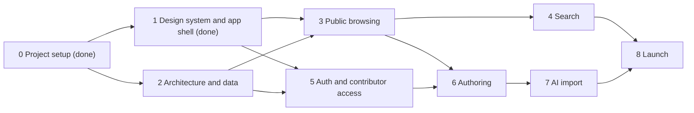

# Recipe Hub Roadmap

This file carries the plan, the architecture, and the owner's guidance for Recipe Hub. Every session reads it in full before starting and updates it before finishing (status, decision log, deferred items). When the code and this file disagree, raise it with the owner instead of silently picking one.

## 1. Product

Recipe Hub is a recipe catalog for the owner's family: anyone can browse and search it, and approved members contribute recipes.

- **Access:** browsing and search are public, so members can share a recipe link with anyone. Contributing (adding and editing recipes) and every AI feature are limited to approved members. People request access; the admin approves and sends an invite, and members sign in with a passkey, or with an emailed one-time code where their device cannot hold one. The family scope is an access rule only: the site reads as a general-purpose recipe catalog (section 6.1).
- **Browse:** a recipe list and detail pages that are pleasant to read while cooking.
- **Search:** rich search across titles, ingredients, instructions, tags, and the person or place a recipe comes from, with filters.
- **Contribute:** three entry modes that all funnel into one normalized recipe shape:
  1. Photos of a written or printed recipe, parsed by AI.
  2. A pasted URL, parsed from the page's structured data first and by AI for the rest.
  3. Manual entry.

Contributors number in the tens, readers in the dozens to hundreds (anyone a member shares a link with), and the catalog hundreds to low thousands of recipes. Small does not mean ad hoc: the architecture is sound and canonical so the project can grow.

## 2. Guiding principles

The owner's guidance. Every session applies it, and the orchestrator checks every delegate's work against it.

1. **Small, flexible, extensible.** Build the smallest thing that solves the stated problem, in a shape that can grow. No speculative features, options, abstractions, or tooling without a real consumer.
2. **Industry standards first.** Ground decisions in current, industry-standard practice, OOP principles, and established design patterns. Verify library and platform behavior against current documentation (for Next.js, the docs bundled in `node_modules/next/dist/docs/`), never memory.
3. **Maintainability is the priority.** Prefer clarity over cleverness and explicit over implicit. There is one way to do each thing, and code that does the same thing looks the same.
4. **Think in layers.** For every layer, know what it is responsible for, how it exposes that to other layers, and what it guarantees them, so each layer can be reasoned about without reading its internals. Express the separation structurally: directories, files, and module boundaries mirror the layers, and tooling enforces the boundaries.
5. **Consistent and deliberate UI.** Built on a component library (shadcn/ui) with a tuned design language. Every screen uses the same tokens, primitives, and patterns, and nothing is styled ad hoc.
6. **Accessible by default.** WCAG 2.2 AA is the baseline for every UI change, not a final pass.
7. **Private where it matters.** Published recipes and dish photos are public; original scans, contact details, access requests, and member data stay private. Family data never enters the repository, and secrets live only in Vercel environment variables.

## 3. How sessions work

- **The main session is the orchestrator.** It owns high-level decisions, architectural forks, sequencing, and validating that delegated work matches this file. It delegates exploration, research, implementation, and test runs to subagents and keeps its own context for synthesis and review.
- **Delegate with clear ownership.** Give each subagent a disjoint set of files, the relevant sections of this file, and acceptance criteria. Subagents implement and report; they do not make architectural decisions. The orchestrator reviews every subagent's diff against sections 2 and 4 before integrating it.
- **Forks go to the owner.** Choices that shape architecture, scope, or a keep or drop decision are presented with a recommendation and its cost, batched together. Each session below lists the forks it is expected to resolve.
- **Session start:** read this file and `AGENTS.md`, review `git log` and the working tree for changes since the last session, and confirm scope with the owner.
- **Session end (definition of done):**
  - `pnpm lint`, `pnpm typecheck`, `pnpm test`, and `pnpm build` pass.
  - Substantial changes get an external Codex review, and its findings are addressed.
  - The change is verified on its Vercel preview deployment.
  - This file is updated: session status, decision log, deferred items, and any guidance that changed.
  - Work lands through a pull request from a session branch (CI plus preview deployment) and merges with the owner's go-ahead.
- **Stay focused.** If a session's scope starts to sprawl, finish the current slice, record the remainder here, and stop. Prefer a clean handoff over a crowded context.

## 4. Architecture

### 4.1 Layers

Recipe Hub is one Next.js project organized as a layered, ports-and-adapters architecture. Dependencies point inward: presentation depends on application, application depends on domain, and infrastructure implements the application's ports.

| Layer | Location | Responsible for | Exposes | Guarantees |
| --- | --- | --- | --- | --- |
| Domain | `src/domain/` | The recipe and member model: entities, value objects, invariants, Zod schemas, domain errors | Types, schemas, pure functions | Pure and deterministic: no I/O, no framework imports, no environment access. A value that passes a domain schema is valid everywhere. |
| Application | `src/application/` | Use cases (browse, search, create, update, import, request and grant access), authorization, orchestration across ports | Service classes with intention-revealing methods; port interfaces in `src/application/ports/` | Server-only. Each use case declares who may call it: recipe reads, search, and access requests are open to anonymous visitors and return public DTOs (no contact details or provider IDs); scans and member data require a member; recipe writes and AI calls require an approved member; reviewing requests and managing members require an admin. Inputs are validated, and outputs are serializable DTOs. |
| Infrastructure | `src/infrastructure/` | Adapters to the outside world: Postgres through Drizzle, Vercel Blob, the AI Gateway, web fetching, Better Auth, the email sender | Classes implementing application ports | Translates external data into domain types at the boundary and hides vendor types and errors behind port contracts. |
| Composition | `src/composition/` | The composition root: constructs adapters and injects them into application services | Factories that return ready services | The only module that knows which adapter backs which port. |
| Presentation | `src/app/`, `src/components/` | Routes, layouts, pages, Server Actions, Route Handlers, UI components | Pages and components | Thin: parses input, calls one application service, renders the result. No business rules, SQL, or vendor SDKs. |
| Shared | `src/lib/` | Cross-cutting utilities: validated environment, logger, small helpers | Functions | Depends on no other layer. |

- **The application layer is the Data Access Layer** that the Next.js data security guide recommends: server-only, deciding for every read and write what the actor (an anonymous visitor or a member) may see or do, and returning minimal DTOs to the render context.
- **`src/components/ui/`** holds the shadcn primitives, which are adjusted only through tokens and variants. Feature components in `src/components/<feature>/` compose primitives and receive data as props. They never fetch data or call services.

### 4.2 Dependency rules and enforcement

- Domain imports only `zod` and pure helpers from `src/lib`. Application imports domain and `src/lib`. Neither imports Next.js, React, Drizzle, or a vendor SDK.
- Presentation never imports infrastructure. Route Handlers that mount a vendor handler (the Better Auth endpoint) obtain it from composition.
- Only `src/lib/env.ts` reads `process.env`. Everything else receives configuration from it.
- Server modules begin with `import 'server-only'`. Client components (`'use client'`) import only components, domain types, and pure helpers.
- Session 2 adds enforcement: a `lint:boundaries` script running dependency-cruiser (the tool and script name the owner's other projects use) and an ESLint restriction on `process.env`. A rule that tooling cannot enforce is written here and checked in review.

### 4.3 Patterns

| Pattern | Where | Why |
| --- | --- | --- |
| Repository | `RecipeRepository` and `MemberRepository` ports with Drizzle adapters | Services and tests do not depend on how data is stored. |
| Strategy | `RecipeExtractor` port with JSON-LD, AI text, and AI vision implementations | The entry modes differ only in how a draft is produced. |
| Adapter | Every infrastructure class | Vendor APIs are translated into port contracts. |
| Composition root with constructor injection | `src/composition/` | Explicit wiring without a DI framework, and fakes injected in tests. |
| Value object | Quantities, units, durations, yields | Each invariant lives in one place. |
| Mapper | Infrastructure (row to domain) and application (domain to DTO) | Each boundary owns its translation. |
| Draft, review, save | All three entry modes | AI output is never saved unreviewed: every mode produces a `RecipeDraft` that the member reviews in the same form before saving. |

**OOP where it earns its keep.** Services, adapters, and extractors are classes that implement interfaces and receive dependencies through their constructors. Domain data is immutable plain objects described by Zod schemas, because data crossing the Server and Client Component boundary must be serializable. Behavior on that data lives in small pure modules beside its schema.

### 4.4 Next.js conventions

- Server Components by default; `'use client'` only at interactive leaves.
- Mutations are Server Actions that validate input with the domain schema, call one application service, and then invalidate cache tags.
- Route Handlers only for HTTP-shaped needs: the auth endpoint, Blob client-upload tokens, and image delivery. Open Graph images, icons, the manifest, the sitemap, and robots use Next's metadata file conventions.
- `proxy.ts` (Next 16's replacement for `middleware.ts`) makes optimistic redirects only on the contribute and admin routes; its matcher excludes metadata files. The authoritative check is the application layer, on every call.
- Cache Components (`'use cache'`, `cacheTag`, `cacheLife`) for public pages, which are the same for every visitor. Session-dependent UI (sign-in state, an Edit button) streams in behind Suspense, following the bundled guide `authentication-with-cache-components.md`.
- Search state lives in the URL (`searchParams`) so results are shareable and work with the back button.

### 4.5 Target structure

```text
src/
  app/                    presentation: routing, thin pages and actions
    (browse)/             public: recipe list and detail, search
    (contribute)/         approved members: add, edit, import
    (account)/            request access, accept an invite, sign in, privacy
    admin/                access requests and members
    design/               design reference (development and previews only)
    api/
      auth/[...all]/      Better Auth handler
      uploads/            Blob client-upload tokens
      images/[...path]/   image delivery: public dish photos, members-only scans
  components/
    ui/                   shadcn primitives
    <feature>/            feature compositions (recipe, search, layout)
  domain/
    recipe/               schemas, value objects, pure functions, errors
    member/
  application/
    ports/                interfaces the use cases depend on
    recipes/
    ingestion/
    search/
    access/
  infrastructure/
    db/                   Drizzle schema, client, migrations, repositories
    storage/
    ai/
    web/
    auth/
  composition/            composition root
  lib/                    env, logger, shared helpers
```

Files are kebab-case (`recipe-repository.ts`), classes and types PascalCase, functions camelCase. Tests sit beside the code they test as `*.test.ts`.

### 4.6 Cross-cutting concerns

- **Configuration:** `src/lib/env.ts` validates every variable with Zod once and exports a typed object (created in Session 1 with `NODE_ENV` and `VERCEL_ENV`; later sessions add their variables there). Vercel supplies the values; local development pulls them with `vercel env pull`.
- **Errors:** domain and application errors are typed classes with stable codes. Presentation maps codes to user-facing messages, and unexpected errors reach Next.js error boundaries.
- **Logging:** one logger module with one message structure: a constant message plus structured fields, with no values interpolated into messages. Lifecycle events (recipe created, import started or failed, access requested or granted, invite issued) log at info, recoverable problems at warn, failures at error. Never log tokens or family members' contact details.
- **Validation:** Zod at every boundary: form input, AI output, scraped data, and database reads where types can drift.
- **Testing:** Vitest for domain and application code with in-memory fakes for ports; integration tests for repositories against a Neon branch; Playwright for a few end-to-end flows once the core flows exist. Fixtures are synthetic or public-domain recipes, never real family data.

## 5. Specifications and constraints

### 5.1 Recipe model

The normalized shape every entry mode produces. Session 2 finalizes it; this is the starting point.

- Title, short description, and notes (the story behind the recipe).
- Source: who or where the recipe comes from (for example, "Grandma Rose" or a cookbook), distinct from the member who entered it.
- Yield (servings or amount) and times (prep, cook, total) as value objects.
- Ingredient sections, each with an optional heading and ingredient lines: quantity (including fractions and ranges), unit, item, preparation note, and the original text kept verbatim.
- Instruction sections of ordered steps.
- Tags (course, cuisine, dietary, occasion) from a managed vocabulary.
- Images, each with a role: dish photos (public, shown on recipe pages and in previews) and original scans (members only).
- Provenance: entry mode (manual, URL, photo), source URL, original images, and which model produced an AI draft.
- Contributor and timestamps.

### 5.2 Entry modes

- **Manual entry:** the recipe form, which is also the review form for the other two modes.
- **URL import:** server-side fetch with SSRF protection (public HTTP(S) addresses only, size and time limits), schema.org `Recipe` JSON-LD parsed first, AI filling gaps or handling pages without structured data, and the result opened as a draft for review.
- **Photo import:** one or more images uploaded from the browser straight to Blob. AI vision transcribes and structures them into a draft, and the originals stay attached to the recipe.
- AI output is validated against the domain schema. A failure produces a partial draft with the problems flagged, never a silent save.

### 5.3 Search

- Weighted full-text search: title first, then ingredients and tags, then description and notes, then instructions. `websearch_to_tsquery` syntax gives quoted phrases, `-` exclusions, and `or`.
- Typo tolerance and partial matches with `pg_trgm`, accent-insensitive matching with `unaccent`.
- Filters: tags, source, contributor, total time, date added.
- Relevance ranking, highlighted matches, pagination, and URL-held state.
- To evaluate: `pg_search` (BM25 ranking) and semantic search with `pgvector` embeddings created at save time. Both extensions are available on the Neon database.

### 5.4 Access control

- **Public:** browsing, recipe pages, search, and dish photos need no account. Public pages never show contact details or access-request data.
- **Members:** adding, editing, and importing recipes, and every AI feature, require an approved member. Two roles, `member` and `admin`, live in the database, never in code. Authorization stays in the application layer; Better Auth's admin plugin is not used, so there is one authorization path.
- **Requesting access:** a public form (name, how they know the family, an optional email) creates a request, not an account. It is protected by Vercel BotID and a rate limit. The admin gets an email (section 5.5) and sees a pending count on the admin page.
- **Reviewing:** the admin approves or denies on the admin page, through Server Actions that re-check authorization. Notification emails link to the request page. One-click approve links are not planned (a Session 5 fork), because mail scanners follow links and such tokens would be a second way to authenticate.
- **Invites:** approval produces a single-use, expiring invite link, stored only as a hash, which the admin sends by text or email. Accepting it creates the member's account in one of two ways: register a passkey through Better Auth's passkey plugin (passkey-first registration that consumes the invite), or, on a device that cannot hold a passkey, enter an email address and confirm it with a one-time code. Adding a device or recovering access means a new invite.
- **Sign-in:** passkeys are the main method. Members who joined with an email sign in with Better Auth's email one-time codes, with the plugin's own sign-up disabled, so codes work only for accounts created through an invite. No social sign-in.
- **Previews:** passkeys are bound to their domain, so production passkeys do not work on preview URLs. A script mints an invite against the preview's Neon branch.

### 5.5 Hosting and environments

- Vercel project `recipe-hub` in team `jrichard-personal` (Pro plan). Functions, Neon, and Blob are all in `iad1`.
- Production is `https://recipes.jakerichard.tech`: a CNAME (TTL 300) in the `jakerichard.tech` Route 53 zone, with a Let's Encrypt certificate managed by Vercel. The `vercel.app` production alias redirects to it with a 308, as the personal-site project does for its own alias.
- The Route 53 zone is in the owner's personal AWS account: use `--profile personal`. The default AWS profile is a work account and is never used for this project.
- No staging environment. Pull requests get preview deployments behind Vercel Authentication, and from Session 2 each preview gets its own Neon branch.
- Environment variables are managed in Vercel and pulled locally with `vercel env pull`. The AI Gateway authenticates with Vercel's OIDC token, so no provider keys exist.
- Email (access-request notifications, invites when sent by email, and sign-in codes) goes through Resend's free plan, with SPF and DKIM records for a sending domain in Route 53.

### 5.6 Platform limits that shape the design

- Function request bodies are capped at 4.5 MB, so every image upload goes from the browser directly to Blob.
- Neon Free plan: 1 GB storage, 100 compute-hours a month, 10 branches.
- AI Gateway free tier: $5 a month, a subset of models, and lower rate limits. Buying credits unlocks every model at provider list price.
- Functions run up to 800 seconds on Pro. Import actions set `maxDuration` explicitly.
- Resend free plan: 3,000 emails a month and 100 a day, from a verified domain only.
- `ImageResponse` (Open Graph images): a 500 KB bundle including fonts, flexbox and a CSS subset only, and TTF, OTF, or WOFF fonts (not WOFF2). Production responses are cached as immutable for a year, so per-recipe image URLs are versioned.

### 5.7 Sharing and metadata

Recipes are meant to be shared, so links need good previews before the site is used.

- **Icons:** a minimal set as static files: `favicon.ico` (32 by 32), `icon.svg` with a dark-mode variant inside the SVG, `apple-icon.png` (180 by 180), and manifest icons at 192, 512, and 512 maskable, from a brand mark designed with the owner.
- **Open Graph:** `opengraph-image` file conventions with `ImageResponse` from `next/og`. `@vercel/og` ships inside Next and is not installed separately. Requirements:
  - A site-wide image for the root.
  - Per-recipe images (title, source, dish photo) generated through `generateImageMetadata`, with the recipe revision in the image id so an edit changes the URL.
  - `twitter.card` set to `summary_large_image`, using the Open Graph image.
  - `metadataBase` set explicitly from `env.ts`.
  - Fonts as committed static TTF instances, because `next/font` cannot feed `ImageResponse`.
- **Structured data:** schema.org `Recipe` JSON-LD on recipe pages (bundled guide `json-ld.md`), with ISO 8601 times, ingredients, `HowToStep` and `HowToSection`, and yield. It powers rich results only if pages are indexed, and helps recipe apps import our pages.
- **Crawling:** `robots.ts` and `sitemap.ts`. Whether public recipes are indexed by search engines is a fork (Session 3); if not, pages carry `noindex` through metadata, not a robots.txt rule, which Google cannot see past.
- **Verification:** Meta's Sharing Debugger and Google's Rich Results Test on production. Previews sit behind Vercel Authentication, so outside crawlers cannot fetch their images.

### 5.8 Project conventions

- **Formatting:** the owner's shared scheme from the Vispero/sage project: Prettier with tabs, single quotes, width 100, `es5` trailing commas, LF line endings, and perfectionist import sorting. Run `pnpm format`; never hand-format against it.
- **Scripts:** `lint` runs every `lint:*` script, so new checks are added as `lint:*`.
- **Commits:** a plain imperative sentence describing the change, without prefixes.
- **Dependencies:** added with their first consumer, chosen against current documentation, installed with pnpm.
- **UI primitives:** added with `pnpm shadcn add <name>`, then `pnpm format` and `pnpm exec eslint . --fix` (section 6.3).
- **Documents:** `README.md` for setup, this file for plan and guidance, `AGENTS.md` for agent instructions.

## 6. Design language

The UI must feel consistent and deliberate. This section is the binding design language, settled with the owner in Session 1. The design reference at `/design` (development and preview deployments only, a static 404 in production) shows every token, primitive, and composition; a change to the language is tuned there first and recorded here.

### 6.1 Rules

- **Tokens only.** Color, typography, radius, spacing, shadow, and motion come from tokens in `src/app/globals.css` (Tailwind v4 `@theme`). Outside `src/components/ui/`, code never uses raw color values, arbitrary values such as `text-[13px]`, inline style objects for visual values, or one-off styles.
- **Semantic names.** Components use semantic tokens (background, card, popover, primary, secondary, muted, accent, destructive, border, input, ring) rather than palette steps, so a theme changes in one place. Every token is defined for both themes.
- **Primitives first.** Screens are built from the primitives in `src/components/ui/`. A new look is a new variant on the primitive, never an override at the call site. Primitives keep shadcn's generated class strings, arbitrary values included, so upstream changes merge cleanly; each deliberate change is listed in 6.5.
- **One of each.** One type scale with paired line heights, one radius token, one focus treatment, one set of motion durations that respects `prefers-reduced-motion`.
- **Content is airy, chrome is compact.** Recipes are read while cooking: generous spacing, `text-lg` and a reading-width column for ingredients and steps; compact navigation and controls.
- **Accessible.** WCAG 2.2 AA in both themes: every text and background token pair is checked (4.5:1 for text, 3:1 for input borders and focus indicators), including hover states; visible focus; full keyboard operation; targets at least 24 by 24 pixels; one `h1` per page and ordered headings; a skip link to `#main`.
- **Voice.** The site reads as a general-purpose recipe catalog. That access is limited to the owner's family is a permission rule, never a theme in the copy: no "family" in UI text. Copy is plain and in sentence case, actions say what they do ("Save recipe", then "Saved"), and errors say what went wrong and how to fix it.

### 6.2 Foundations

**Color.** Neutral grays (oklch hue 90, chroma at most 0.004) with one accent, Spruce, a deep blue-green. Red is reserved for destructive actions and errors.

| Token | Role | Light | Dark |
| --- | --- | --- | --- |
| `background`, `foreground` | Page and body text | `oklch(0.99 0.001 90)`, `oklch(0.21 0.004 90)` | `oklch(0.18 0.002 90)`, `oklch(0.94 0.002 90)` |
| `card`, `popover` | Raised surfaces; dark steps lighten for depth | same as background, `oklch(0.995 0.001 90)` | `oklch(0.215 0.002 90)`, `oklch(0.235 0.002 90)` |
| `primary` | Spruce: primary actions, links, active nav, checked controls | `oklch(0.46 0.07 210)` | `oklch(0.78 0.08 205)` |
| `secondary`, `muted` | Quiet fills (badges, notes) | `oklch(0.955 0.002 90)` | `oklch(0.27 0.002 90)`, `oklch(0.25 0.002 90)` |
| `muted-foreground` | Supporting text | `oklch(0.49 0.004 90)` | `oklch(0.72 0.003 90)` |
| `accent` | Hover and highlight fill in menus, tinted with Spruce | `oklch(0.955 0.02 210)` | `oklch(0.29 0.025 205)` |
| `destructive` | Destructive actions and errors | `oklch(0.5 0.19 20)` | `oklch(0.76 0.15 22)` |
| `border` | Dividers and surface edges (decorative) | `oklch(0.9 0.003 90)` | `oklch(0.32 0.003 90)` |
| `input` | Form control outlines, at least 3:1 | `oklch(0.66 0.004 90)` | `oklch(0.52 0.003 90)` |
| `ring` | Focus, equal to primary | `oklch(0.46 0.07 210)` | `oklch(0.78 0.08 205)` |

Lowest ratios: muted text on muted fills 5.49:1 (light); destructive text on its hover tint 4.55:1; input borders 3.02:1 (light) and 3.41:1 (dark). A token change is rechecked against every pair before it lands.

**Themes.** Light and dark, through the `.dark` class on `<html>` set by `next-themes`. The default follows the device; the header toggle offers Light, Dark, and System.

**Typography.**

- **Families:** Fraunces with its soft axis (`font-heading`) for page titles, headings, recipe titles, and the wordmark; Hanken Grotesk (`font-sans`) for body text and controls; JetBrains Mono (`font-mono`) for times, yields, and small labels, in uppercase with slight tracking. All three load through `next/font/google` in the root layout.
- **Scale:** `text-xs` to `text-5xl` with paired line heights. Steps from `2xl` up tighten their tracking, and larger steps are removed.
- **Weights and usage:** headings use `font-medium`. Recipe titles are `text-4xl`, rising to `text-5xl` from `md`. Reading text for ingredients and steps is `text-lg`.

**Shape.** One radius token, `--radius: 0.625rem`. Controls use `rounded-md` (0.8 times, 8 px), cards `rounded-xl` (1.4 times, 14 px), and badges are pills.

**Depth.** shadcn's Vega style: cards, inputs, and outline buttons carry a faint `shadow-xs` at rest with a hairline ring. Interactive cards lift to `shadow-md` on hover. The shadow color is a per-theme token, faint on light and deep on dark, so depth reads in both.

**Focus.** One treatment in the ring color: a 1 px full-strength edge inside a 3 px half-strength halo. Controls get it from their primitives (border plus ring), and links from a base rule (outline plus ring).

**Motion.** Our own code adds only short color, opacity, and shadow transitions at Tailwind's default 150 ms, and no glass, blur, glow, or animated text. Primitives keep their generated motion (dialogs fade in over a lightly blurred backdrop, toasts slide in and out). A global rule removes animation and transition time under `prefers-reduced-motion`.

**Layout.**

- **Header:** a sticky, compact top bar (`h-14`) holding the wordmark, the main nav, and the theme toggle.
- **Containers:** `PageContainer` sets the width: `wide` (`max-w-6xl`) for browsing and `reading` (`max-w-2xl`) for recipe content.
- **Browse grid:** one column on phones, two on tablets, three on desktop.

### 6.3 Components and patterns

- **Library:** shadcn/ui on Base UI primitives, Vega style, Lucide icons.
  - Installed primitives: attachment, badge, button, card, checkbox, dialog, dropdown-menu, empty, field, input, label, select, separator, skeleton, spinner, tabs, textarea, toast, tooltip.
  - Add more with `pnpm shadcn add <name>`, then `pnpm format` and `pnpm exec eslint . --fix`, plus a demo on `/design`.
  - When the CLI offers to overwrite a primitive listed in 6.5, decline and keep the customized version.
- **Composition:** Base UI composes through the `render` prop, not `asChild`. A link styled as a button takes `buttonVariants()` on the link itself, because Base UI's Button must not render links. `cn` comes from the `cn` package.
- **Forms:**
  - Every control sits in a `Field` with a `FieldLabel`, helper text, and `FieldError`. A disabled field sets `data-disabled` on `Field` so its label dims; `peer-disabled` never matches Base UI controls.
  - Textareas grow with their content (`field-sizing: content`) and fall back to a vertical resize handle where that is unsupported.
  - List-shaped input (ingredients, steps) is a list of separate growing fields, with "Add ingredient" or "Add step", a remove button per item, numbering for steps, and optional sections with headings. Focus moves into a new item and to a neighbor when one is removed. Free-form "one per line" fields are not used.
- **File input:** never the bare native control. A dashed drop area with an icon and a "Choose photos" button opens the hidden native input; chosen files appear below as attachments with thumbnails, size, a remove action, and upload states. Changes are announced politely.
- **Feedback:**
  - Toasts use Base UI's toast, mounted once in the root layout. No action buttons in auto-dismissing toasts, because they cannot be reached in time (WCAG 2.2.1).
  - Empty states use the `empty` primitive (`RecipesEmptyState` on the home page).
  - Loading states are skeletons that mirror the final layout (`RecipeCardSkeleton`). A `loading.tsx` goes only in segments that await data, never above a gated route, where it would turn a 404 into a soft 404.
- **Theme:** `ThemeProvider` in `src/components/layout/` holds the next-themes configuration. `ThemeToggle` swaps its sun and moon icons with `dark:` classes so the server render never depends on the theme.

### 6.4 References

The owner likes [tanstack.com](https://tanstack.com/) and [mstone.ai](https://mstone.ai/). Observations from their markup, CSS, and screenshots (October 2026):

- **TanStack:** a token-driven system.
  - Type: Bricolage Grotesque for display, Inter for body, IBM Plex Mono for small uppercase labels. Weight carries the hierarchy more than size.
  - Layout and color: a dense 42 px sticky nav, a 660 px docs reading column, and flat surfaces with 1 px warm-gray borders. One orange accent appears only on the active item and the wordmark.
  - Dark theme: steps from `#0a0a0a` through lighter grays.
- **mstone.ai:** renders light, with a floating black nav bar, very tight tracking (about -0.035em) on heavy headings, and a single electric-blue accent. General Sans with JetBrains Mono for small uppercase labels, soft shadows, glassy tiles, and 9 to 12 px radii.
- **What was borrowed:** one disciplined accent used sparingly, tight tracking on large headings, a mono for metadata, quiet transitions, and a sticky compact top bar. What was not: glass, glows, and animated text.

### 6.5 Deliberate changes to generated primitives

- `button.tsx` and `badge.tsx`, `default` variant: hover darkens the primary 10% toward the foreground instead of fading it to 80%. White text on faded Spruce is 4.26:1, which fails AA; on the darkened hover it is 7.48:1.
- `button.tsx`, `destructive` variant: the focus border is full-strength `border-destructive` instead of 40 percent, so the focus indicator meets 3:1 like every other control.
- `textarea.tsx`: `resize-y supports-[field-sizing:content]:resize-none`, so auto-growing textareas show no handle.

## 7. Decision log

| Date | Decision | Rationale |
| --- | --- | --- |
| 2026-10-10 | Next.js 16 (App Router), TypeScript end to end, one Vercel project | One Zod recipe schema serves the form, AI output, and database. Zero-config on Vercel. FastAPI with Vite needs Vercel Services (beta) and two copies of the schema; TanStack Start is still a release candidate. |
| 2026-10-10 | Neon Postgres via the Vercel Marketplace (Free plan, `iad1`, Postgres 18, Neon Auth off) | Postgres handles the search. Fast scale-to-zero, billed through Vercel, per-preview branches. Aurora resumes in about 15 seconds and needs IAM setup; Supabase's free tier pauses after a week idle. |
| 2026-10-10 | Private Vercel Blob store `recipe-hub-images` (`iad1`) | Scans stay behind the login, and client uploads avoid the 4.5 MB body limit. Access mode cannot change after creation. |
| 2026-10-10 | Better Auth with the Facebook provider; allowlist in the database (sign-in method superseded below) | Auth.js v5 never went stable and its maintainers recommend Better Auth. A hook before user creation gates sign-up. |
| 2026-10-10 | Drizzle ORM, version chosen in Session 2 | Close to SQL (needed for search) and supported by Better Auth. 1.0 was a release candidate at the time. |
| 2026-10-10 | AI SDK through the Vercel AI Gateway; no provider keys | Owner's choice. OIDC authentication on Vercel; `vercel env pull` locally. |
| 2026-10-10 | pnpm 12, Node 24, ESLint and Prettier, Vitest, GitHub Actions CI | Canonical toolchain; CI runs lint (code and formatting), typecheck, and tests. |
| 2026-10-10 | Formatting scheme matches the owner's Vispero/sage project | One formatting scheme across the owner's projects. |
| 2026-10-10 | Private repository `jaARke/recipe-hub`; repo-local git identity `jake.richard126@gmail.com` | Private is the reversible choice. The identity lets Vercel match commits to the owner. |
| 2026-10-10 | `AGENTS.md` only, no `CLAUDE.md` | Claude Code 2.1.277 and later reads `AGENTS.md` directly. |
| 2026-10-10 | Neon's agent skills not kept in the repository | Owner's choice. The `neon` skill steers toward Neon Auth and Storage, which the stack does not use. |
| 2026-10-10 | shadcn/ui as the component library; design language tuned against tanstack.com and mstone.ai | Owner's choice: flexible, extensible components with a deliberate design language. |
| 2026-10-10 | Production at `recipes.jakerichard.tech` (Route 53 CNAME); no staging environment | Owner's choice. Previews cover pre-production checks. |
| 2026-10-10 | Layered ports-and-adapters architecture with enforced boundaries | Owner's guidance: clear layer responsibilities and guarantees, expressed structurally. |
| 2026-10-10 | shadcn/ui kept after comparing alternatives, on Base UI primitives | geistcn is Vercel's internal package (not on public npm, no license), and Vercel points outside users to shadcn/ui; coss ui, HeroUI, Catalyst, Mantine, and MUI fit a custom design language less well. Base UI is shadcn's default, the only base that does not pull in a second primitive library, and has a funded team; Radix has one active maintainer, and React Aria is the heaviest and newest in shadcn. |
| 2026-10-10 | Vega style, default radius (`0.625rem`), Lucide icons | Owner's choice from side-by-side specimens. Vega's faint resting shadow replaces the proposed "shadow only on interaction". |
| 2026-10-10 | Fraunces (soft), Hanken Grotesk, JetBrains Mono | Owner's choice of a cookbook serif for headings over the proposed display sans. |
| 2026-10-10 | Spruce accent on neutral grays | Owner's choice in a second round: paprika on warm neutrals read too close to Anthropic's look. Every token pair passes AA in both themes. |
| 2026-10-10 | Light and dark themes, default follows the device, through `next-themes` | Platform convention. next-themes 0.4.6 is stale, with an open report of a React script-tag warning that did not reproduce on Next 16.4 and React 19.3; the Next.js guide's inline script is the fallback. |
| 2026-10-10 | A core set of primitives, not the full catalog; Base UI's toast instead of sonner | The smallest set the shell, the reference page, and the next sessions use; more arrive with their first screen. One primitive library and no extra dependency for toasts. |
| 2026-10-10 | shadcn's CSS imported from `shadcn` as a dev dependency, not ejected | Ejecting inlined about 640 lines of variants and utilities, not tokens. The import keeps future `shadcn add` components working and pins the CLI. |
| 2026-10-10 | Arbitrary values allowed only in `src/components/ui/`; `cn` from the `cn` package | Generated primitives keep upstream class strings so updates merge cleanly, and import `cn` directly, so there is one import path and no `src/lib/utils.ts`. |
| 2026-10-10 | Design reference at `/design`, enabled when `NODE_ENV` is `development` or `VERCEL_ENV` is `preview`; `src/lib/env.ts` created | Owner's requirement that it never exists in production. Production prerenders a static 404, metadata included. |
| 2026-10-10 | UI copy reads as a general-purpose recipe catalog | Owner's direction: the family scope is an access rule, not a theme. |
| 2026-10-10 | Ingredients and steps entered as lists of separate fields; file inputs as a drop area with attachments | Owner's feedback: free-form "one per line" fields and the bare native file input are unreasonable for members. |
| 2026-10-10 | Browsing and search public; contributing and AI limited to approved members | Owner's change of direction, so members can share recipes with anyone. Replaces "family only". |
| 2026-10-10 | Sign-in with Better Auth passkeys by admin invite, email one-time codes as the fallback; no Facebook | For a handful of accounts, Facebook's Meta app, Live mode, data-deletion handling, missing emails, and unclear Business Verification outweigh a familiar button. Passkeys cost nothing; codes cover devices older than iOS 16 or Android 9. |
| 2026-10-10 | Access requests reviewed on an admin page; email for notifications and sign-in codes through Resend's free plan | $0 at this volume, and the email-code fallback needs a sender anyway. |
| 2026-10-10 | Sessions reordered: public browsing and search before authentication and authoring | Browsing no longer needs sign-in, so something shareable lands sooner. |
| 2026-10-10 | Icons, manifest, the site-wide Open Graph image, and `metadataBase` in the launch session; per-recipe Open Graph images and JSON-LD with public browsing; `next/og`, not `@vercel/og` | Owner's placement. `@vercel/og` ships inside Next. |

## 8. Chronology and dependencies



- Session 2 is next.
- Session 3 needs the design system and the data layer. It seeds synthetic recipes, so browsing works before authoring exists.
- Session 4 builds on the browse UI and can run in parallel with Session 5.
- Session 5 needs the design system for its account pages and the data layer for Better Auth's tables.
- Session 6 needs public pages to land on and authentication, so recipes are attributed from the first save.
- Session 7 builds on the authoring form, which doubles as the review form. Semantic search with embeddings created at import is revisited after Session 7.
- Owner actions (section 10) have their own lead times: set up the Resend sending domain before Session 5.

## 9. Sessions

### Session 0: Project setup (done 2026-10-10)

Chose the stack and storage; scaffolded Next.js 16.4 with pnpm, Tailwind v4, ESLint with import sorting, Prettier, Vitest, and CI; applied the shared formatting scheme and `.vscode` settings; created the private GitHub repository; created the Vercel project with Git integration; provisioned Neon and the private Blob store and connected both to the project; served production from `recipes.jakerichard.tech` (Route 53 CNAME, HTTPS, 308 redirect from the `vercel.app` alias); wrote this roadmap.

### Session 1: Design system and app shell (done 2026-10-10)

Delivered:

- **Library:** shadcn/ui on Base UI primitives in the Vega style, with the core set of primitives listed in section 6.3.
- **Tokens and themes:** design tokens in `src/app/globals.css` (Spruce on neutral grays, Fraunces, Hanken Grotesk, and JetBrains Mono, one type scale, radius, per-theme shadows, focus, reduced motion), checked for WCAG 2.2 AA in both themes, plus light and dark themes through `next-themes`.
- **App shell:** a skip link, a sticky header with wordmark, nav, and theme toggle, `PageContainer`, the toast viewport, an empty-state home page, and a styled 404.
- **Feature components:** `RecipeCard`, `RecipeCardSkeleton`, and `RecipesEmptyState`.
- **Design reference:** `/design`, covering tokens, every primitive, and compositions (recipe grid and its loading state, recipe detail, photo upload, and a recipe form with list inputs). It is gated through the new `src/lib/env.ts`.
- **Roadmap:** section 6 rewritten as the final design language, and the access model, sign-in, sharing requirements, and session plan revised with the owner.

Deferred, each to the session that needs it:

- **Session 2:** the duration formatting in `recipe-card.tsx` moves to the duration value object, and an `error.tsx` boundary arrives with the first data reads.
- **Session 3:**
  - `MainNav` calls `usePathname`, so it needs a Suspense boundary once a route has dynamic params (`blocking-prerender-client-hook`).
  - The recipe text styles in `src/components/design-reference/recipe-detail-excerpt.tsx` move into real recipe components, and the reference page renders those.
  - A larger recipe card title, if wanted, becomes a card size variant.
- **Session 5 or 6:** a mobile menu once the nav outgrows the header.
- **Session 6:**
  - A compact textarea size variant for list inputs, which the demo currently sizes at the call site.
  - The reordering interaction for list items.
  - Whether step numbers continue across sections.
- **Session 8:** VoiceOver and TalkBack passes on Base UI menus, combobox, toasts, and drawers.
- **Known quirks, fixed if a screen uses them:**
  - Base UI checkbox has no indeterminate look.
  - `FieldSeparator` paints `bg-background` on cards in dark mode.
  - `Label`'s `peer-disabled` classes never match Base UI controls; use `FieldLabel` in a `Field`.

### Session 2: Architecture foundation, recipe domain, and data layer

**Goal:** the layered skeleton with enforced boundaries, the recipe domain model, and persistence.

**Delivers:**

- The directory structure in section 4.5, `server-only`, `lint:boundaries` with dependency-cruiser, and the `process.env` restriction.
- The logger, and `src/lib/env.ts` extended with the database variables.
- The recipe domain model from section 5.1: Zod schemas, value objects, `RecipeDraft`, domain errors, and unit tests.
- Drizzle with a Neon driver: schema, migrations run from the build command, Neon preview branching enabled, repositories with mappers.
- Application services for recipe reads and writes, with authorization behind a port that knows an anonymous actor (public reads) and a member (writes), implemented fully in Session 5; the composition root; in-memory fakes and tests.

**Forks:** Drizzle 0.45 or 1.0; Neon driver (serverless HTTP or WebSocket, or `pg` with Fluid compute pooling); ID strategy and URL slugs; how quantities are represented; the tag vocabulary; typed error classes or a result type.

**Done when:** `lint:boundaries` passes and fails on a deliberate violation, a migration runs on a preview branch, and the recipe services are covered by tests.

### Session 3: Public browsing

**Goal:** anyone can browse and read recipes, and shared links preview well.

**Depends on:** Sessions 1 and 2.

**Delivers:**

- Browse: the recipe list (cards, sorting, pagination) and recipe detail (cooking-friendly layout, print styles, source and contributor), as public, cached pages with cache tags.
- An `ImageStore` port and its Blob adapter, and the image delivery route: public dish photos cached at the CDN. Original scans are refused outright until Session 5 wires member authorization.
- Per-recipe Open Graph images through `next/og`, versioned by revision, and schema.org `Recipe` JSON-LD (section 5.7).
- `robots.ts` and `sitemap.ts`, with the indexing decision applied.
- A seeded set of synthetic recipes and photos, so browsing works before authoring exists.

**Forks:**

- **Blob layout.** Recommendation: the one private store with visibility in the pathname (`dish/` public, `scan/` members only) served through the delivery route, rather than a second public store.
- **Indexing.** Recommendation: `noindex` at first, revisited at launch.
- **Which personal details are public.** Recommendation: member-chosen display names for contributors, sources as entered, and scans for members only.
- **Open Graph fonts.** Recommendation: committed static TTF instances rather than fetching fonts at render time.

**Done when:** a seeded recipe is readable signed out on a preview, its link previews with the right image in the deployment's Open Graph tab, and the services and mappers are tested.

### Session 4: Search

**Goal:** fast, forgiving, filterable search.

**Depends on:** Session 3 (browse UI).

**Delivers:**

- Search storage: a generated, weighted `tsvector` column, GIN indexes, `pg_trgm`, and `unaccent` (wrapped in an immutable function so generated columns can use it), all as migrations.
- `SearchService` with query parsing, filters, facets, ranking, highlighted snippets, and pagination, public like browsing.
- Search UI: a global search bar and a results page with filters, URL state, and empty and no-result states.
- A seeded synthetic corpus with expected-result tests.
- Rate limiting on the public search endpoint if it is not fully cached.

**Forks:** Postgres full-text search alone, `pg_search` BM25, or hybrid with `pgvector` (embeddings revisited after Session 7); the facet set.

**Done when:** misspellings, ingredient combinations, exclusions, and source filters return the expected results quickly on the seeded corpus.

### Session 5: Authentication and contributor access

**Goal:** approved members can sign in to contribute, and the admin reviews requests easily.

**Depends on:** Session 1 (account pages), Session 2 (database and layers).

**Delivers:**

- Better Auth with the Drizzle adapter, sessions in Postgres, the `nextCookies` plugin, database-backed rate limiting, and the handler route.
- Passkeys through Better Auth's passkey plugin and email one-time codes through its email OTP plugin, with accounts created only by accepting an invite (section 5.4).
- The member model with `member` and `admin` roles, the access-request model, single-use hashed expiring invites, and application-layer authorization replacing Session 2's placeholder, including members-only scan delivery.
- A public request form protected by Vercel BotID and a rate limit, an `EmailSender` port with a Resend adapter, and request notifications.
- An admin page for requests (pending count, approve or deny through Server Actions, issue an invite to copy or email) and for members.
- Account pages: request access, accept an invite, sign in, and a privacy page covering what requests and accounts store.
- The optimistic gate in `proxy.ts` for the contribute and admin routes.
- Scripts that create the first admin's invite and mint invites against a preview's Neon branch.

**Forks:**

- **One-click links in notifications.** Recommendation: none; the email links to the request page.
- **Request form fields and invite lifetime.**

**Owner actions:** create a Resend account, add its SPF and DKIM records for a sending domain in Route 53, and store the API key in Vercel; be the first admin.

**Done when:** the owner registers a passkey on production through an invite, a member signs in with an email code, a request can be submitted, reviewed, and turned into an invite, and contribute routes refuse anonymous visitors.

### Session 6: Recipe authoring

**Goal:** members create, edit, and delete recipes with photos.

**Depends on:** Session 3 (pages and image store), Session 5 (members).

**Delivers:**

- The recipe form for create and edit, following section 6.3: list inputs for ingredients and steps with sections, tags, source, times, and yield, validated by the domain schema and built to double as the import review form.
- Photo upload with the drop area and attachments, through Blob client uploads authorized in the token route, each image with a role.
- Edit and delete, allowed for the author and admins.
- Cache invalidation on every mutation.

**Forks:** form library (shadcn's field components with React Hook Form or TanStack Form); reordering list items (drag handle with keyboard support, or move buttons); image optimization for private blobs; whether servings scaling is in scope now.

**Done when:** a member creates, edits, views, and deletes a recipe with photos on a preview deployment, and services and form mapping are tested.

### Session 7: AI import from photos and URLs

**Goal:** photos and links become reviewed recipes.

**Depends on:** Session 6 (recipe form and uploads).

**Delivers:**

- The `RecipeExtractor` strategy: JSON-LD, AI text, and AI vision extractors, all producing `RecipeDraft`.
- URL import with SSRF-safe fetching and HTML cleanup; photo import with multiple images.
- AI SDK calls through the Gateway with structured output against the draft schema, streaming partial results into the review form if that improves the experience.
- Import UI: choose a mode, see progress, review in the recipe form, save with provenance.
- Guardrails: members only, per-member rate limits, size limits, a Gateway budget, and clear error states.
- An evaluation set of synthetic or public-domain recipe cards and pages with expected drafts, plus tests for the JSON-LD extractor.

**Forks:** model choice (check the current Gateway catalog for vision quality and cost); free tier or purchased credits; synchronous requests or background jobs; whether to keep raw AI output for audit.

**Owner actions:** try a few real recipe cards by hand (never committed); decide on Gateway credits.

**Done when:** a handwritten card photo and three different recipe sites each produce an accurate draft that saves after review.

### Session 8: Launch hardening and onboarding

**Goal:** the site is ready to share and members contribute in production.

**Depends on:** all earlier sessions.

**Delivers:**

- **Brand and sharing:**
  - A brand mark designed with the owner and the icon set from section 5.7: favicon, SVG icon with a dark variant, Apple touch icon, and manifest icons.
  - The web app manifest, the site-wide Open Graph image, `metadataBase` from `env.ts`, and the Twitter card.
  - Verification with Meta's Sharing Debugger and Google's Rich Results Test.
- **Tests and audits:**
  - Playwright end-to-end tests for browsing, search, the request and invite flow, manual entry, and import.
  - An accessibility audit: automated with axe, plus keyboard, VoiceOver, and TalkBack passes. Fixes follow.
  - A performance pass: Core Web Vitals, image sizing, caching.
  - A security review: authorization on every write and AI use case, public endpoints and their rate limits, BotID, upload limits, SSRF, and response headers.
- **Operations:** log review, an error alerting decision, a backup and restore approach for Neon (consider a periodic export), and a runbook in the README.
- **Launch decisions:** the indexing decision revisited, invites sent, and onboarding notes for members.

**Owner actions:** review the brand mark; send invites; announce the site.

**Done when:** members sign in and contribute on production, a shared recipe link previews correctly, and every item above is complete.

## 10. Owner action items

| Action | Needed by |
| --- | --- |
| Create a Resend account, add its sending-domain records in Route 53, and store the API key in Vercel | Session 5 |
| Be the first admin and register a passkey | Session 5 |
| Try real recipe cards by hand; decide on AI Gateway credits | Session 7 |
| Review the brand mark; send invites; announce the site | Session 8 |

## 11. Open questions and risks

- **Public exposure:** browsing is public, so recipes, sources, contributor names, and photos can be scraped or indexed. Mitigation: member-chosen display names, members-only scans, `noindex` until launch, and no contact details on public pages.
- **Passkey familiarity:** some relatives may not know passkeys, and recovery depends on the admin. Mitigation: email one-time codes as the fallback, plain onboarding notes, and new invites for new devices.
- **Sign-in on previews:** passkeys are bound to their domain. Mitigation: invites minted against each preview's Neon branch.
- **Spam requests:** the request form is public. Mitigation: BotID, rate limits, and requests that create no account.
- **Free tiers:** Resend allows 100 emails a day, and Neon Free has storage and compute caps. Both are fine at this scale; revisit if usage grows.
- **AI accuracy and cost:** handwritten cards vary widely. Mitigation: mandatory review, an evaluation set, budgets, and rate limits.
- **Cache Components with authentication:** session-derived UI must follow the bundled guide so one member's view is never cached for everyone.
- **Young primitives and stale theming:** Base UI is less than a year past 1.0, with open mobile screen-reader bugs, and next-themes has not shipped since March 2025. Mitigation: screen-reader passes in Session 8, and the Next.js guide's inline script if next-themes breaks.

## 12. Status

- [x] Session 0: Project setup
- [x] Session 1: Design system and app shell
- [ ] Session 2: Architecture foundation, recipe domain, and data layer
- [ ] Session 3: Public browsing
- [ ] Session 4: Search
- [ ] Session 5: Authentication and contributor access
- [ ] Session 6: Recipe authoring
- [ ] Session 7: AI import from photos and URLs
- [ ] Session 8: Launch hardening and onboarding
