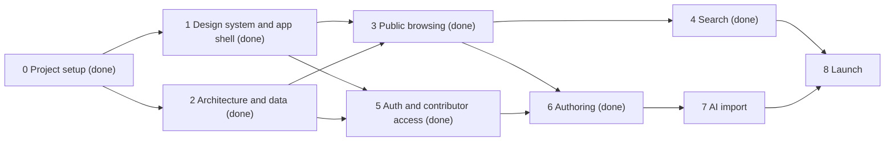

# Recipe Hub Roadmap

This file carries the plan, the architecture, and the owner's guidance for Recipe Hub. Every session reads it in full before starting and updates it before finishing (status, decision log, deferred items). When the code and this file disagree, raise it with the owner instead of silently picking one.

## 1. Product

Recipe Hub is a recipe catalog for the owner's family: anyone can browse and search it, and approved members contribute recipes.

- **Access:** browsing and search are public, so members can share a recipe link with anyone. Contributing (adding and editing recipes) and every AI feature are limited to approved members. People request access; the admin approves and sends an invite, and members sign in with a passkey, or with an emailed one-time code where their device cannot hold one. The family scope is an access rule only: the site reads as a general-purpose recipe catalog (section 6.1).
- **Browse:** a recipe list and detail pages that are pleasant to read while cooking.
- **Search:** rich search across titles, ingredients, instructions, tags, and the person or place a recipe comes from, with filters.
- **Contribute:** three entry modes that all funnel into one normalized recipe shape:
  1. Photos of a written or printed recipe, parsed by AI.
  2. A pasted URL, parsed from the page's structured data first and by AI for the rest.
  3. Manual entry.

Contributors number in the tens, readers in the dozens to hundreds (anyone a member shares a link with), and the catalog hundreds to low thousands of recipes. Small does not mean ad hoc: the architecture is sound and canonical so the project can grow.

## 2. Guiding principles

The owner's guidance. Every session applies it, and the orchestrator checks every delegate's work against it.

1. **Small, flexible, extensible.** Build the smallest thing that solves the stated problem, in a shape that can grow. No speculative features, options, abstractions, or tooling without a real consumer.
2. **Industry standards first.** Ground decisions in current, industry-standard practice, OOP principles, and established design patterns. Verify library and platform behavior against current documentation (for Next.js, the docs bundled in `node_modules/next/dist/docs/`), never memory.
3. **Maintainability is the priority.** Prefer clarity over cleverness and explicit over implicit. There is one way to do each thing, and code that does the same thing looks the same.
4. **Think in layers.** For every layer, know what it is responsible for, how it exposes that to other layers, and what it guarantees them, so each layer can be reasoned about without reading its internals. Express the separation structurally: directories, files, and module boundaries mirror the layers, and tooling enforces the boundaries.
5. **Consistent and deliberate UI.** Built on a component library (shadcn/ui) with a tuned design language. Every screen uses the same tokens, primitives, and patterns, and nothing is styled ad hoc.
6. **Accessible by default.** WCAG 2.2 AA is the baseline for every UI change, not a final pass.
7. **Private where it matters.** Published recipes and dish photos are public; original scans, contact details, access requests, and member data stay private. Family data never enters the repository, and secrets live only in Vercel environment variables.

## 3. How sessions work

- **The main session is the orchestrator.** It owns high-level decisions, architectural forks, sequencing, and validating that delegated work matches this file. It delegates exploration, research, implementation, and test runs to subagents and keeps its own context for synthesis and review.
- **Delegate with clear ownership.** Give each subagent a disjoint set of files, the relevant sections of this file, and acceptance criteria. Subagents implement and report; they do not make architectural decisions. The orchestrator reviews every subagent's diff against sections 2 and 4 before integrating it.
- **Forks go to the owner.** Choices that shape architecture, scope, or a keep or drop decision are presented with a recommendation and its cost, batched together. Each session below lists the forks it is expected to resolve.
- **Session start:** read this file and `AGENTS.md`, review `git log` and the working tree for changes since the last session, and confirm scope with the owner.
- **Session end (definition of done):**
  - `pnpm lint`, `pnpm typecheck`, `pnpm test`, and `pnpm build` pass.
  - Substantial changes get an external Codex review, and its findings are addressed.
  - The change is verified on its Vercel preview deployment.
  - This file is updated: session status, decision log, deferred items, and any guidance that changed.
  - Work lands through a pull request from a session branch (CI plus preview deployment) and merges with the owner's go-ahead.
- **Stay focused.** If a session's scope starts to sprawl, finish the current slice, record the remainder here, and stop. Prefer a clean handoff over a crowded context.

## 4. Architecture

### 4.1 Layers

Recipe Hub is one Next.js project organized as a layered, ports-and-adapters architecture. Dependencies point inward: presentation depends on application, application depends on domain, and infrastructure implements the application's ports.

| Layer | Location | Responsible for | Exposes | Guarantees |
| --- | --- | --- | --- | --- |
| Domain | `src/domain/` | The recipe and member model: entities, value objects, invariants, Zod schemas, domain errors | Types, schemas, pure functions | Pure and deterministic: no I/O, no framework imports, no environment access. A value that passes a domain schema is valid everywhere. |
| Application | `src/application/` | Use cases (browse, search, create, update, import, request and grant access), authorization, orchestration across ports | Service classes with intention-revealing methods; port interfaces in `src/application/ports/` | Server-only. Each use case declares who may call it: recipe reads, search, and access requests are open to anonymous visitors and return public DTOs (no contact details or provider IDs); scans and member data require a member; recipe writes and AI calls require an approved member; reviewing requests and managing members require an admin. Inputs are validated, and outputs are serializable DTOs. |
| Infrastructure | `src/infrastructure/` | Adapters to the outside world: Postgres through Drizzle, Vercel Blob, the AI Gateway, web fetching, Better Auth, the email sender | Classes implementing application ports | Translates external data into domain types at the boundary and hides vendor types and errors behind port contracts. |
| Composition | `src/composition/` | The composition root: constructs adapters and injects them into application services | Factories that return ready services | The only module that knows which adapter backs which port. |
| Presentation | `src/app/`, `src/components/` | Routes, layouts, pages, Server Actions, Route Handlers, UI components | Pages and components | Thin: parses input, calls one application service, renders the result. No business rules, SQL, or vendor SDKs. |
| Shared | `src/lib/` | Cross-cutting utilities: validated environment, logger, small helpers | Functions | Depends on no other layer. |

- **The application layer is the Data Access Layer** that the Next.js data security guide recommends: server-only, deciding for every read and write what the actor (an anonymous visitor or a member) may see or do, and returning minimal DTOs to the render context.
- **`src/components/ui/`** holds the shadcn primitives, which are adjusted only through tokens and variants. Feature components in `src/components/<feature>/` compose primitives and receive data as props. They never fetch data or call services.
- **Test kits** live in a `testing/` directory beside the layer they serve (in-memory port fakes in `src/application/testing/`, a migrated PGlite database in `src/infrastructure/db/testing/`). Only tests import them.
- **Synthetic samples** live in `src/domain/recipe/samples/`. Tests, the seed script, and the design reference all use them, so each sample recipe exists once.

### 4.2 Dependency rules and enforcement

- Domain imports only `zod`, `parse-ingredient` (pure: it reads ingredient lines), and pure helpers from `src/lib`. Application imports domain and `src/lib`. Neither imports Next.js, React, Drizzle, or a vendor SDK.
- Presentation never imports infrastructure. Route Handlers that mount a vendor handler (the Better Auth endpoint) obtain it from composition.
- Vendor code reaches presentation in four places, each because the work runs in the browser or before routing:
  - `src/components/auth/auth-client.ts`, Better Auth's React client, which only client components import. Email codes and passkey ceremonies go through its HTTP calls, which Better Auth rate-limits; its server API skips the limiter.
  - BotID: `withBotId` in `next.config.ts`, `initBotId` in `src/instrumentation-client.ts`, and `checkBotId()` in the request form's Server Action.
  - `src/proxy.ts`, which reads the session cookie with `better-auth/cookies`.
  - `src/components/recipe-form/photo-upload.ts`, Blob's `uploadPresigned`, because photos upload from the browser straight to Blob (section 5.5).
- Only `src/lib/env.ts` reads `process.env`. Everything else receives configuration from it. The exceptions are entry points that run outside Next, where `env.ts`'s `server-only` import cannot resolve:
  - `drizzle.config.ts`, which drizzle-kit loads.
  - The scripts in `scripts/`, which tsx runs with `scripts/tsconfig.json`. It maps `@/` to `src/` and `server-only` to Next's empty module (the alias Vitest uses), so scripts can import server modules.
  - Each loads `.env.local` with `@next/env` and reads its own variables with Zod. Under tsx, `@next/env` is imported whole, because it is bundled CommonJS.
- Server modules begin with `import 'server-only'`. Client components (`'use client'`) import only components, domain types, and pure helpers. Pure helpers and constants that client code imports live in domain modules that define no Zod schema (`amount-format.ts`, `ingredient-parser.ts`, `ingredient-limits.ts`, `import-limits.ts`), so Zod stays out of the browser bundle; type-only imports from schema modules are fine. `import-limits.ts` holds the scan limits the import service enforces and the browser encodes and words its copy by (`maxImportScans`, `maxImportScanSizeInBytes`).
- **Enforcement.** `pnpm lint:boundaries` runs dependency-cruiser with `.dependency-cruiser.ts` (the owner's precedent from sage, kept to a short hand-written rule list). Type-only imports count. It checks that:
  - domain imports only domain, pure `src/lib` helpers (not `env.ts` or `logger.ts`), `zod`, and `parse-ingredient`;
  - application imports only application, domain, `src/lib` without `env.ts`, `zod`, and `server-only`;
  - infrastructure and composition never import presentation, presentation never imports infrastructure, and components never import composition;
  - `src/lib` imports no other layer;
  - test kits and Vitest are imported only by tests;
  - there are no cycles and no unresolvable imports;
  - every application, infrastructure, and composition module imports `server-only`, except the two files drizzle-kit loads outside Next (`schema.ts` and `connection-string.ts` in `src/infrastructure/db/`).
- ESLint forbids `process.env`, `globalThis.process`, and importing `process` outside `src/lib/env.ts`, `drizzle.config.ts`, and `scripts/`, and requires every `logger` message in `src/` and `scripts/` to be a string literal. dependency-cruiser checks `src/` only: a script is its own composition root.
- A rule that tooling cannot enforce is written here and checked in review.

### 4.3 Patterns

| Pattern | Where | Why |
| --- | --- | --- |
| Repository | `RecipeRepository`, `RecipeImportRepository`, `MemberRepository`, `AccessRequestRepository`, and `InviteRepository` ports with Drizzle adapters | Services and tests do not depend on how data is stored. Contract suites (`recipe-repository-contract.ts`, `recipe-import-repository-contract.ts`) hold the in-memory recipe and import repositories to the Drizzle ones. |
| Query port | `RecipeSearch` with `DrizzleRecipeSearch` | Postgres matches, ranks, highlights, and counts facets; the service validates input and maps results to DTOs. |
| Strategy | `PageRecipeExtractor` (`JsonLdPageRecipeExtractor`, then `AiPageRecipeExtractor` reading the page's text) and `ScanRecipeExtractor` (`AiScanRecipeExtractor`), behind a `WebPageFetcher` for pages | The entry modes differ only in how a recipe is read. Every extractor returns an `ExtractedRecipe`, which one domain function turns into a draft. Each call names its `ExtractionRequester` (member id and email), so a model call is attributed to one member. |
| Transaction lock | `lockForTransaction` (`src/infrastructure/db/transaction-lock.ts`) | The one way to take a transaction-scoped advisory lock: slug allocation, member role changes, and each member's import count each take one, so racing writers take turns. |
| Adapter | Every infrastructure class | Vendor APIs are translated into port contracts. |
| Composition root with constructor injection | `src/composition/` | Explicit wiring without a DI framework, and fakes injected in tests. |
| Value object | Amounts, durations, yields, slugs, tags | Each invariant lives in one place. |
| Mapper | Infrastructure (row to domain) and application (domain to DTO) | Each boundary owns its translation. |
| Draft, review, save | Every import | AI output is never saved unreviewed: an import stores its draft, which the member reviews in the recipe form before saving, and the saved recipe takes its provenance from the import. |

**OOP where it earns its keep.** Services, adapters, and extractors are classes that implement interfaces and receive dependencies through their constructors. Domain data is immutable plain objects described by Zod schemas, because data crossing the Server and Client Component boundary must be serializable. Behavior on that data lives in small pure modules beside its schema.

### 4.4 Next.js conventions

- Server Components by default; `'use client'` only at interactive leaves.
- Mutations are Server Actions that validate input with the domain schema, call one application service, and then invalidate cache tags.
- **Server Action forms** (since Session 5):
  - An action takes `(state, formData)`, reads fields with `formText` and `optionalFormText` (a blank optional field is absent), calls one service, and returns `FormState` (`src/components/forms/form-state.ts`). After a success it calls `updateTag` or `refresh()`; `updateTag` already re-renders the current route, so `refresh()` is only for reads that are not cached.
  - An action that leads to another page (creating or editing a recipe) redirects after its `updateTag` calls, so the destination renders fresh in the action's own response: a client navigation afterwards can get the CDN's copy from before the write for a few seconds. `useFormAction` lets Next's redirect through (`unstable_rethrow`). Deleting a recipe still navigates from its dialog, so the dialog's toast can show; the list may show the deleted recipe for those few seconds.
  - The import actions (`importFromUrl`, `importFromScans` in `src/app/(contribute)/contribute/actions.ts`) store the draft, then redirect to its review page, `/contribute/imports/<id>`. Nothing cached changes until a recipe is saved from it, so they update no tag.
  - A Server Action runs as long as the page that renders its form allows, so `/contribute` exports `maxDuration = 120` for its import actions; each model call times out at 90 seconds within it.
  - `toFormError` (`src/app/_lib/form-errors.ts`) turns validation problems into field errors and expected error codes into copy. Anything else is rethrown, without the query parameters a database error carries, because Next logs it in full.
  - Forms call their action through `useFormAction`, a client function. React replays a submit made before hydration through fetch, which BotID can check, and a call that fails in transport (a firewall 429, a lost connection) shows the form's failure message instead of the error page.
  - React resets a form after its action, so error states return the submitted text (`FormError.values`), and a Base UI checkbox or select remounts with the submitted value.
  - The recipe form (`src/components/recipe-form/`) keeps its value in a reducer with stable item ids and sends it as JSON in one hidden field, which `recipeContentFromForm` maps on the server. Errors attach to the items their paths name, so they follow moves. The form needs JavaScript for list editing and uploads, so Save stays disabled until hydration: it is the one form that does not work before hydration.
  - The review page loads a draft into the recipe form on the server with `recipeFormValues(content, problems)`, the one load path create and edit use, and the form posts the import's id in a hidden field. The browser never names a recipe's provenance: the service takes it from the import.
  - Next keeps recent pages alive (Activity), with their state. The create form starts over because its redirect remounts it, and the edit form is keyed by the recipe's `updatedAt`, so a recipe changed elsewhere starts it again.
- Route Handlers only for HTTP-shaped needs: the auth endpoint, Blob client-upload tokens, and image delivery. Open Graph images, icons, the manifest, the sitemap, and robots use Next's metadata file conventions.
- `src/proxy.ts` (Next 16's replacement for `middleware.ts`) makes optimistic redirects only: a request to `/contribute` (the import review pages included), `/recipes/<slug>/edit`, `/admin`, or `/account` without a session cookie goes to `/sign-in?next=<path>`. Its matcher names those routes, so it never runs for public pages or metadata files. The authoritative check is the application layer, on every call.
- **Sessions:**
  - Server Components read the session only through `ActorProvider` (Better Auth's `getSession` with `disableRefresh`), only inside Suspense, and never inside a `'use cache'` function. A public use case never asks for the actor, so cached reads stay cacheable.
  - The composition root's request reader awaits `connection()` before `headers()`. With partial prefetching, headers resolve while the page's shell still prerenders, so the session read would run there: the dev server logs it as reading the clock while prerendering, and production discards the queries.
  - The root layout's header account slot is the one session read on every page, so public pages are partial prerenders with a static shell.
  - Server Components cannot set cookies, so a client leaf for signed-in members (`SessionRenewal`) reads the session through the auth endpoint on load and when the window regains focus, which renews the cookie at most once a day.
  - A gated page sends a signed-out visitor to sign-in from inside Suspense, which is a client-side redirect. `authInterrupts` (`forbidden()`, `unauthorized()`) is still experimental and not used; a member without access sees an in-page message.
  - A sign-in redirect accepts only a path on this site, checked as the browser parses it (`safeNextPath`).
- Cache Components (`'use cache'`, `cacheTag`, `cacheLife`) for public pages, which are the same for every visitor. Session-dependent UI (sign-in state, an Edit button) streams in behind Suspense, following the bundled guide `authentication-with-cache-components.md`.
- **Cached reads:** `src/app/_lib/recipe-cache.ts` is the one home for recipe cache tags (`recipes` for every list page, `recipe:<slug>` for a recipe, and `member:<id>` on every recipe page showing that member's name, so a rename reaches them all) and for the cached reads pages use. Server Actions invalidate with `updateTag`, using `RecipeRef`'s slug. The application layer never imports `next/cache`.
  - `getCachedRecipe` tags the slug it was asked for and the recipe's current slug, so an entry cached under an old slug clears with the current one, and a cached miss clears once a recipe takes the slug.
  - Recipe writes invalidate `recipes` and the recipe's slug, plus the previous slug after a rename, which the repository reads under the row lock.
  - The reads use `cacheLife('days')`, and writes invalidate the tags. A result consumed into a prerendered shell persists in Vercel's ISR cache and revalidates in the background, which catches edits made outside the app.
  - A runtime entry, such as a list page read after `searchParams`, lives in the instance's in-memory cache: it is not shared between instances, and a day after it was cached it counts as a miss and is rebuilt while the request waits.
  - List pages are cached per page and sort (`getCachedRecipePage(page, sort)`), which keeps the keys few.
  - A `'use cache'` argument is part of the key, so pass a fresh object with every key present and arrays sorted, never raw `searchParams`.
- **Search is not cached.** Every query and filter makes its own URL, so entries would rarely be reused and would push list entries out of the in-memory cache. The bundled docs name search filters as the worst case for `'use cache: remote'`. Results are read inside Suspense on every request, and a Vercel WAF rate-limit rule on `/search` protects Neon's compute-hours (section 5.5).
- **Dynamic routes:**
  - With Partial Prefetching, `params` and `searchParams` are read inside `<Suspense>`, with skeleton fallbacks that mirror the page. No `loading.tsx`.
  - A `notFound()` inside Suspense keeps status 200 and adds `noindex`, so unknown slugs, invalid parameters, and pages past the end get a soft 404. A `redirect()` there is a client-side redirect with status 200 (a `permanentRedirect` leaves at once, a temporary one after a second, which is why old slugs use the permanent one), and a `next.config` redirect cannot drop a query parameter (the request's query is merged into the destination), so a page names its normalized URL with `alternates.canonical` instead.
  - `generateStaticParams` must return at least one param or the build fails. Recipe pages return the first page's slugs, or a placeholder that fails the slug schema and prerenders a 404 while production is empty.
  - `MainNav` reads `usePathname` inside Suspense, with a fallback that marks no link as current.
- **Metadata routes** inside a route group get a hash suffix (`/recipes/<slug>/opengraph-image-<hash>/<id>`). Every named export of a metadata file is re-exported into its route, so helpers stay unexported.
- **URL state:** search state lives in the URL (`searchParams`) so results are shareable and work with the back button.
  - The list keeps its page and sort there (`/?sort=title&page=2`). Defaults are left out, so each view has one URL, and `generateMetadata` on `/` sets the canonical URL, so `/?page=1` names `/`.
  - Search uses `q`, `tag` (repeated), `source`, `contributor` (a member id), `time`, `added`, `sort`, and `page`. `src/components/search/search-params.ts` is the one module that parses and builds them.
  - An empty value means absent, because forms submit blank fields.
- **Forms:** `next/form` for every GET form. It navigates client-side and still submits natively before hydration.
  - It drops a query string in `action`, so state travels in hidden inputs.
  - With JavaScript it drops a submit button's name and value, so no state lives in a button.
  - `useFormStatus` never reports pending for it in the App Router.
  - Before hydration, the query field, links, and native `<details>` work. Base UI selects and checkboxes do nothing, so filters and sort need JavaScript; with JavaScript off, Suspense content never appears at all.

### 4.5 Target structure

```text
assets/fonts/             static TTF subsets for Open Graph images, with their licenses
scripts/                  entry points run with tsx outside Next, one folder per script
  bootstrap/              the first admin
  seed/                   sample recipes; photos/ holds seed photos and their sources
  evaluate/               the import evaluation; cases/ holds its inputs and expected drafts
src/
  app/                    presentation: routing, thin pages and actions
    _lib/                 cached reads and cache tags shared by routes
    (browse)/             public: recipe list and detail, search
    (contribute)/         approved members: add, edit, import, review an import's draft
    (account)/            request access, accept an invite, sign in, account, privacy
    admin/                access requests and members
    design/               design reference (development and previews only)
    api/
      auth/[...all]/      Better Auth handler
      uploads/            Blob client-upload tokens
      images/[...path]/   image delivery: public dish photos, members-only scans
  components/
    ui/                   shadcn primitives
    <feature>/            feature compositions (recipe, recipe-form, recipe-import, search, layout, forms, auth, account, admin)
  domain/
    recipe/               schemas, value objects, pure functions, errors
    member/
  application/
    ports/                interfaces the use cases depend on
    recipes/
    ingestion/            imports: the import service, its errors and DTOs
    search/
    access/               access requests, invites, and the sign-up gate
    members/
  infrastructure/
    db/                   Drizzle schema, client, migrations, repositories
    storage/
    ai/                   AI Gateway extractors, prompts, and the model output schema
    web/                  the guarded page fetcher, JSON-LD extractor, and page text
    auth/                 Better Auth, the actor provider
    email/                Resend
  composition/            composition root
  lib/                    env, logger, site name, dates, shared helpers
  proxy.ts                optimistic sign-in redirects for gated routes
  instrumentation-client.ts  BotID's browser check
```

At the root, `drizzle.config.ts` configures drizzle-kit, `vercel.json` sets the build command that migrates and seeds before `next build`, and `.dependency-cruiser.ts` holds the boundary rules.

Files are kebab-case (`recipe-repository.ts`), classes and types PascalCase, functions camelCase. Non-component modules export inline. Tests sit beside the code they test as `*.test.ts`.

### 4.6 Cross-cutting concerns

- **Configuration:** `src/lib/env.ts` validates every variable with Zod once and exports a typed object, so later sessions add their variables there. Today it holds:
  - `NODE_ENV`, `VERCEL_ENV`, and the pooled `DATABASE_URL`;
  - `BLOB_STORE_ID`, and `BLOB_WEBHOOK_PUBLIC_KEY`, which the Blob SDK's presigned upload handler requires although no completion callback is requested;
  - `VERCEL_PROJECT_PRODUCTION_URL`, from which it derives `siteUrl` (production's origin on every deployment, `http://localhost:3000` when absent);
  - `VERCEL_URL` and `VERCEL_BRANCH_URL`, the deployment's own hosts. With them it derives `appUrl`, the base for links in emails: production's domain, a preview's branch alias, or the dev server. Better Auth answers on those hosts only;
  - `VERCEL_GIT_COMMIT_REF`, required on previews, from which it derives `imageEnvironment`, the folder this deployment writes images to (section 5.5);
  - `BETTER_AUTH_SECRET`, `RESEND_API_KEY`, and `RESEND_EMAIL_DOMAIN`. It refuses to start if `BETTER_AUTH_SECRETS` or `BETTER_AUTH_TRUSTED_ORIGINS` is set, because Better Auth reads both itself and would let them override the configured secret and hosts.

  Vercel supplies the values; local development pulls them with `vercel env pull`. The Blob SDK and the AI SDK's Gateway provider read Vercel's OIDC token themselves, and locally both refresh an expired one with the Vercel CLI's login (the AI SDK through `@vercel/oidc`). There is no Blob read-write token and no `AI_GATEWAY_API_KEY`, which would win over OIDC. `drizzle.config.ts` and the scripts read their own variables (section 4.2): `scripts/bootstrap/bootstrap.ts` reads `ADMIN_EMAIL`, and `scripts/evaluate/evaluate.ts` stops before any call without `VERCEL_OIDC_TOKEN`.

- **Errors:**
  - Expected failures are classes extending `AppError` (`src/lib/errors.ts`) with a stable `code`: `recipe.invalid`, `recipe.not-found`, `recipe.edit-conflict`, `recipe.invalid-page`, `recipe.invalid-search`, `image.invalid-upload`, `import.invalid`, `import.page-refused`, `import.page-unavailable`, `import.paused`, `import.failed`, `import.no-recipe`, `import.rate-limited`, `import.unavailable`, `access.sign-in-required`, `access.forbidden`, `access.invalid-request`, `access.invalid-invite`, `access.invalid-email`, `access.invite-unavailable`, `access.invite-not-found`, `access.request-not-found`, `member.invalid-profile`, `member.not-found`, `member.role-conflict`, `member.last-admin`, `email.delivery-failed`, and in the browser `photo.unreadable`.
  - A code a form can receive needs its copy in `errorMessages` (`src/app/_lib/form-errors.ts`), or `toFormError` rethrows it as unexpected.
  - The import errors live in `src/application/ingestion/errors.ts`. `import.page-unavailable` carries a reason for logs (`not-found`, `unreachable`, `timed-out`, `not-html`, `too-large`, `not-public`) and `import.page-refused` the site's status; members see one message for each.
  - Validation errors extend `InvalidInputError` (`src/domain/problem.ts`), which carries the problems, so every form maps them to fields one way.
  - Reads return `null` when nothing is found; writes throw. Validation failures carry problems with dotted paths (`ingredientSections.0.lines.2.item`), the same shape drafts use, so the form renders both alike.
  - Server Actions return expected errors as values and rethrow anything else, as the bundled error-handling guide says. Production masks thrown server errors to a digest, so a code never reaches the client by being thrown.
  - Presentation maps codes to user-facing messages, and unexpected errors reach Next.js error boundaries.
- **Logging:** `getLogger(name)` in `src/lib/logger.ts` writes one JSON line per event (`level`, `logger`, `message`, camelCase fields, and `err` serialized with its code and cause) through the console method matching the level, because Vercel takes a line's level from the console method, not from the JSON. It has no dependency. Messages are constant (ESLint enforces it), with values in the fields. Lifecycle events (recipe created, updated, or deleted, recipe images deleted, image upload authorized, import started, finished, or failed, expired import drafts cleared, access requested, request declined, invite issued or revoked, access granted, member renamed, admin role granted or removed, admin bootstrapped) log at info with the acting `memberId`, recoverable problems at warn (a recipe save refused as stale or for an unavailable import, an image delete that failed, an upload refused, an import refused at the daily limit, an import draft that could not be cleared, an admin role removal refused), failures at error. Never log tokens, codes, email addresses, or names; access events carry ids only.
  - Import events carry ids, error codes, the mode, the model, and the cost, never the page's address, its text, or the model's output. The fetcher's and the AI adapter's error causes keep codes only, since their messages can quote the address or the output.
  - A member's email leaves the app only as the AI Gateway's reporting `user` (section 5.5); providers get a SHA-256 of the member id instead.
  - Drizzle's query errors end with the query's parameters, so the logger cuts them from every logged message and stack.
  - Better Auth's own warnings and errors go through the logger as `auth`.
- **Validation:** Zod at every boundary: form input, AI output, scraped data, and every database read of a recipe document or an import's draft.
- **AI calls:** `extractWithModel` (`src/infrastructure/ai/model-extraction.ts`) is the one way to call a model.
  - It calls `generateText` with `Output.object` against the flat output schema in `recipe-output.ts`, the instructions as the system prompt, and a 90-second timeout. Reasoning stays at each model's default.
  - It never sets sampling parameters: Claude Sonnet and Haiku 5.5 refuse non-default `temperature`, `top_p`, and `top_k`, and Gemini 3 deprecated them. Sonnet 5.5 also refuses forced tool use; `Output.object` through the Gateway works with it, as the evaluation showed.
  - Every call asks for zero data retention and names the member: their email as the Gateway's `user`, and a SHA-256 of their member id as `safetyIdentifier`.
  - A 402 from the Gateway (credits or budget exhausted, which `@ai-sdk/gateway` raises as `GatewayInternalServerError` with `statusCode: 402`) becomes `import.paused`; any other failure, a timeout, a refusal, or output that fails the schema becomes `import.failed`.
  - Prompts treat the photo or page as data only and tell the model never to follow instructions written in it.
  - The cost comes from `providerMetadata.gateway.cost`. The model comes from the SDK's response, which reports the model asked for, since the Gateway names none; that is the model that answered only while no Gateway fallbacks are configured.
- **Fetching pages:** `GuardedWebPageFetcher` is the only code that fetches an address a member gives. It uses `guarded-fetch`'s own undici fetch, so page fetches bypass Next's fetch caching and instrumentation.
- **Testing:**
  - Vitest for domain and application code, with in-memory fakes for ports. Vitest aliases `server-only` to Next's own empty module, so server modules import in tests.
  - Repository tests run against PGlite (Postgres 18.3 in WASM, loading `pg_trgm` and `unaccent` from its contrib modules) built by the real migrations, inside `pnpm test`, with no secrets or branch quota. `pgvector` ships separately, as `@electric-sql/pglite-pgvector`.
  - PGlite differs from `pg` in two ways tests cannot catch: `pg` returns `count(*)` as a string (use Drizzle's `count()` or `::int`), and PGlite rejects a migration chunk holding more than one statement.
  - Search's expected-result tests run over every sample recipe, the same corpus previews are seeded with.
  - Playwright for a few end-to-end flows once the core flows exist.
  - Fixtures are synthetic or public-domain recipes, never real family data.
  - Infrastructure adapters are tested against real engines, never module mocks. `BlobImageStore` is a thin pass-through with no local engine, so the seed run and the preview verify it; a test covers its refusal to delete outside its folders. `BlobUploadHandler` runs the real SDK against a local fake of Blob's API through `VERCEL_BLOB_API_URL`.
  - A PL/pgSQL trigger on PGlite proves that every slug write holds the slug allocation lock.
  - Better Auth runs for real on PGlite through `src/infrastructure/auth/testing/`, with rate limiting on. `ResendEmailSender` runs the real SDK against a local HTTP server through its `RESEND_BASE_URL`.
  - The AI extractors run against the AI SDK's `MockLanguageModelV4` (`ai/test`), and against a real `createGateway` given an injected `fetch` with canned answers, which checks the request body the Gateway receives and how its errors map. No test calls a model.
  - `GuardedWebPageFetcher` runs `guarded-fetch` for real through its `fetch` option, which sends a public test origin to a local HTTP server, so every address check still runs. Its tests of DNS-based blocks resolve `localtest.me`, so they need DNS.
  - Import services run against `FixedWebPageFetcher`, `FixedPageRecipeExtractor`, and `FixedScanRecipeExtractor` in `src/application/testing/`.
  - The evaluation's scoring (`scripts/evaluate/score.ts`) is tested beside it, inside `pnpm test`; the evaluation itself makes paid calls and runs by hand (section 7).
  - Presentation logic that is pure (JSON-LD mapping, page numbering) is tested beside its component.

## 5. Specifications and constraints

### 5.1 Recipe model

The normalized shape every entry mode produces, finalized in Session 2 in `src/domain/recipe/`.

- **Content** (member-editable): a title; an optional description, notes (the story behind the recipe), and source (who or where the recipe comes from, such as "Grandma Rose" or a cookbook, distinct from the member who entered it).
- **Yield and times:** a yield is servings or "makes" an amount with an optional unit ("Serves 4 to 6", "Makes 10 biscuits"). Times are optional prep, cook, and total minutes; a stated total wins, otherwise prep plus cook.
- **Amounts:** a positive decimal or a range (`{ min, max? }`), displayed as the nearest common fraction (halves, thirds, quarters, eighths). Units are free text as written.
- **Ingredients and steps:** ingredient sections, each with an optional heading and lines that keep the original text verbatim beside their amount, unit, item, and preparation note. Instruction sections of steps, each an object with text, so a step can gain fields without reshaping stored recipes.
  - Members type one line per ingredient. `parseIngredientLine` (`parse-ingredient` with our adapter) reads the amount and unit only where they open the line unambiguously ("1-1/2" is 1½; "2-inch piece" and "1,5 kg" keep no amount), the preparation follows the first comma outside parentheses, and a closing note such as "to taste" moves to the preparation. Anything else keeps its text as the item, so it displays as written.
  - The parser is the only source of a line's structure: the form sends text and the server parses it. Lines hold at most 500 characters (`maxIngredientLineLength`), which also bounds the parser. Every sample line parses to its stored structure, which a test checks.
- **Text:** every text field is trimmed, stripped of C0 control characters other than tabs and line breaks (NUL included), and composed (NFC), so text that reads the same is stored the same.
- **Tags** are dynamic, with no fixed vocabulary or groups. The first recipe to use a tag sets its label; later spellings that differ only in case or spacing reuse it, and a contributor can respell a tag that only their recipe uses. Two saves racing to introduce the same new tag in different spellings can keep both; at this scale that is accepted and fixed by a merge.
- **Images**, each with a role: dish photos (public; the first is the cover) and original scans (members only). Array order is display order.
  - Each image is a Blob pathname plus optional alt text. A pathname starts with its role (`dish/` or `scan/`) and has only plain segments (letters, numbers, `_`, `-`, `.`), because `..` or `%2e%2e` would climb from `dish/` into `scan/` once the SDK builds the blob URL.
  - Only JPEG, PNG, WebP, and AVIF are served (`recipeImageContentTypes`).
  - Uploads are JPEG, re-encoded in the browser: dish photos at most 2400 px on the long edge at quality 0.85, scans 3072 px at 0.9, in sRGB with the rotation applied and no metadata (no location). A file the browser cannot read, such as HEIC outside Safari, is refused with guidance.
  - Scans also have a byte budget, 3,750,000 bytes (`maxImportScanSizeInBytes`): one over it is encoded again at quality 0.8, 0.7, 0.6, then 0.5, then drawn at long edges of 2304, 1728, then 1600 px at 0.5, never enlarged, until it fits. It keeps the last attempt if nothing does, and imports refuse a larger one. Claude through Bedrock or Vertex refuses an image over 5 MB of base64, which grows a file by a third.
  - No dimensions are stored yet: every screen shows photos in fixed-aspect boxes.
- **Provenance**, set at creation: the entry mode (`manual`, `url` with its source URL, or `photo`) and which model produced an AI draft. A recipe saved from an import takes the import's provenance, never one the browser names; the source URL is the address the member gave, not where the site redirected.
- **Identity:** uuidv7 ids generated by Postgres 18, a slug from the title (ASCII, at most 60 characters, `-2` and up on a collision) that follows the title when it changes, the contributor (a foreign key to `users`, with no cascade), and timestamps.
  - Old slugs stay in `old_recipe_slugs`, reserved for their recipe: they keep finding it, so shared links keep working, a recipe renamed back gets its old slug again, and deleting the recipe frees them. Every slug candidate is checked exactly against current and old slugs, under one transaction-scoped advisory lock that creates and renames share, so they never race.
  - `updatedAt` is the version an edit starts from: a save from an older version is refused (`recipe.edit-conflict`), and every save moves it forward at least a millisecond.
- **`RecipeDraft`:** the same content with every field optional, plus provenance and problems. Drafts are never saved as recipes; members review them in the recipe form.
- **Imports** (Session 7, `src/domain/recipe/recipe-import.ts`): an import records the member, its mode (`url` or `photo`), its status (`running`, `succeeded`, or `failed`), the source URL, the model that answered, the cost in US dollars, a failed import's error code, and its `ImportDraft` (draft content and problems).
  - Only the member who started an import can review its draft and save it, once, within 7 days (`importDraftLifetimeDays`, `reviewableDraft`). The draft and source URL are cleared when the recipe is saved, or after the 7 days; the rest stays as a record of use and cost.
  - Extractors return an `ExtractedRecipe` (text as written, ingredient lines unparsed), and `importDraftFromExtractedRecipe` turns it into the draft: `parseIngredientLine` reads every line, a line over 500 characters keeps its first 500 with a problem, a yield or time the domain refuses is left out with a problem quoting the original, and sections with only a heading are dropped.
  - The form joins a draft's distinct problems for each field in order (a failed save still shows one per field), so they come as: what the draft could not keep as read, then the model's review notes, then what the recipe lacks (a title, ingredients, steps), then notes whose item was dropped, on its section or list. A note on the times as a whole sits on the total time.

**Storage.** One `recipes` row per recipe: `content` (a jsonb document), `provenance` (jsonb), `tags` (`text[]`), and columns for id, slug, contributor, the import it was saved from (`import_id`, unique, so an import saves one recipe), and timestamps; old slugs in `old_recipe_slugs`; one `recipe_imports` row per import, with its draft as jsonb (migration `0006`). The mapper validates every read with the domain schema, which keeps schema changes small:

- An added optional field needs no migration.
- A new required field needs a default or a one-statement backfill.
- A rename or restructure is a small SQL data migration.
- A field that needs filtering or sorting becomes a generated column computed from `content`.

**Search columns** (Session 4) are STORED generated columns, computed by Postgres from `content` and `tags`:

- `search_vector`: the weighted `tsvector`.
- `search_words`: the unaccented title, ingredient items, and tags, which close matches compare.
- `tag_keys`: each tag lowercased like `tagKey`.
- `source_key`: the source, lowercased.
- `total_minutes`: by `totalMinutes`' rule.
- `title_sort`: the title unaccented and lowercased.

How they behave:

- Recipe reads select the original columns only (`recipeColumns`).
- They recompute when a write sets a column they read.
- Changing a helper function, the text search configuration, or `unaccent`'s rules recomputes nothing, so such a change ships with a backfill (`UPDATE recipes SET content = content`).
- A document without a title, or with times that are not whole numbers, cannot be stored, because the columns would fail.

Unknown keys are dropped on read, so older code that re-saves a recipe would drop fields newer code added; add fields in one deployment before anything depends on them.

### 5.2 Entry modes

`/contribute` offers the three modes as tabs, "Manual", "Link", and "Photos", beside a fourth, "Drafts", for imports not yet saved. Both imports store a draft and open it at `/contribute/imports/<id>` in the recipe form, where the member reviews and saves it. Recipes are edited at `/recipes/<slug>/edit`, where they are also deleted.

- **Manual entry:** the recipe form, which is also the review form for imports.
- **URL import** (`RecipeImportService.importFromUrl`):
  - **Fetch:** `GuardedWebPageFetcher`, through `guarded-fetch`, takes public HTTP(S) addresses on the web's ports without credentials, checks each of up to 5 redirects again, allows 10 seconds and 5 MB (after decompression) for the whole fetch, takes HTML only, decodes it with the charset the browser rules give (byte-order mark, then header, then `<meta>`, through `encoding-sniffer`), and names the site in an honest User-Agent (`RecipeHub/1.0 (+<site>)`).
  - **Refusals:** a site that answers 401, 402, 403, 429, or 451, or with a Cloudflare challenge, gets "This website doesn't support importing recipes."; any other failure gets "We couldn't open that page. Check the link and try again." No paste box and no spoofed browser.
  - **Reading:** the page's schema.org `Recipe` JSON-LD first (`JsonLdPageRecipeExtractor`): `@graph`, top-level arrays, `@id` references, `ItemList` and `PropertyValue` ingredients, `HowToSection` step groups, and ISO 8601 or written-out durations ("PT0S" is no time). A page with several recipes uses the one its URL's fragment names, then its `mainEntity`, then the one whose `url` is the page, then the first with ingredients. Structured data it cannot read, such as references that form a cycle, leaves the page to the model.
  - **AI reading:** when the JSON-LD lacks a title, an ingredient, or a step, the model reads the page's text instead (`pageText`): the whole body through `html-to-text`, starting at the element the URL's fragment names, without links' addresses or images, cut at the last line within 100,000 characters. No site-specific selectors.
- **Photo import** (`importFromScans`): up to 6 photos (`maxImportScans`) of one recipe's pages, uploaded from the browser straight to Blob in the recipe form's "Original recipe" field and ordered with Move up and Move down. The service accepts only new upload names in this environment's scan folder, each listed once, stored as a JPEG within the byte budget. The model reads every page in one call, each after a "Page 1 of 2" label, writes a verbatim transcription first (with `[illegible]` and `[?]` markers), then the draft. The scans stay attached to the recipe.
- **What the model returns:** text as written, never filled in or converted; a source with more than one recipe yields its most prominent one with a note naming what was left out; and review notes on what to check, each naming a field (and a section and line for an ingredient or step), which become the draft's problems. A reading with neither an ingredient nor a step fails with "We couldn't find a recipe to import."
- **Limits:** 50 imports per member in any rolling 24 hours, counted under a lock per member; admins have no limit. When the Gateway's credits run out, imports pause ("Imports are paused. You can still enter the recipe manually.").
- AI output is validated against its own schema, the draft is built by the domain's rules and validated again on every read, and the recipe saved from it passes the recipe schema like any other. The draft is never saved unreviewed, and a save checks that the import is the member's, succeeded, holds a draft under 7 days old, and saved no recipe yet.

### 5.3 Search

Public, at `/search`, with Postgres full-text search, `pg_trgm`, and `unaccent` (decided in Session 4).

- **Matching:**
  - A weighted `tsvector`: A the title; B ingredient items and tags; C the description, notes, and source; D the steps. Ingredient items are indexed rather than verbatim lines, so units and amounts never match.
  - Queries go through `websearch_to_tsquery`, which gives quoted phrases, `-` exclusions, and `or`, and never raises a syntax error. Curly quotes, which phones type, are read as quotes.
  - The `public.recipe_english` text search configuration runs `unaccent` before English stemming, so "creme brulee" finds "Crème brûlée" and the highlight keeps its accents. Tag keys keep accents, as `tagKey` does.
- **Close matches:**
  - When nothing matches exactly, a second query compares the included words with `search_words` by `word_similarity`, at 0.5 or more. pg_trgm's default of 0.6 misses a one-letter slip in a short word ("chiken" scores 0.5).
  - Excluded terms still exclude. The page says "No exact matches for “chiken”. Showing close matches."
- **Filters:**
  - Tags combine with AND and compare by key.
  - Source compares ignoring case.
  - Total time is "or less" (15, 30, 60, or 120 minutes), and recipes without a time drop out.
  - Date added is a rolling past week, month, or year.
  - Contributor compares the member id in the `contributor` parameter. A well-formed id that names no member gets the soft 404, like an unknown slug.
- **Facets:** tags are counted within the results, so a count is what adding that tag would leave. Sources are counted with every filter but the source, so another source can be chosen. Contributors are counted the same way, labeled by display name, and the chosen one is listed even at zero. Display names are not unique, so two members with one name show as two choices told apart by their counts.
- **Sorting:**
  - Best match is offered only with a query and is then the default. It ranks with `ts_rank_cd` (default weights, no length normalization), or by similarity for close matches.
  - Newest is the default otherwise.
  - A to Z sorts by `title_sort`.
  - Every order ends with the id, so ties are stable across pages. The list at `/` offers Newest and A to Z.
- **Highlights:**
  - `ts_headline` runs for the page's rows only and marks matches with control characters, which the adapter splits into text segments. Nothing from a recipe is ever rendered as HTML.
  - The snippet comes from the first of the description, ingredient lines, notes, and steps that matched, with "…" where a fragment is cut. Otherwise it is the description.
- **Pages:** 24 results a page, numbered with the shared `RecipePagination`.
- **Input:** the service bounds what a public URL supplies: a query of at most 200 characters, at most 20 tags, and no NUL characters, which Postgres text cannot hold. A source is unbounded, because the filters offer every source recipes use. Invalid input gets the soft 404.
- **Later:**
  - BM25 with Neon's `lakebase_text`: the storage is ready, but it is 0.1.x, cannot run in PGlite, and support on Neon's Launch plan is unconfirmed.
  - Semantic search with `pgvector` after Session 7: embedding every public query clashes with members-only AI.
  - "Did you mean" corrections from a words list.

### 5.4 Access control

- **Public:** browsing, recipe pages, search, and dish photos need no account. Public pages never show contact details or access-request data. A recipe page names its contributor by display name.
- **Members:** adding, editing, and importing recipes, and every AI feature, require an approved member. An import's draft is visible only to the member who started it. Two roles, `member` and `admin`, live in the database (`users.role`), never in code. Authorization stays in the application layer; Better Auth's admin plugin is not used, so there is one authorization path. Original scans are served to members only, never cached publicly. A recipe is edited and deleted by its contributor or an admin, and any member sees its scans on the recipe page.
- **Requesting access:** a public form at `/request-access` (name, how they know us, an optional email) creates a request, not an account. Vercel BotID checks the submission first, and a WAF rule allows 5 posts per 10 minutes per IP (section 5.5). Every admin gets an email linking to `/admin`, which shows the pending count.
- **Reviewing:** admins approve or decline on `/admin` through Server Actions that re-check authorization. Declining deletes the request, and an invite left naming it (one whose approval failed partway) loses the link; an approved request is kept as a record of who was invited. Notification emails link to the admin page and act on nothing, because mail scanners follow links.
- **Invites:**
  - Approving a request, or inviting someone directly, creates a single-use invite that lasts 7 days. Only a SHA-256 hash of its 256-bit token is stored.
  - The admin copies the link (`/invite#<token>`; the fragment never reaches a server) or has it emailed, and sees whether the email went out. Admins see open invites and can revoke them.
  - The invite is created before the request is marked approved, so a failure leaves the request pending.
- **Accepting an invite, email first:**
  - The invitee confirms an email address with a one-time code. That creates the account, with the invite's display name, and signs them in. The page then offers a passkey.
  - Better Auth's email-code sign-up stays on, and a hook before user creation refuses every address without an open invite bound to it. `users.invite_id` is unique, so an invite creates one account.
  - Every member has a verified email.
  - A revocation or rebinding that lands between the hook's check and the insert, milliseconds apart, does not stop that account. The unique key still prevents a second.
- **Sign-in:**
  - The page leads with the email field and "Email me a code". The field has `autocomplete="username webauthn"`, so autofill offers saved passkeys, and "Sign in with a passkey" sits below.
  - Codes are 6 digits, last 10 minutes, allow 3 attempts, and are stored encrypted. A code is emailed only to a member's address or one bound to an open invite, and every address gets the same response.
  - A new device or a lost passkey means signing in with a code and adding a passkey on `/account`. Adding one needs a sign-in from the last day.
  - Sessions last 180 days and renew on the first visit each day (section 4.4). No social sign-in.
- **Better Auth's surface:** it serves only the routes the flows use (session read, sign-out, email code send and sign-in, and passkeys). `disabledPaths` turns off the rest, including `/update-user`, so names change only through `/account`. `/callback/:id` and `/reset-password/:token` cannot be named there and stay mounted, inert without social providers or password resets; a test pins that set. Its database rate limiter covers every route in every environment, with passkey routes at 10 a minute.
- **First admin:** a build step, `pnpm db:bootstrap`, makes the account at `ADMIN_EMAIL` an admin whenever the database has none, creating a verified account named "Admin" if needed. The admin signs in with a code, renames themselves on `/account`, and adds a passkey.
- **More admins:** an admin makes a member an admin, or removes admin from an admin, themselves included, on `/admin`. Each change is confirmed in a dialog, re-checked in the service, and logged with both ids. Role changes take one advisory lock, and removing the last admin is refused (`member.last-admin`), so two admins removing each other at once leave one of them an admin. A change another admin already made is refused as `member.role-conflict`.
- **Previews:**
  - Passkeys are bound to their host, so production's do not work on previews, and one made on a branch alias does not work on that deployment's own URL.
  - Previews copy production's members, and the bootstrap covers a branch with no admin, so the owner signs in on a preview with an email code and tests invites from its `/admin`.

### 5.5 Hosting and environments

- Vercel project `recipe-hub` in team `jrichard-personal` (Pro plan). Functions, Neon, and Blob are all in `iad1`.
- Production is `https://recipes.jakerichard.tech`: a CNAME (TTL 300) in the `jakerichard.tech` Route 53 zone, with a Let's Encrypt certificate managed by Vercel. The `vercel.app` production alias redirects to it with a 308, as the personal-site project does for its own alias.
- The Route 53 zone is in the owner's personal AWS account: use `--profile personal`. The default AWS profile is a work account and is never used for this project.
- No staging environment. Pull requests get preview deployments behind Vercel Authentication, and each gets its own Neon branch, `preview/<git-branch>`, created by the integration and deleted by `.github/workflows/preview-branch-cleanup.yml` when the pull request closes.
- When Vercel misses a push, as its Git integration did during an incident on 2026-10-12, create the deployment from the Git ref (Deployments, then Create Deployment, or Vercel's API), not with the CLI, so it keeps its branch alias and its Neon branch.
- Local development uses the Neon branch `develop` through Development-scoped variables, never production.
- **Backups:** Neon keeps a 7-day restore window and takes a snapshot daily, keeping each for 35 days. The production branch, `main`, is protected. Neither covers deleting the database through Vercel, nor Blob photos (Session 8's off-Neon backup). Since Session 6 the app deletes photos for real when a recipe or photo is removed, so until that backup lands a deleted photo cannot be recovered.
- Every build migrates its database before `next build` (`vercel.json`'s `buildCommand`). The previous deployment keeps serving during and after a production build, and Skew Protection keeps old Server Actions alive for 12 hours, so migrations are expand then contract: additive first, removals in a later deployment.
- Every build then runs `pnpm db:bootstrap` (section 5.4) and `pnpm db:seed`, which seeds preview branches with 30 synthetic recipes (four with photos) and refuses production, so production never holds synthetic recipes. The recipes double as search's expected-result corpus, so search can be checked on every preview.
  - The seed is idempotent: it skips recipes whose slug exists and uploads only missing photos. A Postgres advisory lock serializes concurrent builds of one pull request, which would otherwise both create a recipe (the second as `-2`).
  - Locally, `pnpm db:seed` seeds `develop` on demand.
  - Seeded recipes belong to a "Sample contributor" member (`sample-contributor@recipes.invalid`), which the seed finds or creates before its recipes; it can never receive a code.
- **Rate limits:** a Vercel WAF rate-limit rule on the path `/search` (fixed 60-second window, 100 requests per IP), created in the dashboard. Blocked requests never reach a function or the database.
  - Pro has 40 such rules, at $0.50 per million allowed requests drawn from the monthly credit.
  - Counters are per region, and prefetches count too, which is why the limit is generous.
  - It was published returning 429 rather than logging first.
  - A second rule, "Rate limit access requests", allows 5 POSTs to `/request-access` per 10 minutes per IP (fixed 600-second window), returning 429. The form shows its own failure message. `@vercel/firewall`'s `checkRateLimit` could name the limit, but a missing rule returns not limited with an error of `not-found`, which each caller would have to treat as a refusal; in development without `firewallHostForDevelopment` it passes silently, and previews need Protection Bypass for Automation. So the WAF rule was preferred. Pro's rate-limit windows run from 10 seconds to 10 minutes, so a daily cap, such as imports', lives in the app.
- Environment variables are managed in Vercel and pulled locally with `vercel env pull`. The AI Gateway and Blob authenticate with Vercel's OIDC token, so no provider keys or Blob tokens exist for them. Locally, the Blob SDK and the AI SDK (through `@vercel/oidc`) refresh an expired development token with the Vercel CLI's credentials, although Vercel's Gateway docs still say to pull again every 12 hours.
  - Vercel now calls Sensitive variables Secret. `BETTER_AUTH_SECRET` is a Secret in Production and Preview, with a separate readable value in Development, each generated and piped into `vercel env add` so it never appears on a command line.
  - `ADMIN_EMAIL` (Config, every environment) names the first admin.
  - The Neon integration also adds `PG*`, `POSTGRES_*`, and `NEON_PROJECT_ID` variables. The app reads none of them; they are the integration's to manage and harmless to keep.
- **Blob layout:** one private store, `recipe-hub-images`, serves every environment, since Blob has no branches.
  - Pathnames put visibility first, then the environment: `dish/production/`, `dish/preview/<branch>/`, `dish/development/`, the same under `scan/`, and seed photos at `dish/seed/<slug>.jpg`. Uploads are named `<folder><uuid>.jpg`.
  - A preview's `<branch>` is its Git branch lowercased, with every run of other characters as one hyphen, then a hyphen and the first 8 hex digits of the SHA-256 of the exact branch name (only the hash for a branch with no letters or digits). So every branch has its own folder, which Session 8 can delete when its pull request closes.
  - Preview branches copy production's rows, so previews read production's photos.
  - Writes and deletes stay inside their own environment's folders, so a preview never deletes a photo production uses: `BlobImageStore` refuses to delete outside them, and nothing deletes a photo another recipe still lists (`findImagesInUse`) or an unsaved import's draft names (`findImagesInUnsavedImports`), as importing the same scans twice does. Seed photos sit outside every environment's folders, so nothing deletes them.
  - **Uploads:** the browser asks `/api/uploads` for a presigned URL (`handleUploadPresigned` under OIDC), then uploads straight to Blob. The token covers exactly one upload name in this environment's folder for a signed-in member, JPEG only, at most 8 MB, valid for 10 minutes, never overwriting. No completion callback is requested, because Blob cannot reach a dev server or a protected preview, so saving a recipe checks that each new photo is in this environment's folders and stored.
  - **Deletes:** removing a recipe or a photo deletes its blobs after the database write commits, then purges Vercel's CDN (the image route tags dish photos `image:<pathname>`) and the image optimizer (by source image). The image route reads past Blob's own cache, so a just-deleted photo is not cached again. A failed delete is logged and left for Session 8's sweep.
  - Seed photos are reachable through production's image route too. They are public-domain or CC0, so that is harmless.
- **AI Gateway** (imports) is paid for with credits on the team, at provider list prices:
  - The owner bought $30 of credits on 2026-10-12, with auto-reload back to $30 whenever the balance falls below $5, at most $100 a month. That cap is the budget: once reloads stop and the credits run out, the Gateway answers 402 and imports pause until it is topped up. The app keeps no money cap of its own; each import stores its cost.
  - Local development, previews, and production spend the same credits.
  - Every call asks for zero data retention, so neither the Gateway nor the provider keeps the photos or page text; the Gateway keeps metadata only.
  - Each call's `user` is the member's email, which Custom Reporting (beta) uses to group spend by member, billed at $0.075 per 1,000 writes and $5 per 1,000 report queries. Its retention is undocumented, the Logs dashboard shows no user, and per-member Gateway budgets never apply to OIDC calls, so the import limit lives in the app.
  - The models are set in the composition root (`pageModelId`, `scanModelId`), both Claude Sonnet 5.5 (decision log). `pnpm evaluate` (`scripts/evaluate/`) scores any Gateway model against the evaluation set; run it with `pnpm --silent evaluate` to capture its report, since pnpm prints the command first.
- **Email** (access-request notifications, invites when sent by email, and sign-in codes) goes through Resend's free plan:
  - Resend is installed through the Vercel Marketplace as the resource `recipe-hub-email`, billed through Vercel. It provisions `RESEND_API_KEY` (full access) and `RESEND_EMAIL_DOMAIN` as readable Config variables in all three environments, so local development sends real email.
  - The sending domain is `recipes.jakerichard.tech`. Its records sit beside the site's CNAME, not on it: MX and SPF at `send.recipes`, and DKIM at `resend._domainkey.recipes`, all in Route 53. The apex's DMARC policy (`p=reject`) covers the subdomain. Open and click tracking are off.
  - Mail comes from `Recipe Hub <recipes@recipes.jakerichard.tech>` as plain text; invites reply to the inviting admin.

### 5.6 Platform limits that shape the design

- Function request bodies are capped at 4.5 MB, so every image upload goes from the browser directly to Blob. Server Action bodies are capped at 1 MB by default (`experimental.serverActions.bodySizeLimit` in `next.config.ts`); a recipe's JSON is a few kilobytes, and an import posts a link or a few scan names, because photos never pass through them.
- Vercel's CDN caches a streamed response only up to 20 MB, and the image optimizer takes sources up to 8192 px a side, which the upload cap and the browser's resizing keep well inside.
- Neon Launch plan, billed through Vercel with no monthly minimum: $0.106 per CU-hour, $0.35 per GB-month of storage, $0.20 per GB-month of history, and $0.09 per GB-month of snapshots. Ten branches are included (production, `develop`, and one per open pull request), then $1.50 per branch-month.
  - The compute suspends after 5 idle minutes, and each wake costs at least 5 minutes of compute. Uncached search reaches the database on every request, so a crawler sending unique queries could keep it awake around the clock: about 180 CU-hours, roughly $19 a month at 0.25 CU, and more if it scales up. The WAF rule on `/search` guards against that.
- AI Gateway: the free tier's monthly credit (its amount is no longer documented) covers a subset of models with lower rate limits, and none of them is a current Claude or Gemini 3 model. Buying credits unlocks every model at provider list price and ends the free credit; bought credits expire a year after purchase. Gemini 3.8 Flash's prices double on 2027-01-01.
- Model inputs and outputs: Claude through Bedrock or Vertex refuses an image over 5 MB of base64, which sets the scan byte budget (section 5.1). Anthropic's strict schemas allow at most 24 optional and 16 union-typed parameters per request and no length or numeric bounds, OpenAI's strict mode requires every key, and Gemini refuses `oneOf`, which together shape the flat output schema.
- Functions run 300 seconds by default and up to 800 on Pro. `/contribute` sets `maxDuration` to 120 seconds for its import actions.
- Resend free plan: 3,000 emails a month and 100 a day (every sign-in code counts), up to 3 verified domains, sending from a verified domain only.
- `ImageResponse` (Open Graph images):
  - Flexbox and a CSS subset only, no CSS variables or oklch. Static TTF, OTF, or WOFF fonts only: not WOFF2, and not variable fonts.
  - `` sources must be JPEG or PNG: WebP renders blank and AVIF throws.
  - The docs' 500 KB bundle limit is Edge-era wording and is not enforced on the Node runtime.
  - Next 16.4 sends `Cache-Control: public, max-age=0, must-revalidate`, not immutable, so each fetch renders again. Per-recipe image URLs are still versioned, and an old version's URL returns 404.

### 5.7 Sharing and metadata

Recipes are meant to be shared, so links need good previews before the site is used.

- **Icons:** a minimal set as static files: `favicon.ico` (32 by 32), `icon.svg` with a dark-mode variant inside the SVG, `apple-icon.png` (180 by 180), and manifest icons at 192, 512, and 512 maskable, from a brand mark designed with the owner.
- **Open Graph:** `opengraph-image` file conventions with `ImageResponse` from `next/og`. `@vercel/og` ships inside Next and is not installed separately. Requirements:
  - A site-wide image for the root.
  - Per-recipe images (title, source, dish photo) generated through `generateImageMetadata`, with the recipe revision in the image id so an edit changes the URL. New photos are JPEG (section 5.1), which `ImageResponse` draws.
  - A recipe without a description gets a generated meta and Open Graph description from its source, yield, total time, and first ingredients (`recipeMetaDescription`).
  - `twitter.card` set to `summary_large_image`, using the Open Graph image.
  - `metadataBase` set explicitly from `env.ts` (`siteUrl`, from `VERCEL_PROJECT_PRODUCTION_URL`), since Session 3. Next's own fallback covers only Open Graph images, while canonical URLs, `og:url`, and JSON-LD need absolute URLs. On previews, Next points `og:image` at the branch URL regardless.
  - Fonts as committed static TTF instances in `assets/fonts/`, because `next/font` cannot feed `ImageResponse`.
    - Fraunces is instanced from Google Fonts' variable file at SOFT 100, weight 500, optical size 72 (upstream statics have no 500), then subset to Latin: `fonttools varLib.instancer "Fraunces[SOFT,WONK,opsz,wght].ttf" SOFT=100 wght=500 opsz=72 WONK=0` and `pyftsubset --layout-features='kern,liga' --no-hinting` with the Latin unicode list.
    - Hanken Grotesk Regular is the upstream static file, subset the same way.
    - fontTools runs in a throwaway virtualenv, not as a dependency.
  - The card's colors are constants that mirror the light theme tokens in sRGB, because Satori reads neither CSS variables nor oklch.
- **Structured data:** schema.org `Recipe` JSON-LD on recipe pages (bundled guide `json-ld.md`), typed with `schema-dts`.
  - Fields: ISO 8601 times (prep and cook only as a pair), ingredients as written, `HowToStep`s with named `HowToSection`s for headed sections, yield, keywords from tags, and every dish photo as an absolute URL.
  - `author` is the contributor's display name, as a `Person`; the source stays out of it, since a source can be a cookbook.
  - It powers rich results only if pages are indexed (Google requires an image), and helps recipe apps import our pages.
- **Crawling:** pages carry `noindex, follow` through the root layout's metadata until launch, not a robots.txt rule, which Google cannot see past.
  - `robots.ts` allows everything, so crawlers can read each noindex and link-preview bots can fetch Open Graph images.
  - `sitemap.ts` arrives with the indexing flip in Session 8. Google advises listing only URLs you want indexed, and Next does not escape sitemap XML (slugs are ASCII).
  - Vercel adds `X-Robots-Tag: noindex` to previews.
- **Verification:** Meta's Sharing Debugger and Google's Rich Results Test on production. Previews sit behind Vercel Authentication, so outside crawlers cannot fetch their images.

### 5.8 Project conventions

- **Formatting:** the owner's shared scheme from the Vispero/sage project: Prettier with tabs, single quotes, width 100, `es5` trailing commas, LF line endings, and perfectionist import sorting. Run `pnpm format`; never hand-format against it.
- **Scripts:** `lint` runs every `lint:*` script, so new checks are added as `lint:*`. Scripts that run app code outside Next live in `scripts/`, one folder per script: `scripts/<name>/<name>.ts`, with the files it reads beside it (`seed/photos/`, `evaluate/cases/`). They run with `tsx --tsconfig scripts/tsconfig.json`, which stays at `scripts/` (section 4.2).
- **Commits:** a plain imperative sentence describing the change, without prefixes.
- **Dependencies:** added with their first consumer, chosen against current documentation, installed with pnpm. pnpm blocks dependency build scripts, so each package that has one is listed in `pnpm-workspace.yaml`'s `allowBuilds` deliberately (`esbuild: false`: drizzle-kit's bundler runs from its platform package without the script).
  - pnpm refuses a version published within its minimum release age (`minimumReleaseAge`). Choose a version older than the window rather than adding an exemption, as Session 7 did with `ai` 7.0.137 when 7.0.138 was too new.
  - `npm view` fails in this pnpm-only project (`EBADDEVENGINES`); use `pnpm view`.
- **Migrations:** change `src/infrastructure/db/schema.ts`, run `pnpm db:generate --name <change>`, and commit the generated files. Never edit an applied migration. drizzle-kit 0.31 applies only migrations newer than the last one applied, so an older migration merged late would be skipped silently. `drizzle-kit check` (`pnpm lint:migrations`) only warns about that, so a test fails when the journal is out of timestamp order.
  - Extensions, functions, and text search configurations, which drizzle-kit does not model, go in a custom migration (`pnpm db:generate --custom --name <change>`), journaled before anything that uses them. Put `--> statement-breakpoint` after every statement: PGlite rejects a chunk holding two.
  - The migrator applies every pending migration in one transaction, so `CREATE INDEX CONCURRENTLY` cannot be used.
  - Adding a STORED generated column rewrites the table under an exclusive lock, held until that transaction commits, which blocks the previous deployment's reads. At today's size this takes milliseconds. Once the table is large, combine additions into one `ALTER TABLE` and set `lock_timeout` first.
  - `ADD CONSTRAINT ... UNIQUE` builds its index under the same exclusive lock (migration `0006`'s `recipes_import_id_unique`), so the same applies.
  - Never interpolate a JavaScript value into a generated or index expression: drizzle-kit writes it as `$1`. Write constants literally, or through one `sql.raw` constant (`recipeSearchConfiguration`).
  - Changing a generated column's expression: drizzle-kit 0.31 drops and re-adds the column without its indexes (drizzle-orm issue 4929). Rewrite the generated statement to `ALTER TABLE ... ALTER COLUMN ... SET EXPRESSION AS (...)`, which keeps them.
  - An immutable SQL wrapper uses a SQL-standard `RETURN` body with schema-qualified names, because Postgres 17 and later run index builds and maintenance with a restricted `search_path`.
- **UI primitives:** added with `pnpm shadcn add <name>`, then `pnpm format` and `pnpm exec eslint . --fix` (section 6.3).
- **Documents:** `README.md` for setup, this file for plan and guidance, `AGENTS.md` for agent instructions.

## 6. Design language

The UI must feel consistent and deliberate. This section is the binding design language, settled with the owner in Session 1. The design reference at `/design` (development and preview deployments only, a static 404 in production) shows every token, primitive, and composition; a change to the language is tuned there first and recorded here.

### 6.1 Rules

- **Tokens only.** Color, typography, radius, spacing, shadow, and motion come from tokens in `src/app/globals.css` (Tailwind v4 `@theme`). Outside `src/components/ui/`, code never uses raw color values, arbitrary values such as `text-[13px]`, inline style objects for visual values, or one-off styles. The one exception is Open Graph images: `ImageResponse` takes inline styles only, so the card defines a few colors once, as constants that mirror the light theme tokens.
- **Semantic names.** Components use semantic tokens (background, card, popover, primary, secondary, muted, accent, destructive, border, input, ring) rather than palette steps, so a theme changes in one place. Every token is defined for both themes.
- **Primitives first.** Screens are built from the primitives in `src/components/ui/`. A new look is a new variant on the primitive, never an override at the call site. Primitives keep shadcn's generated class strings, arbitrary values included, so upstream changes merge cleanly; each deliberate change is listed in 6.5.
- **One of each.** One type scale with paired line heights, one radius token, one focus treatment, one set of motion durations that respects `prefers-reduced-motion`.
- **Content is airy, chrome is compact.** Recipes are read while cooking: generous spacing, `text-lg` and a reading-width column for ingredients and steps; compact navigation and controls.
- **Accessible.** WCAG 2.2 AA in both themes: every text and background token pair is checked (4.5:1 for text, 3:1 for input borders and focus indicators), including hover states; visible focus; full keyboard operation; targets at least 24 by 24 pixels; one `h1` per page and ordered headings; a skip link to `#main`.
- **Voice.** The site reads as a general-purpose recipe catalog. That access is limited to the owner's family is a permission rule, never a theme in the copy: no "family" in UI text. Copy is plain and in sentence case, actions say what they do ("Save recipe", then "Saved"), and errors say what went wrong and how to fix it.

### 6.2 Foundations

**Color.** Neutral grays (oklch hue 90, chroma at most 0.004) with one accent, Spruce, a deep blue-green. Red is reserved for destructive actions and errors.

| Token | Role | Light | Dark |
| --- | --- | --- | --- |
| `background`, `foreground` | Page and body text | `oklch(0.99 0.001 90)`, `oklch(0.21 0.004 90)` | `oklch(0.18 0.002 90)`, `oklch(0.94 0.002 90)` |
| `card`, `popover` | Raised surfaces; dark steps lighten for depth | same as background, `oklch(0.995 0.001 90)` | `oklch(0.215 0.002 90)`, `oklch(0.235 0.002 90)` |
| `primary` | Spruce: primary actions, links, active nav, checked controls | `oklch(0.46 0.07 210)` | `oklch(0.78 0.08 205)` |
| `secondary`, `muted` | Quiet fills (badges, notes) | `oklch(0.955 0.002 90)` | `oklch(0.27 0.002 90)`, `oklch(0.25 0.002 90)` |
| `muted-foreground` | Supporting text | `oklch(0.49 0.004 90)` | `oklch(0.72 0.003 90)` |
| `accent` | Hover and highlight fill in menus, tinted with Spruce | `oklch(0.955 0.02 210)` | `oklch(0.29 0.025 205)` |
| `highlight`, `highlight-foreground` | Search matches (`<mark>`), tinted with Spruce; text is `foreground` | `oklch(0.9 0.045 205)` | `oklch(0.38 0.06 205)` |
| `destructive` | Destructive actions and errors | `oklch(0.5 0.19 20)` | `oklch(0.76 0.15 22)` |
| `border` | Dividers and surface edges (decorative) | `oklch(0.9 0.003 90)` | `oklch(0.32 0.003 90)` |
| `input` | Form control outlines, at least 3:1 | `oklch(0.66 0.004 90)` | `oklch(0.52 0.003 90)` |
| `ring` | Focus, equal to primary | `oklch(0.46 0.07 210)` | `oklch(0.78 0.08 205)` |

Lowest ratios: muted text on muted fills 5.49:1 (light); destructive text on its hover tint 4.55:1; input borders 3.02:1 (light) and 3.41:1 (dark). Highlighted text is 13.34:1 (light) and 8.18:1 (dark) on its fill. A token change is rechecked against every pair before it lands.

**Themes.** Light and dark, through the `.dark` class on `<html>` set by `next-themes`. The default follows the device; the header toggle offers Light, Dark, and System. The dark tokens and the `dark:` variant apply on screen only, so printouts always use the light tokens.

**Typography.**

- **Families:** Fraunces with its soft axis (`font-heading`) for page titles, headings, recipe titles, and the wordmark; Hanken Grotesk (`font-sans`) for body text and controls; JetBrains Mono (`font-mono`) for times, yields, and small labels, in uppercase with slight tracking. All three load through `next/font/google` in the root layout.
- **Scale:** `text-xs` to `text-5xl` with paired line heights. Steps from `2xl` up tighten their tracking, and larger steps are removed.
- **Weights and usage:** headings use `font-medium`. Recipe titles are `text-4xl`, rising to `text-5xl` from `md`. Reading text for ingredients and steps is `text-lg`.

**Shape.** One radius token, `--radius: 0.625rem`. Controls use `rounded-md` (0.8 times, 8 px), cards `rounded-xl` (1.4 times, 14 px), and badges are pills.

**Depth.** shadcn's Vega style: cards, inputs, and outline buttons carry a faint `shadow-xs` at rest with a hairline ring. Interactive cards lift to `shadow-md` on hover. The shadow color is a per-theme token, faint on light and deep on dark, so depth reads in both.

**Focus.** One treatment in the ring color: a 1 px full-strength edge inside a 3 px half-strength halo. Controls get it from their primitives (border plus ring), and links from a base rule (outline plus ring).

**Motion.** Our own code adds only short color, opacity, and shadow transitions at Tailwind's default 150 ms, and no glass, blur, glow, or animated text. Primitives keep their generated motion (dialogs fade in over a lightly blurred backdrop, toasts slide in and out). A global rule removes animation and transition time under `prefers-reduced-motion`.

**Layout.**

- **Header:** a sticky, compact top bar (`h-14`).
  - Below `sm`: the wordmark, the search icon link to `/search`, and a menu button. The menu holds Recipes, the account items (Sign in and Request access, or the member's name, Add recipe, Account, Admin for admins, and Sign out), and Theme.
  - From `sm`: the wordmark, the main nav, the search field in a `<search>` landmark (`w-56`, `w-72` from `lg`), the theme toggle, and "Sign in" or the member's initial (its first whole character, through `Intl.Segmenter`), which opens Add recipe, Account, Admin, and Sign out.
  - Search is left out on `/search`, whose own field is the only one there.
  - The account controls stream in behind Suspense in a frame as wide as "Sign in", so nothing in the bar moves and no state flashes.
  - The page scrolls with `scroll-pt-16` on `html`, so a focused control never sits under the sticky header (WCAG 2.4.11).
- **Containers:** `PageContainer` sets the width: `wide` (`max-w-6xl`) for browsing and `reading` (`max-w-2xl`) for recipe content.
- **Browse grid:** one column on phones, two on tablets, three on desktop.

### 6.3 Components and patterns

- **Library:** shadcn/ui on Base UI primitives, Vega style, Lucide icons.
  - Installed primitives: alert, attachment, badge, button, card, checkbox, dialog, carousel, dropdown-menu, empty, field, input, input-group, label, pagination, progress, select, separator, skeleton, spinner, tabs, textarea, toast, tooltip.
  - Add more with `pnpm shadcn add <name>`, then `pnpm format` and `pnpm exec eslint . --fix`, plus a demo on `/design`. A generated file that still fails a lint rule gets a one-line suppression with its reason, listed in 6.5.
  - When the CLI offers to overwrite a primitive listed in 6.5, decline and keep the customized version.
- **Composition:** Base UI composes through the `render` prop, not `asChild`. A link styled as a button takes `buttonVariants()` on the link itself, because Base UI's Button must not render links. `cn` comes from the `cn` package.
- **Forms:**
  - Every control sits in a `Field` with a `FieldLabel`, helper text, and `FieldError`. A disabled field sets `data-disabled` on `Field` so its label dims; `peer-disabled` never matches Base UI controls.
  - Textareas grow with their content (`field-sizing: content`) and fall back to a vertical resize handle where that is unsupported.
  - List-shaped input (ingredients, steps) is a list of separate growing fields (the textarea's `compact` size), with "Add ingredient" or "Add step" and optional sections with headings. Flat lists and sections are one model, sections with optional headings: every section shows a heading field, "Heading (optional)", once there is more than one or any has a heading, and the first section's field explains that a blank heading holds what comes before any section ("Leave blank for ingredients that come before any section."). Removing sections back to one without a heading returns to the flat list, and a heading with an error keeps its field. Free-form "one per line" fields are not used.
    - Each item has an actions menu (⋮) with Move up, Move down, Move to another section, and Remove. Moves are announced in one polite status per list ("Moved “2 cups flour” from position 4 to 3 of 9.").
    - Focus moves into a new item, to a neighbor when one is removed, and stays with an item that moves.
    - Steps are numbered, restarting in each section, and their labels name the section ("Step 2, For the glaze"), so every label is unique.
    - Each ingredient field shows how the line will read on the recipe page, tied to the field with `aria-describedby`.
  - Shared pieces in `src/components/forms/`:
    - `TextField` wires the label, description, and error, and `TextareaField` does the same for several lines. Both build `aria-describedby` with `describedBy`, which the recipe card and result row use too.
    - `FormErrorAlert` is a destructive `Alert` with the toast's error icon.
    - `FormStatusMessage` is a live region that is always present.
    - `useFocusOnChange` moves focus when a step changes.
    - `useFocusOnFailure` moves focus after each failed result, once, to the form's alert or else its first invalid field. The recipe form and both import forms use it.
    - `ProblemSummary` lists a form's problems in a destructive `Alert` ("Check 3 things"), each naming where it is ("Step 2, For the glaze") and linking to that field, which the link focuses and centers. The recipe form shows it over a loaded draft until the first save. It is the seam failed saves will use too (Session 8).
    - A draft's warnings each have a "Mark as checked" toggle, in the summary and beside the field. Checked warnings dim, and the summary counts them ("1 of 3 checked"). The state lives in the page only, and checking never blocks a save.
    - `ConfirmActionDialog` confirms a destructive or consequential action in a dialog, with an optional `onSuccess` for actions whose item takes the page with it. Its `variant` is required: `destructive`, or `default` for an action that takes nothing away, such as making someone an admin, whose trigger is an outline button.
  - Pending buttons stay focusable (`focusableWhenDisabled`).
  - Multi-step forms (sign-in, accepting an invite) move focus to each step's field or heading.
  - A one-time code is one pasteable field (`autocomplete="one-time-code"`, `inputmode="numeric"`), never a box per digit, so it meets WCAG 2.2's accessible authentication criterion.
- **File input:** never the bare native control. A dashed drop area with an icon and a "Choose photos" button opens the hidden native input; chosen photos appear below as attachment rows with a thumbnail, progress (`Progress`, with `locale="en-US"` so the server and browser format alike), and states (preparing, uploading, uploaded, failed). Changes are announced politely.
  - Each photo has an actions menu: "Use as cover photo" for dish photos, Move up and Move down for scans (pages are read in order, and moves are announced like list moves), and Remove. Dish photos take optional alt text.
  - The recipe form has two such fields: "Photos" (dish photos, public, the first is the cover) and "Original recipe" (scans, members only, named by page).
  - Save waits, with its reason shown, while any photo is preparing or uploading.
- **Feedback:**
  - Toasts use Base UI's toast, mounted once in the root layout. No action buttons in auto-dismissing toasts, because they cannot be reached in time (WCAG 2.2.1).
  - A form's overall result is an `Alert`: destructive for failures (`role="alert"`), default for success, which takes focus when it replaces the form.
  - Destructive actions (declining a request, revoking an invite, deleting a recipe, removing admin) confirm in a `Dialog`, and so does making someone an admin. When the item disappears, a toast reports it, and focus moves to its section's heading. Deleting a recipe goes to the list, replacing the edit page's history entry.
  - Empty states use the `empty` primitive (`RecipesEmptyState` on the home page).
  - Loading states are skeletons that mirror the final layout (`RecipeCardSkeleton`). A `loading.tsx` goes only in segments that await data, never above a gated route, where it would turn a 404 into a soft 404.
- **Theme:** `ThemeProvider` in `src/components/layout/` holds the next-themes configuration. `ThemeToggle` swaps its sun and moon icons with `dark:` classes so the server render never depends on the theme.
- **Recipes:**
  - `RecipeCard` takes a `RecipeSummaryDto`. A recipe without a photo keeps the same 4:3 box, in `bg-muted` with a muted cooking-pot icon, so every row lines up.
  - Card photos are decorative (`alt=""`). A card's or result row's link is named by its title (`aria-labelledby`) and described by its source, snippet, and details (`aria-describedby`), so a screen reader does not read the whole card as the link's name. Cards in the first row and the first three search results load eagerly.
  - `recipe-summary.tsx` holds what the card and the result row share: the 4:3 cover or no-photo box (`RecipeCover`), the facts, and the tags.
  - `RecipeDetail` takes a `PublicRecipeDto` and a heading level: 1 on recipe pages, 4 under `/design`'s own headings. `RecipeSearch`, `AdminDashboard`, and the invite steps take a heading level the same way.
  - The detail shows the source, a URL import's "Imported from <host>" (`RecipeImportedFrom`, linked with `rel="nofollow noopener noreferrer"`, since a saved site can change hands), "Added by <display name> on <date>" and the date edited (en-US, America/New_York, in `<time>`, through `formatDate` in `src/lib/dates.ts`), a 3:2 cover that preloads and is hidden in print, ingredients and steps in `text-lg`, and notes.
    - An ingredient line with an amount shows the amount and unit in bold, then the item and preparation; a line without one shows its original text.
    - Step numbers restart in each section.
    - Tags link to `/search?tag=`; cards and result rows keep plain badges, because the whole card is a link.
    - Members' parts stream in behind their own Suspense boundaries, so the public page stays prerendered: for the contributor and admins, a pencil icon button ("Edit recipe", with a tooltip) in a box `RecipeDetail` reserves at the right of the title's first line (`titleAction`), so nothing shifts; and for any member, an "Original recipe" section of scans. Both are hidden in print.
    - The cover and a row of 4:3 thumbnails for the other dish photos open one viewer: a `Dialog` holding a `Carousel` of every photo in 4:3 boxes (`object-contain`, so each shows whole), with Previous and Next, arrow keys, the alt text, and "Photo 2 of 4" in a polite status. The scans section opens the same viewer with "Page" wording.
  - `IngredientLineText` renders an ingredient line for the recipe page and the recipe form's preview.
  - `recipeTextStyles` in `recipe-detail.tsx` holds the recipe text hierarchy.
  - `RecipePhoto` is the one fixed-aspect `next/image` box (`fit` cover or contain), and `RecipeScanImage` its plain `` sibling for scans, which are never optimized.
  - The site's name has one home, `siteName` in `src/lib/site.ts`, shared by pages, emails, and the passkey prompt.
- **Pagination:**
  - `RecipePagination` shows Previous and Next only where they lead somewhere.
  - It shows the first and last pages, the current page with one on each side, and an ellipsis for longer gaps (a gap of one page shows that page), plus a "Page 3 of 5" label.
  - It wraps on narrow phones rather than scrolling sideways.
  - It takes a `pageHref(page)` function, so the list and search share it and each keeps its own parameters.
- **Sorting:** `RecipeSortForm` is a GET form whose `Select` submits on selection, with the page's other state in hidden inputs. Paging keeps the order.
- **Search results:**
  - `/search` holds the query form (field, "Search" button, a hint about phrases and exclusions), the filters, and the results.
  - Filters sit in a sidebar from `lg` and in a native `<details>` "Filters" disclosure below it, both rendered from one component, each in its own form. They apply with an "Apply filters" button, never on each change, so choosing several loads once.
  - Filters are tags, Source, "Added by" (the contributor), total time, and date added.
  - Above the results are the active filters as removable chips, "Clear filters", the count in a polite status (`<p role="status">`, with an sr-only note of the query, close matches, order, and page, so a new search or page is announced even when the count is the same), and the sort.
  - Results are `RecipeSearchResult` rows in a divided list: a small 4:3 cover, the title as a heading, the source, a two-line snippet, the facts, and the tags.
  - `HighlightedSegments` renders highlighted text as text and `<mark>`. A base rule styles `<mark>` with the highlight tokens and bolder weight, the cue that does not rely on color.
  - No-result states use the `empty` primitive, with a way forward (clear the filters, or shorten the search). Close matches carry a line above them.
- **Disclosures:** native `<details>` with a `<summary>` styled by `buttonVariants` and a rotating chevron. A base rule hides the browser's marker.
- **Printing:** the header and the cover photo are hidden, and sections, steps, and notes avoid page breaks.
- **Adding and importing:**
  - `/contribute` opens on `RecipeEntryTabs`: "Manual" (the recipe form), "Link", "Photos", and "Drafts". The labels are short so four tabs fit a 320 px screen. Hidden panels stay mounted, so switching keeps what was entered and lets uploads finish. A tab shows its panel as the arrow keys reach it, and panels take no tab stop, since each opens with a field.
  - "Link" is one URL field. "Photos" reuses the recipe form's "Original recipe" photo field, up to 6 pages in order, and its button waits, with its reason shown, while a photo uploads.
  - While an import runs, `RecipeImportSubmit` shows a spinner in the button, an indeterminate `Progress`, the stage ("Reading the page…", "Reading the photos…") in a polite status announced once, and the seconds elapsed, shown but not announced. An import takes up to a minute or two.
  - "Drafts" always shows, with a count badge that is part of the tab's name when there are drafts. Its panel (`UnsavedImportList`) lists the member's unexpired drafts, newest first, at most 10, each with its title (or "Untitled"), its mode, and its age, linking to its review page, or the `empty` primitive ("No drafts").
  - The review page, "Review the import" at `/contribute/imports/<id>`, says where the draft came from ("Imported from <host>", or "Read from your photos") above the recipe form. The draft's `ProblemSummary` takes focus as the page loads. A draft already saved redirects to its recipe; one that is not the member's, failed, or expired shows one empty state, "This draft isn't available", so an id never tells another member which.
- **Accounts and admin:**
  - Account pages use the reading container. Passkeys are described plainly: "Use your face, fingerprint, or screen lock." The copy warns against adding one on a shared device, and notes that in-app browsers in some email apps cannot save one.
  - `/admin` lists access requests (with a pending count), the invite form, open invites, and members, in that order. An issued invite's link shows once, in a status region with "Copy link".
  - Each member row offers "Make admin" or "Remove admin", named for the member for screen readers and confirmed in a `ConfirmActionDialog`; the admin's own row asks "Remove your admin access?". After a role change, focus moves to the member's name, beside the new role's badge; after admins remove their own role, the page no longer shows the list, and focus falls to the page (Session 8).
  - `/design`'s "Accounts and admin" section renders these components with fixtures and stand-in actions. Sections jump between subsections with `ReferenceSubsectionNav`.

### 6.4 References

The owner likes [tanstack.com](https://tanstack.com/) and [mstone.ai](https://mstone.ai/). Observations from their markup, CSS, and screenshots (October 2026):

- **TanStack:** a token-driven system.
  - Type: Bricolage Grotesque for display, Inter for body, IBM Plex Mono for small uppercase labels. Weight carries the hierarchy more than size.
  - Layout and color: a dense 42 px sticky nav, a 660 px docs reading column, and flat surfaces with 1 px warm-gray borders. One orange accent appears only on the active item and the wordmark.
  - Dark theme: steps from `#0a0a0a` through lighter grays.
- **mstone.ai:** renders light, with a floating black nav bar, very tight tracking (about -0.035em) on heavy headings, and a single electric-blue accent. General Sans with JetBrains Mono for small uppercase labels, soft shadows, glassy tiles, and 9 to 12 px radii.
- **What was borrowed:** one disciplined accent used sparingly, tight tracking on large headings, a mono for metadata, quiet transitions, and a sticky compact top bar. What was not: glass, glows, and animated text.

### 6.5 Deliberate changes to generated primitives

- `button.tsx` and `badge.tsx`, `default` variant: hover darkens the primary 10% toward the foreground instead of fading it to 80%. White text on faded Spruce is 4.26:1, which fails AA; on the darkened hover it is 7.48:1.
- `button.tsx`, `destructive` variant: the focus border is full-strength `border-destructive` instead of 40 percent, so the focus indicator meets 3:1 like every other control.
- `textarea.tsx`: `resize-y supports-[field-sizing:content]:resize-none`, so auto-growing textareas show no handle. A `size` variant adds `compact` (`min-h-0`), one line tall for list items.
- `carousel.tsx`: Embla's slide animation runs in script, out of reach of the global reduced-motion rule, so a default breakpoint sets its duration to 0 under `prefers-reduced-motion`. An `eslint-disable-next-line react-hooks/set-state-in-effect`, with its reason, covers upstream's first `onSelect(api)`.
- `button.tsx`: `aria-disabled:pointer-events-none aria-disabled:opacity-50`, so a pending button rendered with `focusableWhenDisabled`, which sets `aria-disabled` rather than `disabled`, dims like a disabled one.
- `pagination.tsx`, `PaginationLink`: renders `next/link` with `buttonVariants({ variant: isActive ? 'outline' : 'ghost', size })` instead of Base UI's `Button` with `render={<a />}`. Base UI's Button must not render links, and `next/link` keeps page changes client-side. Its props are `next/link`'s.
- `progress.tsx`, `ProgressIndicator`: `data-indeterminate:w-full data-indeterminate:animate-pulse`, so a bar with `value={null}`, for work with no measurable progress such as an import, fills its track and pulses instead of showing nothing. The global reduced-motion rule stops the pulse.
- `select.tsx`, `SelectContent`: `alignItemWithTrigger` defaults to `false`, so the popup opens below its trigger at the trigger's width. Base UI's default lays the selected item over the trigger, offset a few pixels so the popup overhangs it, and only for mouse input, so touch already opened below.

## 7. Decision log

| Date | Decision | Rationale |
| --- | --- | --- |
| 2026-10-10 | Next.js 16 (App Router), TypeScript end to end, one Vercel project | One Zod recipe schema serves the form, AI output, and database. Zero-config on Vercel. FastAPI with Vite needs Vercel Services (beta) and two copies of the schema; TanStack Start is still a release candidate. |
| 2026-10-10 | Neon Postgres via the Vercel Marketplace (Free plan, `iad1`, Postgres 18, Neon Auth off; plan superseded below) | Postgres handles the search. Fast scale-to-zero, billed through Vercel, per-preview branches. Aurora resumes in about 15 seconds and needs IAM setup; Supabase's free tier pauses after a week idle. |
| 2026-10-10 | Private Vercel Blob store `recipe-hub-images` (`iad1`) | Scans stay behind the login, and client uploads avoid the 4.5 MB body limit. Access mode cannot change after creation. |
| 2026-10-10 | Better Auth with the Facebook provider; allowlist in the database (sign-in method superseded below) | Auth.js v5 never went stable and its maintainers recommend Better Auth. A hook before user creation gates sign-up. |
| 2026-10-10 | Drizzle ORM, version chosen in Session 2 | Close to SQL (needed for search) and supported by Better Auth. 1.0 was a release candidate at the time. |
| 2026-10-10 | AI SDK through the Vercel AI Gateway; no provider keys | Owner's choice. OIDC authentication on Vercel; `vercel env pull` locally. |
| 2026-10-10 | pnpm 12, Node 24, ESLint and Prettier, Vitest, GitHub Actions CI | Canonical toolchain; CI runs lint (code and formatting), typecheck, and tests. |
| 2026-10-10 | Formatting scheme matches the owner's Vispero/sage project | One formatting scheme across the owner's projects. |
| 2026-10-10 | Private repository `jaARke/recipe-hub`; repo-local git identity `jake.richard126@gmail.com` | Private is the reversible choice. The identity lets Vercel match commits to the owner. |
| 2026-10-10 | `AGENTS.md` only, no `CLAUDE.md` | Claude Code 2.1.277 and later reads `AGENTS.md` directly. |
| 2026-10-10 | Neon's agent skills not kept in the repository | Owner's choice. The `neon` skill steers toward Neon Auth and Storage, which the stack does not use. |
| 2026-10-10 | shadcn/ui as the component library; design language tuned against tanstack.com and mstone.ai | Owner's choice: flexible, extensible components with a deliberate design language. |
| 2026-10-10 | Production at `recipes.jakerichard.tech` (Route 53 CNAME); no staging environment | Owner's choice. Previews cover pre-production checks. |
| 2026-10-10 | Layered ports-and-adapters architecture with enforced boundaries | Owner's guidance: clear layer responsibilities and guarantees, expressed structurally. |
| 2026-10-10 | shadcn/ui kept after comparing alternatives, on Base UI primitives | geistcn is Vercel's internal package (not on public npm, no license), and Vercel points outside users to shadcn/ui; coss ui, HeroUI, Catalyst, Mantine, and MUI fit a custom design language less well. Base UI is shadcn's default, the only base that does not pull in a second primitive library, and has a funded team; Radix has one active maintainer, and React Aria is the heaviest and newest in shadcn. |
| 2026-10-10 | Vega style, default radius (`0.625rem`), Lucide icons | Owner's choice from side-by-side specimens. Vega's faint resting shadow replaces the proposed "shadow only on interaction". |
| 2026-10-10 | Fraunces (soft), Hanken Grotesk, JetBrains Mono | Owner's choice of a cookbook serif for headings over the proposed display sans. |
| 2026-10-10 | Spruce accent on neutral grays | Owner's choice in a second round: paprika on warm neutrals read too close to Anthropic's look. Every token pair passes AA in both themes. |
| 2026-10-10 | Light and dark themes, default follows the device, through `next-themes` | Platform convention. next-themes 0.4.6 is stale, with an open report of a React script-tag warning that did not reproduce on Next 16.4 and React 19.3; the Next.js guide's inline script is the fallback. |
| 2026-10-10 | A core set of primitives, not the full catalog; Base UI's toast instead of sonner | The smallest set the shell, the reference page, and the next sessions use; more arrive with their first screen. One primitive library and no extra dependency for toasts. |
| 2026-10-10 | shadcn's CSS imported from `shadcn` as a dev dependency, not ejected | Ejecting inlined about 640 lines of variants and utilities, not tokens. The import keeps future `shadcn add` components working and pins the CLI. |
| 2026-10-10 | Arbitrary values allowed only in `src/components/ui/`; `cn` from the `cn` package | Generated primitives keep upstream class strings so updates merge cleanly, and import `cn` directly, so there is one import path and no `src/lib/utils.ts`. |
| 2026-10-10 | Design reference at `/design`, enabled when `NODE_ENV` is `development` or `VERCEL_ENV` is `preview`; `src/lib/env.ts` created | Owner's requirement that it never exists in production. Production prerenders a static 404, metadata included. |
| 2026-10-10 | UI copy reads as a general-purpose recipe catalog | Owner's direction: the family scope is an access rule, not a theme. |
| 2026-10-10 | Ingredients and steps entered as lists of separate fields; file inputs as a drop area with attachments | Owner's feedback: free-form "one per line" fields and the bare native file input are unreasonable for members. |
| 2026-10-10 | Browsing and search public; contributing and AI limited to approved members | Owner's change of direction, so members can share recipes with anyone. Replaces "family only". |
| 2026-10-10 | Sign-in with Better Auth passkeys by admin invite, email one-time codes as the fallback; no Facebook | For a handful of accounts, Facebook's Meta app, Live mode, data-deletion handling, missing emails, and unclear Business Verification outweigh a familiar button. Passkeys cost nothing; codes cover devices older than iOS 16 or Android 9. |
| 2026-10-10 | Access requests reviewed on an admin page; email for notifications and sign-in codes through Resend's free plan | $0 at this volume, and the email-code fallback needs a sender anyway. |
| 2026-10-10 | Sessions reordered: public browsing and search before authentication and authoring | Browsing no longer needs sign-in, so something shareable lands sooner. |
| 2026-10-10 | Icons, manifest, the site-wide Open Graph image, and `metadataBase` in the launch session; per-recipe Open Graph images and JSON-LD with public browsing; `next/og`, not `@vercel/og` | Owner's placement. `@vercel/og` ships inside Next. |
| 2026-10-10 | Drizzle ORM 0.45.4 with drizzle-kit 0.31.11, written ready for 1.0 (no relational queries, no `casing` option, no drizzle-zod) | 1.0 is a release candidate that still breaks APIs between releases, and Better Auth's relations-v2 schema generator has an open bug. 0.45 skips a migration merged out of timestamp order, so a test checks the journal's order. |
| 2026-10-10 | `pg` with `attachDatabasePool` on the pooled URL; migrations on the unpooled URL; `sslmode` pinned to `verify-full` | Neon's and Vercel's recommendation for Fluid compute, with interactive transactions. The HTTP driver has none, and its migrator is not transactional. pg 8 already verifies fully and warns that pg 9 will not. |
| 2026-10-10 | uuidv7 ids from Postgres 18 on every table; a recipe slug assigned once from the title | Readable share links that never break, and one ID strategy that Better Auth's tables can follow in Session 5. Renames keep the slug; duplicate titles get `-2`. |
| 2026-10-10 | A recipe is a jsonb `content` document plus `provenance`, `tags`, and identity columns | Owner's direction: small schema changes stay cheap. Generated columns can read the row's own document, which suits Session 4's search. Replaces one table per section. |
| 2026-10-10 | Amounts as positive decimals or ranges, units as written, original lines verbatim | What Mealie, Tandoor, and parse-ingredient store; display snaps to common fractions. |
| 2026-10-10 | Dynamic tags: the first recipe to use a tag sets its label | Owner's direction, replacing a managed vocabulary with groups. |
| 2026-10-10 | Typed error classes with stable codes; reads return `null`; Server Actions return expected errors as values | The bundled error-handling guide, with one error channel through the layers. A result type would thread through every caller while repositories still throw. |
| 2026-10-10 | Authorization through an `ActorProvider` port with an always-anonymous placeholder until Session 5 | Public reads never resolve the actor, so they stay cacheable; writes resolve it inside the service, as the Next data-security guide's Data Access Layer does. Deployments refuse every write until sign-in exists. |
| 2026-10-10 | Migrations run from `vercel.json`'s `buildCommand`; per-preview Neon branches deleted by a workflow when the pull request closes; a `develop` branch for local work | Versioned, and local `pnpm build` never migrates. The integration deletes a branch only after its last deployment is deleted, and `.env.local` pointed at production. |
| 2026-10-10 | `drizzle.config.ts` is the one file besides `env.ts` that reads `process.env` | drizzle-kit loads it outside Next, where `env.ts`'s `server-only` import cannot resolve. |
| 2026-10-10 | Repository tests against PGlite inside `pnpm test` | Real Postgres 18.3 built by the real migrations, with no secrets, no branch quota, and no CI change. Replaces tests against a Neon branch. |
| 2026-10-10 | Logger: console-backed JSON lines with no dependency | Vercel takes a line's level from the console method. pino writes every level to stdout, so the level filter would show everything as info; LogTape works but is more than the app needs. |
| 2026-10-10 | `error.tsx` lands with Session 3's first data-reading page | Nothing in Session 2 renders data, so a boundary could not be exercised. |
| 2026-10-11 | One private Blob store. Pathnames put visibility first, then the environment (`dish/<env>/...`, `scan/<env>/...`; seeds at `dish/seed/<slug>.jpg`), and the domain requires plain segments under the role's folder | Previews keep reading production's photos from copied rows, and the environment segment lets Session 6 keep preview writes and deletes away from production's. A store per environment would break those photos on previews, and a public store would make every URL permanent. Plain segments stop `..` from reaching `scan/` when the SDK builds the blob URL. |
| 2026-10-11 | Blob authenticates with OIDC (`BLOB_STORE_ID`); the read-write token was removed, not made Sensitive | Short-lived, rotating credentials replace a readable long-lived secret that Vercel flagged. The SDK silently falls back to a token when OIDC fails, so none is kept. |
| 2026-10-11 | Dish photos stream through `/api/images/[...path]` with year-long immutable caching (`s-maxage` for Vercel's CDN). Anything else, or any query string, gets 404 with `no-store`, and only image content types are served (query rule amended below) | Pathnames are never reused, so a response never changes, and a query string would bypass the CDN cache. |
| 2026-10-11 | Vercel image optimization for dish photos through `images.localPatterns`, in fixed-aspect boxes (cards 4:3, the recipe cover 3:2); no image dimensions stored yet | Cropped boxes need no dimensions and cause no layout shift. The optimizer fetches without cookies, so scans never use it. About $0.05 per 1,000 transformations. |
| 2026-10-11 | `pnpm db:seed` (tsx) seeds six synthetic recipes and four public-domain or CC0 photos through `RecipeService` and `BlobImageStore`: on `develop` on demand and in every preview build, never in production | Browsing works before authoring, with the real slug, tag, and validation rules. Production never holds synthetic recipes. |
| 2026-10-11 | Samples moved from `src/domain/recipe/testing/` to `src/domain/recipe/samples/` | Tests, the seed, and the design reference share one copy of each recipe. |
| 2026-10-11 | Recipe list at `/` with `?page=N`: 24 per page, newest first, numbered pagination from a total count; sorting moves to Session 4 | Numbered pages let readers jump, and a count is cheap at this scale. A title sort needs Session 4's unaccent-backed columns to order accented titles correctly. |
| 2026-10-11 | Recipe pages show the source and the dates added and edited (en-US, America/New_York); contributor names wait for Session 5 | Owner's choice. Vercel renders in UTC, so a fixed zone keeps an evening edit on the right day. |
| 2026-10-11 | `noindex, follow` through the root metadata; `robots.ts` allows everything; `sitemap.ts` waits for the indexing flip in Session 8 | Crawlers must reach a page to read its noindex, and link-preview bots must fetch Open Graph images. Google advises listing only URLs you want indexed. |
| 2026-10-11 | `metadataBase` set now (moved from Session 8), from `VERCEL_PROJECT_PRODUCTION_URL`, with localhost when absent | Canonical URLs, `og:url`, and JSON-LD need absolute URLs, and Next's own fallback covers only Open Graph images. It matches Next's fallback and needs no configuration. |
| 2026-10-11 | Open Graph fonts committed as Latin subsets: Fraunces instanced at SOFT 100, weight 500, optical size 72, plus Hanken Grotesk Regular | Satori needs static fonts, and upstream ships no weight-500 soft instance. Nothing is fetched at render time. |
| 2026-10-11 | Cached reads and tag names in `src/app/_lib/recipe-cache.ts`, with `cacheLife('days')` | One home for the tags Session 6's Server Actions invalidate, outside the application layer, which may not import `next/cache`. Background revalidation after a day catches edits made outside the app. |
| 2026-10-11 | `generateStaticParams` returns a placeholder slug while no recipes exist | Cache Components fails the build on an empty result, and production starts empty. The placeholder fails the slug schema and prerenders a 404. |
| 2026-10-11 | Print uses the light tokens: the dark theme applies on screen only | Paper is light. |
| 2026-10-11 | Search with Postgres full-text search, `pg_trgm`, and `unaccent`; not `lakebase_text` BM25 or hybrid `pgvector` | It runs in PGlite, so tests check real ranking, and on Neon's Free plan. BM25's corpus weighting is invisible at this size, and `lakebase_text` is 0.1.x, cannot run locally, and is unconfirmed on the Free plan. Hybrid search would embed every public query, against members-only AI. The storage is ready for BM25 later. |
| 2026-10-11 | Accents ignored through a `recipe_english` text search configuration (`unaccent`, then English stemming), plus an `immutable_unaccent` wrapper for the sort and similarity columns | The configuration keeps accents in highlights. The wrapper is honest about immutability because it names `public.unaccent`, whose rules Neon changes only by support ticket. |
| 2026-10-11 | Close matches only when nothing matches exactly: `word_similarity` of 0.5 or more against the title, ingredient items, and tags | The smallest rule that finds every tested misspelling's recipe first ("chiken", "biscut", "pot rost") while unrelated queries stay empty. Per-word corrections ("Did you mean") can follow. |
| 2026-10-11 | Facets: tags (AND, counted within the results) and source (counted with every other filter); total time and date added as filters without counts; the contributor filter in Session 5 | Tags have no groups, so OR would mostly widen results. Contributors have no public names yet. |
| 2026-10-11 | Sorts: Best match (only with a query), Newest, and A to Z, on `/` and `/search`, each order defined once | Resolves the sorting moved from Session 3. A to Z uses an unaccented key, so accented titles sort beside plain ones. |
| 2026-10-11 | Search results are not cached; a Vercel WAF rate-limit rule guards `/search`; list pages are cached per page and sort; no `'use cache: remote'` | Per-query entries would rarely be reused and would push list entries out of the per-instance cache, and the docs name search filters as remote caching's worst case. Neon's compute-hours are the scarce resource, and the WAF blocks requests before a function runs. Session 5 can add a rule of its own or call `checkRateLimit`. |
| 2026-10-11 | Search at its own route, `/search`, which lists every recipe when empty; `/` keeps the cached home list | Filter-only browsing works, and the home list stays cached. |
| 2026-10-11 | `/?page=1` and other default parameters name `/` through `alternates.canonical` | A `next.config` redirect would loop, a `redirect()` inside Suspense is a client-side redirect with status 200, and `proxy.ts` stays limited to gated routes. |
| 2026-10-11 | Header search: an icon link on phones, a field from `sm`, left out on `/search` | A field at 375 px would show four to nine characters, and a second row would add height to every page. |
| 2026-10-11 | Results as rows; filters in a sidebar from `lg` and a `<details>` disclosure below, applied with a button; only `input-group` added | Rows fit four to five on a phone screen and give snippets room. `<details>` works before hydration and needs no new primitive. Applying on each change would navigate on every arrow key in a select. |
| 2026-10-11 | Highlight tokens tinted with Spruce, with bolder text | One accent hue in the design language; the weight is the cue that does not rely on color. |
| 2026-10-11 | 30 synthetic samples, seeded on previews, double as the search corpus | Search can be checked on every preview against the recipes the tests use. |
| 2026-10-11 | Forms promise "works before hydration", not "works without JavaScript" | Suspense content arrives hidden and is revealed by an inline script, so with JavaScript off results never appear, and Base UI controls need hydration. |
| 2026-10-12 | The image route allows one query parameter, `_vercel_system`, and logs a warning for every query it refuses | Vercel's image optimizer adds it when fetching a source image, so every optimized dish photo had failed with "Bad status code from upstream image" since Session 3, on previews and, once photos exist, production. The platform passes the parameter through from outside requests too, so it can bypass the CDN cache; Session 8 reviews that. |
| 2026-10-12 | Neon Launch plan, with the restore window and scheduled snapshots configured and the production branch, `main`, protected | A daily recoverable backup needs a paid plan: Free keeps 6 hours of history and one manual snapshot. Launch has no minimum and costs a few dollars a month at this size. The restore window recovers what is noticed quickly, to the second; snapshots reach back 35 days for what is noticed late. Neither survives deleting the database through Vercel, which Neon calls permanent, and neither covers Blob photos. |
| 2026-10-12 | Self-hosted Better Auth, not Neon's Managed Better Auth (Neon Auth) | It exposes no passkeys, documents no invite-only sign-up or hooks before user creation, and asks Server Components that read the session to set `dynamic = 'force-dynamic'`, which Cache Components replaces. It documents no exit to self-hosting. Familiar sign-in methods (Google, passwords) are Better Auth options either way. |
| 2026-10-12 | Better Auth 1.7.7 with its Drizzle adapter (joins off, no `relations()`), uuid ids filled by Postgres's `uuidv7()`, and a hand-written schema; its `users` table is the member model, with `role` and `invite_id` fields clients cannot set | 1.7.7 fixes a database rate-limit race on Postgres through Drizzle. One table avoids keeping two rows in step and a lookup per authorization check. Its generated schema emits `relations()`, v4 ids, and timestamps without zones. |
| 2026-10-12 | Email-first accounts: an invite is accepted by confirming an email with a code, which creates the account, then a passkey is offered; replaces passkey-first registration | Owner's choice. Every member has a verified email, so a new device or a lost passkey needs a code, not a new invite, and previews and the first admin need no tokens. Passkey-first needed placeholder emails, a cookie for the token, and transactional writes. |
| 2026-10-12 | Invite-only sign-up through Better Auth's create hook, with email-code sign-up left on; `users.invite_id` unique; Better Auth's unused routes disabled by allowlist | One gate covers every way to create an account, and Postgres enforces single use. The plugin's own `disableSignUp` would also refuse invitees. |
| 2026-10-12 | Sign-in page leads with the email code, with passkey autofill on the email field and a passkey button below | Owner's choice, for relatives who don't know passkeys; members with a passkey are offered it as soon as they focus the field. |
| 2026-10-12 | Sessions of 180 days, renewed on the first visit each day, from the browser | Owner's choice: easy for relatives. Below every browser's cookie cap (Chrome clamps at 400 days). Server Components cannot set cookies, so server reads never renew and a client leaf does. |
| 2026-10-12 | First admin by a build step, `pnpm db:bootstrap`, from `ADMIN_EMAIL`, in every environment; no invite-minting scripts | Owner's choice. No token or connection string reaches a laptop, previews and `develop` get an admin the same way, and the owner signs in with a code. |
| 2026-10-12 | Requests ask for a name, how they know us, and an optional email; declining deletes; invites last 7 days, single use and revocable | Owner's choice. A week lets relatives act when they get to it; deleting keeps nothing about people who were turned away. |
| 2026-10-12 | Request form protected by BotID Basic and a second WAF rule, 5 posts per 10 minutes per IP; not `checkRateLimit`, not Deep Analysis | Owner's choice, consistent with the search rule. It blocks before a function runs and cannot fail open; the form shows a generic failure. Deep Analysis costs $1 per 1,000 checks. |
| 2026-10-12 | Notification emails link to `/admin` only | As planned: mail scanners follow links, and a token in an email would be a second way to authenticate. |
| 2026-10-12 | Header: a menu below `sm` with Recipes, the account items, and Theme; "Sign in" or an initial menu from `sm` | Owner's choice. An account control did not fit at 360 or 375 px beside the existing controls, and the menu has room for Session 6's Add recipe. |
| 2026-10-12 | Display names are Better Auth's `name`, set by the admin on the invite and changed by members on `/account`; a rename invalidates a `member:<id>` tag on recipe pages; Better Auth's `/update-user` is disabled | Owner's choice. Names appear on cached pages, so every rename goes through the one action that invalidates them. |
| 2026-10-12 | The seed creates a "Sample contributor" member outside production; `develop` was reset from `main` once before migration 0003 | Owner's choice. No migration carries synthetic data, and previews show "Added by" and the contributor filter. |
| 2026-10-12 | Resend through the Vercel Marketplace (`recipe-hub-email`), sending from `recipes.jakerichard.tech`; its full-access key stays a readable Config variable in all three environments | Owner's choices: integrations kept in Vercel, and a subdomain keeps sending reputation apart from the owner's own mail. Readable keys let local development send real email. |
| 2026-10-12 | pg's `enableChannelBinding` not adopted | Owner's choice. Neon offers SCRAM-SHA-256-PLUS on both endpoints and verify-full TLS already guards the connection; pg 8 ignores the URL's `channel_binding`, and a pending pg change would honor it. |
| 2026-10-12 | No Google sign-in | Owner's choice: a Google Cloud project, a consent screen, and fixed redirect URIs (no previews) for little gain; with verified emails it can link to accounts later. |
| 2026-10-12 | Server Action forms return `FormState`, call actions through `useFormAction`, and map errors with `toFormError`; forms promise "works before hydration" | One way for every form. React replays early submits through fetch, which BotID needs, and a failed call shows the form's message instead of the error page. |
| 2026-10-12 | Query parameters are cut from logged errors and from errors that form actions rethrow; text fields refuse NUL | Drizzle's query errors carry their parameters, which held what visitors typed, and Next logs a rethrown error in full. Postgres cannot store NUL, which surfaced the leak. |
| 2026-10-12 | `authInterrupts` not used: gated pages redirect to sign-in and show an in-page message to members without access | It is still experimental, and inside Suspense both give status 200 anyway; the proxy gives the real redirect status. |
| 2026-10-12 | Contributor search filter keyed by member id (`contributor`), counted like sources | Names are mutable and not unique, so the URL names the member and the label comes from the join. |
| 2026-10-12 | Scans served to members through the image route's own branch, never cached publicly or optimized | Resolves the Session 3 deferral; dish photos stay cacheable because their branch never reads the session. |
| 2026-10-12 | A push Vercel missed is deployed from its Git ref, not with the CLI or an empty commit | Owner's choice. A Git-sourced deployment gets its branch alias and Neon branch, and adds no commit. |
| 2026-10-12 | The recipe form keeps its value in a reducer and posts it as JSON in one field through Session 5's form contracts; no form library | Owner's choice. Errors attach to items, so they follow moves, and every form still saves one way. React Hook Form would need a translator for dotted paths and bypass `useFormAction`; TanStack Form duplicated or dropped errors on moves in testing and has open bugs with Cache Components. |
| 2026-10-12 | Ingredients are typed as one line each and read by `parse-ingredient` in the domain, behind a named dependency-cruiser exception, with our adapter; the parser is the only source of a line's structure | Owner's choice over a hand-written parser: a maintained library covers formats beyond the samples. Search indexes the parsed item, so manual entry needs one, and separate fields per line would mean dozens of inputs on a phone. |
| 2026-10-12 | List items reorder through an actions menu per item (Move up, Move down, Move to another section, Remove), which replaces the remove button; no drag and drop | No dependency, no lost width on phones, and moves between sections are explicit. WCAG 2.5.7 needs a way that does not drag anyway; dnd-kit's classic packages are stale and its successor is pre-1.0. |
| 2026-10-12 | Photos are resized and re-encoded to JPEG in the browser before upload; no image dimensions stored | The image route serves originals publicly, and desktop uploads and iPhone library picks keep their location. Re-encoding drops metadata and applies rotation and sRGB, which Open Graph cards ignore, and settles their JPEG-or-PNG limit, with no server compute or native dependency. |
| 2026-10-12 | Step numbers restart in each section | Owner's choice. Form labels name the section, so they stay unique. |
| 2026-10-12 | Servings scaling deferred, not scheduled | Owner's choice. Amounts are structured, so it needs no data change later. |
| 2026-10-12 | Create at `/contribute`, edit at `/recipes/<slug>/edit` in the `(contribute)` group, delete on the edit page; the recipe page streams in "Edit recipe" and, for members, the original scans | The URL reads from the recipe, and the page members cook from carries no destructive control. Route groups may share a dynamic segment when the URLs differ. |
| 2026-10-12 | Slugs follow titles; old slugs stay in `old_recipe_slugs`, reserved for their recipe, and redirect client-side (supersedes "never rewritten") | Owner's choice. Old links keep working, and a link preview of one already describes the renamed recipe. |
| 2026-10-12 | Edits are optimistic: a save from an older `updatedAt` is refused with `recipe.edit-conflict` | Found in review: concurrent edits were last-write-wins and could save a photo another edit had just deleted. |
| 2026-10-12 | Uploads go from the browser to Blob through presigned URLs (`handleUploadPresigned` under OIDC) with no completion callback; upload names are `<role>/<environment>/<uuid>.jpg`, checked exactly | `handleUpload` needs a read-write token. The callback cannot reach a dev server or a protected preview without leaking a bypass secret, so saving checks that each new photo is stored instead. |
| 2026-10-12 | Removing a photo or a recipe deletes its blobs in this environment's folders, unless another recipe lists them, and purges the CDN and the image optimizer | Owner's choice: Blob holds only what is in use, and a removed public photo stops being served. Purges are free. |
| 2026-10-12 | Unsaved uploads and closed previews' photos are cleaned in Session 8; previews upload to per-branch folders now | Owner's choice. A folder per branch, named with a hash of the exact branch name, lets a closed preview's photos go as a whole. |
| 2026-10-12 | Two photo fields: "Photos" (public) and "Original recipe" (scans, members only) | The privacy difference shows where a file is dropped, and each role gets its own size. |
| 2026-10-12 | The off-Neon backup stays in Session 8, as its first item | Owner's choice. Neon's restore window and snapshots cover everything but deleting the database through Vercel. |
| 2026-10-12 | Hand-written helpers kept after an audit for libraries; adopted Better Auth's typed error codes, `Intl.Segmenter` for the account initial, `z.uuidv4()`, and NFC text | Owner asked. `format-quantity` fails 6 of 24 amount cases and cannot narrow its fractions; `Intl.DurationFormat`, slug libraries, and `nuqs` each break specified behavior. Watch `any-ascii` (non-Latin slugs), `react-dropzone`, `compressorjs`, and Base UI's `Form`. |
| 2026-10-12 | Every dish photo is browsable: thumbnails under the cover open a viewer built from shadcn's `Carousel` (Embla) in the `Dialog` primitive; scans use the same viewer | Owner's choice, asking to build from the component library rather than from scratch. Embla 8.6 is shadcn's own carousel; a swipeable cover would crop photos and is harder to make accessible. |
| 2026-10-12 | The edit control is a pencil icon button beside the recipe title | Owner's choice over a separate row: it sits with the content, in a reserved box so nothing shifts as it streams in. |
| 2026-10-12 | Creating and editing a recipe redirect from the Server Action after `updateTag` (supersedes "never redirects"); deleting still navigates from its dialog | Found on the preview: a client navigation after a save could get Vercel's CDN copy from before it for a few seconds, while a redirect renders the destination in the action's own response, the bundled docs' read-your-own-writes pattern. Delete keeps its toast. |
| 2026-10-12 | Domain text strips control characters, NUL included, rather than refusing NUL | Highlights mark matches with control characters, and imports make stray ones likelier; members never see them. |
| 2026-10-12 | Scans are read in one multimodal call whose output starts with a verbatim transcription (`[illegible]` and `[?]` markers), then the draft; no OCR stage and no second pass | Two 2026 benchmarks found dedicated OCR models and OCR-then-LLM pipelines less accurate on handwriting than frontier vision models reading the image: in WildHandBench every OCR model scored below the generalists, and in OCR-Robust GPT-5.1 scored 52.90 through an OCR stage against 60.58 end to end. The Gateway lists no OCR models, so one would add a vendor. A second text pass cannot fix misreadings. Transcribing first follows all three vendors' guidance for about 500 output tokens. The transcription is not stored. |
| 2026-10-12 | Scans are sent as stored, with no resizing, deskewing, or contrast changes on the server; the browser keeps each scan within 3.75 MB, and imports refuse larger ones; scans move up and down in the form | Claude through Bedrock or Vertex refuses an image over 5 MB of base64, and a byte budget keeps every provider open, where pinning Claude to Anthropic's own endpoint would not. No study shows deskewing or binarization helping frontier models, and binarization can erase faint pencil. Full size costs no more, except OpenAI's `original` detail, so OpenAI reads at `high`. Pages are read in the order the member gives. |
| 2026-10-12 | URL imports read the page's schema.org `Recipe` JSON-LD first, through a hand-written mapper over `cheerio`, `schema-dts`, and `iso8601-duration`, and leave the page to the model only when the JSON-LD lacks a title, an ingredient, or a step | Exact and free where sites publish structured data. The mapper read 12 of 12 real pages and 7 of 7 edge fixtures. `recipe-scrapers` 3.2.0, the one maintained TypeScript library, read the 12 pages but failed 7 of 8 fixtures, ignores `ItemList` ingredients, throws on "PT", rewrote yields lossily ("2 dozen cookies" became "2 cookies"), and has one maintainer and 7 stars. No microdata library: 1 of 13 sites used microdata alone, without instructions. |
| 2026-10-12 | The model reads the whole page body as plain text through `html-to-text`, starting at the element the URL's fragment names and cut at 100,000 characters, with no site-specific selectors and no noise stripping beyond its defaults | Owner's choice: selectors for recipe-card plugins need upkeep as the plugins change. Readability, `@extractus/article-extractor`, and `defuddle` each dropped the ingredient list on 3 or 4 of 17 pages, and `defuddle` is broken with jsdom 30 and fetches third-party resources on Node by default. Plain text had the same recall as Markdown (1.4 to 2.6 times the tokens) and trimmed HTML (about 3 times), and the recipe ended within the first 3,263 tokens of every single-recipe page measured. |
| 2026-10-12 | JSON-LD stays first after the evaluation, although the model's reading recovers what it drops | Owner's choice. On the two evaluation pages with complete JSON-LD it scored 0.93 and 0.95 against about 1.0 for the model: WP Recipe Maker's JSON-LD carries no ingredient group headings, and neither page's JSON-LD holds the notes. JSON-LD costs nothing and answers at once. |
| 2026-10-12 | Pages are fetched with `guarded-fetch` 0.1.5 plus our own redirect loop and port, credential, and content-type checks, with an honest User-Agent | It blocked all 34 SSRF cases tried (literal, encoded, DNS-based, redirect, and simulated rebinding), and it checks the address it connects to. Agent-based libraries do not work with Node's `fetch`; `ssrf-guard` 1.0.0, or about 110 lines on `undici` and `ipaddr.js`, are the fallbacks. Its own redirects skip the port check, so each hop is its own guarded request. A spoofed browser User-Agent drew Cloudflare challenges where the honest one did not. |
| 2026-10-12 | A site that refuses the fetch gets one message, "This website doesn't support importing recipes.", with no paste box and no screenshot suggestion | Owner's choice. From a residential address, People Inc.'s sites (Allrecipes, Serious Eats, Simply Recipes, EatingWell, Food & Wine, Martha Stewart) answered 402 to every User-Agent, Food52 a Vercel bot checkpoint, and two blogs 403. Pasted text would be a fourth entry mode to build and test. |
| 2026-10-12 | The model answers in a flat output schema in `src/infrastructure/ai/recipe-output.ts`, and a domain function, `importDraftFromExtractedRecipe`, builds the draft with `parseIngredientLine` and problems | Converting the draft schemas to JSON Schema drops their refinements and turns unions into `oneOf`, which Gemini refuses. One schema fits every provider: every key required with null for absent (OpenAI's strict mode), no bounds, and 13 nullable fields where Anthropic allows 16 union-typed ones. Lines arrive as text, so the parser stays the only source of a line's structure. |
| 2026-10-12 | The model's review notes become the draft's problems, each naming a field, plus a section and line for an ingredient or step; no confidence scores | Numeric confidence and log probabilities discriminate poorly for extraction, and Claude and Gemini 3 give no log probabilities. Inline markers and notes are what transcription practice and Mealie use, and the form already shows problems beside their fields. A note without a place shows on the form. |
| 2026-10-12 | No streaming: an import shows its stage, an indeterminate bar, and the seconds elapsed, then opens its review page (supersedes streaming into the review form) | A partial object is not a draft. Streaming would add a Route Handler, `@ai-sdk/react`, Zod in the browser bundle, and a second load path, and an error after a stream starts arrives only as an incomplete object. |
| 2026-10-12 | Imports are synchronous Server Actions: `/contribute` sets `maxDuration` to 120 seconds, each model call times out at 90, and the action stores the draft before redirecting to it | A call of 10 to 60 seconds needs no background job. Queues is beta, and Workflow would add a compiler plugin, polling, and a second copy of family content in its run storage for 7 days. A member who navigates away mid-import finds the finished draft in their list. |
| 2026-10-12 | `/contribute` holds four tabs (Manual, Link, Photos, and Drafts, which replaced a list under the tabs at the owner's request), short so they fit a phone; a draft opens at `/contribute/imports/<id>`, which loads it into the recipe form on the server | Owner's choice. "Add recipe" in the menus leads to every mode. The review page loads a draft the way create and edit load, so the form keeps one load path, and its URL survives a reload. |
| 2026-10-12 | Imports are recorded in `recipe_imports` (migration `0006`), which limits each member to 50 imports in any rolling 24 hours under a lock per member; admins have no limit | Owner's choice of 50 and the exemption, over a proposed 20 a day for everyone. The table is also the record of use and cost and the source of provenance, and it fails closed with the database the session already needs. WAF windows end at 10 minutes, `@upstash/ratelimit` allows requests when its store times out, and the Gateway's per-user reporting sets no limits. |
| 2026-10-12 | The budget is the Gateway's credits: $30 bought, auto-reload back to $30 below $5, at most $100 a month; a 402 pauses imports with a message, and each import stores its cost | Owner's choice of credits over the free tier, which has no current Claude or Gemini 3 model. The reload cap is a hard ceiling, so a Gateway project budget or a money cap in the app would duplicate it. Previews and production share it. |
| 2026-10-12 | A recipe saved from an import takes the import's provenance: the review form posts the import's id, the save checks it, and `recipes.import_id` (unique) names it | The browser never names a provenance, and an import saves one recipe, as `users.invite_id` lets an invite create one account. A signed token or encrypted closure would carry the same facts with more machinery and no record. |
| 2026-10-12 | An import's draft and source URL are cleared when its recipe is saved, or after 7 days, lazily before each new import; the row stays as a record of member, mode, model, cost, status, and times; raw model output is not kept | Owner's choice over keeping drafts and raw output 30 days. Nothing reviews raw output, the Gateway keeps metadata only, and clearing before each import needs no scheduled job. |
| 2026-10-12 | A loaded draft opens with a problem summary at the top of the recipe form, which takes focus and links to each problem; it is built as a seam failed saves can use | Field errors render `role="alert"`, so a draft with many problems would announce none on load. The owner wants failed saves to use the same summary eventually (Session 8). |
| 2026-10-12 | An imported recipe's byline reads "Imported from <host>", linked with `rel="nofollow noopener noreferrer"`; the scans section keeps "Original recipe" | "Original recipe at <host>" sat beside the scans heading. A saved link can change hands (one 2013 recipe blog now redirects to a casino), so the link passes no ranking, opener, or referrer. |
| 2026-10-12 | An evaluation set of 16 cases in `scripts/evaluate/`: 7 handwritten and 4 printed public-domain or CC0 cards in 14 images, 2 federal pages, and 3 synthetic pages built from the samples; copies committed at the production scan setting (about 11 MB) with their sources in `SOURCES.md`; one script scores them | The owner will not handwrite cards, so cards come from NARA and the Smithsonian with rights checked at the source. Archive image links are not stable, so copies are committed, and encoding them as members' scans are encoded makes the evaluation's input production's. Scores stay simple: ingredient lines matched by similarity, steps and notes by character error rate, and exact or numeric checks for the rest. |
| 2026-10-12 | Claude Sonnet 5.5 reads pages and scans; the owner keeps `pageModelId` and `scanModelId` separate in the composition root, so either can change without the other | Owner's choice from the evaluation (16 cases, 2 runs, $3.37). Handwritten, printed, and page scores: Sonnet 5.5 0.932, 0.971, 0.990, with the smallest spread between runs (0.008), 7.0 s mean (12.6 s p90), no invented yields or times, $0.022 an import. GPT-6.1 Sol 0.927, 0.942, 0.978 at 19.8 s and $0.013, with 3 invented. Claude Haiku 5.5 0.867, 0.932, 0.975 at 14.5 s and $0.0019. Gemini 3.8 Flash 0.858, 0.963, 0.998 at 30.6 s, with a timeout. GPT-6 Luna 0.823, 0.912, 0.998 at $0.0011, with 16 misread numbers (1½ as 1/2, ¾ as 1/3). Gemini 3.1 Pro Preview 0.773, 0.940, 0.989 at $0.052, with two timeouts. Later changes can follow the owner's judgment or published results. |
| 2026-10-12 | Each model call names the member: their email as the Gateway's `user`, and a SHA-256 of their member id as `safetyIdentifier` | Owner's choice. Custom Reporting groups spend by `user` for $0.075 per 1,000 writes and $5 per 1,000 report queries, accepted; no free per-member field is reportable. Providers get the hash, as Vercel advises, so misuse traces to one account without its email. The privacy page says so, and logs still carry ids only. |
| 2026-10-12 | Admins grant and remove admin on `/admin`, confirmed in a dialog and logged with ids; removing the last admin is refused under a lock | Owner's addition to scope. `setRole` existed for the bootstrap only. One lock for every role change means two admins removing each other leave one, and admins may remove their own role while another remains. |
| 2026-10-12 | Scripts live one folder per script, `scripts/<name>/<name>.ts`, with their files beside them | Each script's data (seed photos, evaluation cases) sits with it. `bootstrap` and `seed` moved; `scripts/tsconfig.json` stays at the root of `scripts/`. |
| 2026-10-12 | The planned comparison of the transcription field against a direct call and two passes was not run | Owner's choice. The research basis for one call with a transcription field stands, and the committed evaluation compares models only. |
| 2026-10-12 | Semantic search with embeddings created at import is not added now; it stays after Session 7 | Embedding at import is not nearly free: recipes typed in or edited need embeddings too, and search would still embed every public query, which clashes with members-only AI (section 5.3). |
| 2026-10-12 | Flat lists and sections stay one model, sections with optional headings; the heading field reads "Heading (optional)", the first section's says "Leave blank for ingredients that come before any section.", removing back to one section without a heading returns to the flat list, and a heading with an error keeps its field | Owner's choice, after finding that removing a section never recomputed whether headings show. One shape keeps moves between sections and stored recipes as they are; the copy says what a blank heading means. |
| 2026-10-12 | A draft's warnings each get a "Mark as checked" toggle, in the summary and beside the field; checked warnings dim, the summary counts "1 of 3 checked", the state stays in the page, and checking never blocks a save | Owner's choice. A member working through a long draft can see what is left. A warning is advice about the source, not a validation error, so it never stops a save, and page state needs no storage. |
| 2026-10-12 | Tag autofill is specified for Session 8, before invites go out: a combobox (shadcn's Base UI combobox) suggesting tag labels already in use from one cached query tagged `recipes`, still allowing new tags | Owner's choice. Suggestions steer members toward labels already in use before the catalog grows, and the cached query, cleared by every recipe write, keeps typing off the database. |

## 8. Chronology and dependencies



- Session 3 (done) seeded synthetic recipes, so browsing works before authoring exists.
- Session 4 (done) added search and grew the seeded samples to 30, which double as its expected-result corpus.
- Session 5 (done) added accounts, invites, sign-in, and the admin page.
- Session 6 (done) added recipe authoring: the recipe form, photo uploads, editing, deleting, and slugs that follow titles.
- Session 7 added recipe import from links and photos, read by Claude Sonnet 5.5 through the AI Gateway into drafts reviewed in the authoring form, an evaluation set, and admins granting and removing admin. Its migration is `0006`; if another session's migration merges first, the later branch regenerates its migration after rebasing, so its timestamp is newest (section 5.8).
- Session 8 is next. Semantic search with embeddings is revisited after Session 7, not at import (decision log).
- Owner actions (section 10) have their own lead times: AI Gateway credits were bought on 2026-10-12, and trying real recipe cards in the import UI remains.

## 9. Sessions

### Session 0: Project setup (done 2026-10-10)

Chose the stack and storage; scaffolded Next.js 16.4 with pnpm, Tailwind v4, ESLint with import sorting, Prettier, Vitest, and CI; applied the shared formatting scheme and `.vscode` settings; created the private GitHub repository; created the Vercel project with Git integration; provisioned Neon and the private Blob store and connected both to the project; served production from `recipes.jakerichard.tech` (Route 53 CNAME, HTTPS, 308 redirect from the `vercel.app` alias); wrote this roadmap.

### Session 1: Design system and app shell (done 2026-10-10)

Delivered:

- **Library:** shadcn/ui on Base UI primitives in the Vega style, with the core set of primitives listed in section 6.3.
- **Tokens and themes:** design tokens in `src/app/globals.css` (Spruce on neutral grays, Fraunces, Hanken Grotesk, and JetBrains Mono, one type scale, radius, per-theme shadows, focus, reduced motion), checked for WCAG 2.2 AA in both themes, plus light and dark themes through `next-themes`.
- **App shell:** a skip link, a sticky header with wordmark, nav, and theme toggle, `PageContainer`, the toast viewport, an empty-state home page, and a styled 404.
- **Feature components:** `RecipeCard`, `RecipeCardSkeleton`, and `RecipesEmptyState`.
- **Design reference:** `/design`, covering tokens, every primitive, and compositions (recipe grid and its loading state, recipe detail, photo upload, and a recipe form with list inputs). It is gated through the new `src/lib/env.ts`.
- **Roadmap:** section 6 rewritten as the final design language, and the access model, sign-in, sharing requirements, and session plan revised with the owner.

Deferred, each to the session that needs it:

- **Session 2:** the duration formatting in `recipe-card.tsx` moves to the duration value object, and an `error.tsx` boundary arrives with the first data reads.
- **Session 3:** resolved there. `MainNav` renders inside Suspense, the recipe text styles live in the real recipe components that `/design` renders, and a larger card title was not needed.
- **Session 5:** resolved there: the header's phone menu arrived with the account control.
- **Session 6:** resolved there: the compact textarea variant, reordering through an actions menu per item, and step numbers that restart in each section (the owner's choice).
- **Session 8:** VoiceOver and TalkBack passes on Base UI menus, combobox, toasts, and drawers.
- **Known quirks, fixed if a screen uses them:**
  - Base UI checkbox has no indeterminate look.
  - `FieldSeparator` paints `bg-background` on cards in dark mode.
  - `Label`'s `peer-disabled` classes never match Base UI controls; use `FieldLabel` in a `Field`.

### Session 2: Architecture foundation, recipe domain, and data layer (done 2026-10-10)

**Goal:** the layered skeleton with enforced boundaries, the recipe domain model, and persistence.

**Delivers:**

- The directory structure in section 4.5, `server-only`, `lint:boundaries` with dependency-cruiser, and the `process.env` restriction.
- The logger, and `src/lib/env.ts` extended with the database variables.
- The recipe domain model from section 5.1: Zod schemas, value objects, `RecipeDraft`, domain errors, and unit tests.
- Drizzle with a Neon driver: schema, migrations run from the build command, Neon preview branching enabled, repositories with mappers.
- Application services for recipe reads and writes, with authorization behind a port that knows an anonymous actor (public reads) and a member (writes), implemented fully in Session 5; the composition root; in-memory fakes and tests.

**Forks:** Drizzle 0.45 or 1.0; Neon driver (serverless HTTP or WebSocket, or `pg` with Fluid compute pooling); ID strategy and URL slugs; how quantities are represented; the tag vocabulary; typed error classes or a result type.

**Done when:** `lint:boundaries` passes and fails on a deliberate violation, a migration runs on a preview branch, and the recipe services are covered by tests.

Delivered:

- **Boundaries:** `lint:boundaries` with dependency-cruiser and the ESLint restrictions in section 4.2, verified to fail on deliberate violations.
- **Shared:** `src/lib/env.ts` with `DATABASE_URL`, the `AppError` base, and the logger.
- **Domain:** the recipe model in section 5.1 with Zod schemas, value objects (amounts, durations, yields, slugs, tags), `RecipeDraft`, problems, `InvalidRecipeError`, a minimal member model, and synthetic samples matching the design reference. `RecipeCard` formats time with the duration value object.
- **Data:** Drizzle 0.45 on `pg` with `attachDatabasePool`, the `recipes` table and its first migration, `DrizzleRecipeRepository` with its mapper, and PGlite repository tests.
- **Application:** `RecipeService` (public `getRecipe` and `listRecipes`; `createRecipe`, `updateRecipe`, and `deleteRecipe` for members, with edits and deletes limited to the contributor and admins), the `RecipeRepository` and `ActorProvider` ports, DTOs, in-memory fakes, and tests.
- **Composition:** `getRecipeService()` in `src/composition/services.ts`, wired with the Drizzle repository and the always-anonymous `AnonymousActorProvider`.
- **Operations:** migrations in the build through `vercel.json`, per-preview Neon branches with a cleanup workflow, and a `develop` branch for local work.

Deferred, each to the session that needs it:

- **Session 3:** resolved there: the `error.tsx` boundary, where seed data lives, the seeded `contributorId`, paging with a total count, and `RecipeCard` taking `RecipeSummaryDto`.
- **Session 4:** resolved there.
  - The search and filter columns are generated from `content` and `tags`.
  - The GIN index went on `tag_keys`, since filters compare keys.
  - `findTagLabels` now narrows rows through that index.
  - BM25 with `lakebase_text` was evaluated and deferred.
- **Session 5:** resolved there.
  - Better Auth uses uuid ids filled by Postgres, and `recipes.contributor_id` has its foreign key.
  - `BetterAuthActorProvider` replaced `AnonymousActorProvider`.
  - Scans are served to members through the image route; a members-only recipe read that lists them waits for its first screen (Session 6).
  - Public recipe DTOs carry the contributor's display name.
  - `enableChannelBinding` was tested on `develop` and not adopted (decision log).
- **Session 6:** resolved there: the form mapping omits blank optional fields, and the in-memory and Drizzle recipe repositories run one contract suite. Error mapping was resolved in Session 5 (`toFormError`).
- **Session 7:** resolved there: extractors return ingredient lines as text, which the parser reads, keeping a line's text when its amount is invalid. Converting the draft schemas to JSON Schema proved lossy, so the model answers in its own flat schema.

### Session 3: Public browsing (done 2026-10-11)

**Goal:** anyone can browse and read recipes, and shared links preview well.

**Depends on:** Sessions 1 and 2.

**Delivers:**

- Browse: the recipe list (cards, sorting, pagination) and recipe detail (cooking-friendly layout, print styles, source and contributor), as public, cached pages with cache tags.
- An `ImageStore` port and its Blob adapter, and the image delivery route: public dish photos cached at the CDN. Original scans are refused outright until Session 5 wires member authorization.
- Per-recipe Open Graph images through `next/og`, versioned by revision, and schema.org `Recipe` JSON-LD (section 5.7).
- `robots.ts` and `sitemap.ts`, with the indexing decision applied.
- A seeded set of synthetic recipes and photos, so browsing works before authoring exists.

**Forks:**

- **Blob layout.** Recommendation: the one private store with visibility in the pathname (`dish/` public, `scan/` members only) served through the delivery route, rather than a second public store.
- **Indexing.** Recommendation: `noindex` at first, revisited at launch.
- **Which personal details are public.** Recommendation: member-chosen display names for contributors, sources as entered, and scans for members only.
- **Open Graph fonts.** Recommendation: committed static TTF instances rather than fetching fonts at render time.

**Done when:** a seeded recipe is readable signed out on a preview, its link previews with the right image in the deployment's Open Graph tab, and the services and mappers are tested.

Delivered:

- **Browse:** two public pages, read through cached functions tagged `recipes` and `recipe:<slug>`, with skeleton fallbacks and a root `error.tsx`.
  - The recipe list at `/`: cards with a cover photo or a no-photo box, and numbered pagination from a total count, 24 per page.
  - Recipe pages at `/recipes/[slug]`: the source, the dates added and edited, times and yield, the cover photo, ingredients, steps, notes, and print styles.
- **Images:**
  - The `ImageStore` port and `BlobImageStore` on the private store, authenticating with OIDC.
  - `RecipeImageService`: dish photos and image content types only; scans are refused until Session 5.
  - `/api/images/[...path]` with year-long immutable caching, and Vercel image optimization for dish photos.
- **Sharing:** per-recipe Open Graph images (title, source, and dish photo, versioned by `updatedAt`), `Recipe` JSON-LD, canonical URLs, `metadataBase`, `robots.ts`, and `noindex` until launch.
- **Domain and application:** the role-in-pathname rule with plain segments, the served image content types, `toIsoDuration`, `RecipeRepository.count()`, and `listRecipes` returning `{ recipes, total }`.
- **Seeding:**
  - Six synthetic recipes in `src/domain/recipe/samples/`, two of them new.
  - Four public-domain or CC0 photos, with their sources in `scripts/seed/photos/SOURCES.md`.
  - `pnpm db:seed`, which runs in preview builds and on demand locally.
- **Design reference:** `/design` renders the real recipe components from DTOs built with the application's mappers, plus a pagination demo. The duplicated sample recipe is gone.
- **Operations:** the Blob connection moved to OIDC and its read-write token was removed. `delete-branch-action` v3.2.1 is already the latest release.

Deferred, each to the session that needs it:

- **Session 4:** resolved there.
  - Sorting for the list and search.
  - The canonical URL for `/?page=1`.
  - The `RecipePagination` demo.
  - `'use cache: remote'`: not needed yet. Session 8 revisits it if Neon's compute-hours climb.
- **Session 5:** resolved there: the seed's "Sample contributor" member (with `develop` reset from `main`), "Added by" and the JSON-LD `author`, and the image route's members-only branch for scans.
- **Session 6:** resolved there.
  - Uploads write under each environment's folders, deletes refuse other environments' folders, and client uploads use `handleUploadPresigned`, JPEG only.
  - Photos are re-encoded to JPEG in the browser, so Open Graph cards draw them without `sharp`. Every dish photo now shows, in a thumbnail row and a viewer whose boxes letterbox each photo whole, so no dimensions are stored.
  - Server Actions invalidate `recipes` and `recipe:<slug>` with `updateTag`, and a recipe without a description gets a generated one.
  - Photos upload before the recipe saves, and saving checks each one is stored.
- **Session 8:**
  - `sitemap.ts` and the `sitemap` line in `robots.ts`, when noindex comes off.
  - Open Graph caching:
    - Consider explicit immutable headers through `ImageResponse`'s `headers`, since the URLs are versioned. The cost: a deleted recipe's card lingers on the CDN unless purged.
    - Downscale the embedded photo; photo cards are 770 to 955 KB.
  - Unknown slugs and invalid pages return the not-found page with status 200 and `noindex`. Revisit with a proxy existence check if real 404s matter.
    - The server's HTML holds only the skeleton; the not-found UI arrives in the streamed payload, so clients without JavaScript see the skeleton alone.
    - An invalid list page keeps the title "Recipe Hub"; an unknown slug gets "Page not found".
  - Rich Results Test: recipes without a photo cannot qualify, and `recipeYield` is text ("Serves 8") where Google prefers a number for servings.
  - Check that Flat Rate CDN is on in Billing.
- **Operations:** `neondatabase/delete-branch-action` v3.2.1 is the latest release, a composite action. The Node 20 warning comes from the `setup-node@v4` it pins. Revisit when Neon updates it, or replace it with a `neonctl` step.
- **Known quirks:**
  - shadcn's `PaginationEllipsis` puts `aria-hidden` on the span holding its "More pages" text, so the text is never announced. The page links carry their own labels.
  - `components.json` points `utils` at `@/lib/utils`, which does not exist. The CLI still writes `import { cn } from 'cn'`.
  - Satori: `lineClamp` works only with `display: 'block'`, and adjacent JSX text children throw (use a template string).
  - Cards in the first row load eagerly. On tall screens a photo in the second row can be the largest paint, which is accepted.

### Session 4: Search (done 2026-10-11)

**Goal:** fast, forgiving, filterable search.

**Depends on:** Session 3 (browse UI).

**Delivers:**

- Search storage: a generated, weighted `tsvector` column, GIN indexes, `pg_trgm`, and `unaccent` (wrapped in an immutable function so generated columns can use it), all as migrations.
- `SearchService` with query parsing, filters, facets, ranking, highlighted snippets, and pagination, public like browsing.
- Search UI: a global search bar and a results page with filters, URL state, and empty and no-result states.
- A seeded synthetic corpus with expected-result tests.
- Rate limiting on the public search endpoint if it is not fully cached.

**Forks:** Postgres full-text search alone, `lakebase_text` BM25, or hybrid with `pgvector` (embeddings revisited after Session 7); the facet set.

**Done when:** misspellings, ingredient combinations, exclusions, and source filters return the expected results quickly on the seeded corpus.

Delivered:

- **Storage:** two migrations.
  - A custom one creates `pg_trgm`, `unaccent`, the immutable helpers (`immutable_unaccent`, `immutable_array_to_string`, `search_key`, `search_keys`), and the `recipe_english` configuration.
  - A generated one adds the six search columns of section 5.1, with GIN indexes on `search_vector` and `tag_keys`.
  - Recipe reads select the original columns only.
- **Application:**
  - The `RecipeSearch` port.
  - `RecipeSearchService`, which validates public input (`recipe.invalid-search`) and parses text for close matches the way `websearch_to_tsquery` does, reading curly quotes as quotes.
  - Sort on `listRecipes`, and the shared `paginationSchema` in `src/application/pagination.ts`.
- **Infrastructure:**
  - `DrizzleRecipeSearch`: exact and close matches, filters, facets, three sorts, and highlights for the page's rows, split into text segments.
  - One definition of each order (`recipe-order.ts`).
  - `findTagLabels` narrowed through the tag-key index.
- **Presentation:**
  - `/search`, and the header search.
  - Sort and a canonical URL on `/`.
  - `RecipePagination` with `pageHref`, and the shared recipe summary pieces, with card and row links named by their titles.
  - `input-group`, the highlight tokens, and `/design` demos: the search bar, results, loading, no results, and recipe pagination.
- **Corpus and tests:**
  - 30 synthetic samples, seeded on previews.
  - Expected-result tests over all of them: misspellings, ingredient combinations, exclusions, phrases, `or`, partial words, accents both ways, source, tag, and time filters, facets, and A to Z.
  - Tests that the generated columns agree with `totalMinutes` and `tagKey`, and tests of the parser, the service, and the URL helpers.
- **Fix:** dish photos load on deployments. Since Session 3 the image route had refused the optimizer's fetches over a query parameter the optimizer adds.
- **Speed:**
  - On the preview's Neon branch (30 recipes, warm), every statement plans and runs in under 1 ms. A full search's statements total 1.3 to 1.7 ms, and a misspelled one, with its close-match pass, 3.0 ms. These are database times; round trips to Neon come on top.
  - In PGlite, a full search takes 2 to 8 ms over 2,000 recipes. The close-match query, run only when nothing matches exactly, takes 35 to 45 ms there.

Deferred, each to the session that needs it:

- **Session 5:** resolved there: the contributor filter, the header's phone menu, the request form's WAF rule after BotID, and previews reached by email-code sign-in with a bootstrapped admin instead of a minting script.
- **Session 6:** resolved there: the domain's text schema strips C0 control characters, and recipe-page tags link to search.
- **Session 8:**
  - **Pending feedback while a search loads.** `useFormStatus` never reports pending for `next/form` in the App Router, so the old results stay until the new ones arrive. If Neon's wake-up makes the wait noticeable, dim the results with the `data-pending` pattern in the bundled `interactive-apps.md`.
  - **Neon compute-hours.** Watch them, and consider `'use cache: remote'` for list reads if they climb. Check whether an idle pooled connection keeps the compute awake.
  - **Close matches.** "chick" also reaches black bean chili and chocolate chip cookies at 0.5; a cutoff relative to the best score would drop them. Consider "Did you mean" corrections from a words list, and BM25 with `lakebase_text` once it matures.
  - **Phone filters.** The disclosure stays open after "Apply filters", with focus on the button. Revisit with real use.
  - **Accessibility audit:**
    - Card titles are not headings.
    - After a client-side page change, focus stays on the clicked page link while the page scrolls to the top.
  - **Indexing.** Search pages keep `noindex` when indexing turns on.
  - **Image route cache bypass.** Any request can add `_vercel_system` to skip the CDN cache, costing a function run and a Blob read. Consider a WAF rate limit on `/api/images`, keyed so the optimizer's own fetches are not throttled.
  - **`/design` navigation.** The Compositions section has no in-section navigation and now holds about ten subsections. Session 5 added `ReferenceSubsectionNav`, so the fix is one line.
- **Known quirks:**
  - **`next/form` prefetch.** Its docs list `prefetch` as a boolean defaulting to true, but the source accepts only `false` or `null`, and it prefetches only the shell.
  - **Soft 404 in development.** It emits two robots meta tags: the root's and the injected `noindex`.
  - **`ts_debug`.** It shows `unaccent`'s output capitalized, so it is unreliable for checking `recipe_english`.
  - **drizzle-kit.** Its `out` must be relative to the working directory, and `--custom` rewrites the previous snapshot with its keys reordered.
  - **The close-match parser.** It takes words as runs of letters and numbers, so a script whose vowel signs never combine into one character (Devanagari) would split mid-word.
  - **Vercel docs.** They disagree on the Runtime Cache's tags per item (128 or 64) and on the Pro rate-limit window cap (10 minutes or 3,600 seconds).
  - **Neon SQL Editor.** A 9 KB paste of 13 `EXPLAIN ANALYZE` statements failed with `can't access property "map", Q.fields is undefined`. Runs of 2 to 5 KB worked, each statement in its own result tab.
  - **Vercel's image optimizer.** It fetches a local source with an undocumented `_vercel_system` query parameter, and request logs omit query strings, so the route's refusal warning is the way to see it.
  - **Source counts with close matches.** In close-match mode, source counts use close matching, but choosing a source that has exact matches shows those instead, so a count can differ from the results it leads to.

### Session 5: Authentication and contributor access (done 2026-10-12)

**Goal:** approved members can sign in to contribute, and the admin reviews requests easily.

**Depends on:** Session 1 (account pages), Session 2 (database and layers).

**Delivers:**

- Better Auth with the Drizzle adapter, sessions in Postgres, the `nextCookies` plugin, database-backed rate limiting, and the handler route.
- Passkeys through Better Auth's passkey plugin and email one-time codes through its email OTP plugin, with accounts created only by accepting an invite (section 5.4).
- The member model with `member` and `admin` roles, the access-request model, single-use hashed expiring invites, and application-layer authorization replacing Session 2's placeholder, including members-only scan delivery.
- A public request form protected by Vercel BotID and a rate limit, an `EmailSender` port with a Resend adapter, and request notifications.
- An admin page for requests (pending count, approve or deny through Server Actions, issue an invite to copy or email) and for members.
- Account pages: request access, accept an invite, sign in, and a privacy page covering what requests and accounts store.
- The optimistic gate in `proxy.ts` for the contribute and admin routes.
- Scripts that create the first admin's invite and mint invites against a preview's Neon branch.

**Forks:**

- **One-click links in notifications.** Recommendation: none; the email links to the request page.
- **Request form fields and invite lifetime.**

**Owner actions:** create a Resend account, add its SPF and DKIM records for a sending domain in Route 53, and store the API key in Vercel; be the first admin.

**Done when:** the owner registers a passkey on production through an invite, a member signs in with an email code, a request can be submitted, reviewed, and turned into an invite, and contribute routes refuse anonymous visitors. With email-first accounts, the owner instead signs in on production with a code as the bootstrapped admin and then registers a passkey (section 10).

Delivered:

- **Data:** migration `0003` with Better Auth's tables (`users` as the member model, with `role` and `invite_id`; `sessions`, `accounts`, `verifications`, `passkeys`, `rate_limits`), `access_requests`, `invites`, and the foreign key from `recipes.contributor_id`; `0004` lets declining delete a request an invite still names. Drizzle repositories for members, requests, and invites, tested on PGlite.
- **Domain and application:**
  - Member, request, and invite models with their validation, errors extending a shared `InvalidInputError`, and the text and problem helpers moved to `src/domain/`.
  - `AccessRequestService`, `InviteService`, `AccountService` (the sign-up gate and code emails, called only by the auth adapter), and `MemberService`.
  - `requireAdmin`, and the `EmailSender` port.
- **Auth:**
  - Better Auth 1.7.7 with email codes and passkeys, sign-up gated by invite, database rate limiting in every environment, allowlisted routes, and 180-day sessions renewed from the browser.
  - `BetterAuthActorProvider`, the handler at `/api/auth/[...all]`, and the optimistic gate in `src/proxy.ts`.
- **Email:** `ResendEmailSender`, through the Vercel Marketplace integration, sends request notifications, invites, and sign-in codes from `recipes.jakerichard.tech`.
- **Pages:**
  - `/request-access`, protected by BotID and a WAF rule.
  - `/sign-in`, `/invite`, `/account` (name, email, passkeys, sign out), and `/privacy`.
  - `/admin` for requests, invites, and members.
  - `/contribute`, a members-only placeholder.
- **Header:** the phone menu, the account menu, and session renewal.
- **Contributors:** "Added by" on recipe pages, the JSON-LD `author`, the contributor search filter and facet, and the `member:<id>` cache tag. Scans are served to members only.
- **Operations:**
  - `pnpm db:bootstrap` in the build, and the seed's sample contributor.
  - In Vercel: `BETTER_AUTH_SECRET` and `ADMIN_EMAIL`, and the second WAF rule.
  - Resend's records in Route 53.
- **Fixes:**
  - Logged errors, and errors that form actions rethrow, lose their query parameters, and text fields refuse NUL. Both came out of the first external review.
  - Declining deletes a request that an invite still names (migration `0004`), from the second.
  - The session read awaits the request before building Better Auth, which reads the clock, so prerendering stops first.
- **Design reference:** the `alert` primitive, and an "Accounts and admin" section rendering the real components.
- **Tests:** 674, including Better Auth's flows end to end on PGlite.
- **Preview checks:**
  - Signed out: public pages unchanged, with "Added by Sample contributor" and its JSON-LD `author`; the contributor filter; `/contribute`, `/admin`, and `/account` redirecting to sign-in with a 307; and `/design`'s new section.
  - Signed in: the bootstrapped admin by email code; two requests sent from a browser, each notifying the admin by email, one approved with its invite emailed and one declined; a direct invite revoked; the invite accepted with a code, a passkey created and listed, a rename, `/admin` refused to the member, and passkey sign-in after signing out.
  - The build created and connected `preview/session-5-auth`, the first preview since `main` was protected. Vercel's Git integration missed both pushes during its incident that day, so the deployment was created from the Git ref through Vercel's API.
- **Production:** the build applied `0003` and `0004`, bootstrapped the admin, and skipped the seed. Signed-out checks passed, and the owner signed in with a code, set a display name, and registered a passkey on 2026-10-12.

Deferred, each to the session that needs it:

- **Session 6:** resolved there: `/contribute` holds the recipe form, and `getRecipeMemberView` shows scans to members on the recipe page. The form did not need `recipe-list-params.ts`'s helpers, which, like `search-params.ts`, still import a value from a server-only port, so client code cannot reuse them yet.
- **Session 8:**
  - **Security review:**
    - The race between the sign-up hook's check and the insert (section 5.4).
    - The two parameterized Better Auth routes that stay mounted. An `onRequest` plugin enforcing the allowlist would close them if a version adds more.
    - Better Auth's server API skips its rate limiter, so server code never sends codes.
    - Resend's 100 a day are shared with sign-in codes. Consider BotID on code requests if they are abused.
    - Confirm the cleanup workflow's `NEON_API_KEY` is project-scoped.
  - **Resilience:** a session read that throws in the header, as in a database outage, reaches the global error page for signed-in members. Catch it with `unstable_rethrow`, or wrap the slot in a boundary.
  - **Performance:**
    - The admin page reads the session once per service call; deduplicate with React `cache()`.
    - Index `recipes.contributor_id` as the catalog grows, since the contributor filter and facet scan recipes.
  - **Accessibility audit:**
    - `AlertDialog` (`role="alertdialog"`) for confirmations.
    - The signed-in flows by keyboard and screen reader, including focus after approving, declining, and revoking.
  - **Passkeys:**
    - Name them from the authenticator or browser; today every one shows as "Passkey" with its date.
    - Call `PublicKeyCredential.signalUnknownCredential` when sign-in finds no matching passkey.
  - **Indexing:** `noindex` on the sign-in, invite, account, request, and admin pages when indexing turns on.
  - **Operations:**
    - Expired session rows appear to be deleted only when next read (unconfirmed); consider a periodic cleanup.
    - Two bootstraps running at once on a database with no admin would fail the second: on the unique email when they create the account, or, since Session 7, with `member.role-conflict` when they promote an existing one.
    - `BLOB_WEBHOOK_PUBLIC_KEY` gained a consumer in Session 6: the presigned upload handler requires it.
    - `neondatabase/delete-branch-action@v3` (v3.2.1, still the latest) is a composite action pinning `actions/setup-node@v4`, which targets Node 20 and GitHub now runs on Node 24 with a warning. Move when Neon releases an update, or replace it with a `neonctl` step (Session 3's Operations note).
  - **End-to-end tests:** this session's preview checks ran in Playwright with a Vercel share link past preview protection, Chromium's virtual authenticator for passkeys, and codes read from the inbox. BotID refuses a headless browser, so the suites need a way past it on `/request-access`.
  - **Copy:** an invitee who enters an existing member's address signs in as that member, and the invite stays open; "Your account is ready" then reads slightly off.
- **Known quirks:**
  - Better Auth's client types omit `catchAllError`, so `settleAuthCall` turns a thrown network failure into a status.
  - The bundled `proxy.md` names `unstable_doesProxyMatch`, but Next 16.4.0 exports `unstable_doesMiddlewareMatch`.
  - Outside production, Resend's SDK prints refused requests to the console, which can quote an address; only a local dev server shows them.
  - Display names are not unique, so two members with one name appear as two "Added by" choices.
  - Reloading `/invite` after its fragment is removed shows "This invite can't be used".
  - Migration `0003` fails on a database whose recipes name a contributor without an account; only `develop` had one, and it was reset from `main` on 2026-10-12 before migrating.
  - `/design` logs a preload warning for the buttermilk biscuits photo.
  - BotID refuses a headless browser on previews, so a scripted check of `/request-access` needs a person to send the request.

### Session 6: Recipe authoring (done 2026-10-12)

**Goal:** members create, edit, and delete recipes with photos.

**Depends on:** Session 3 (pages and image store), Session 5 (members).

**Delivers:**

- The recipe form for create and edit, following section 6.3: list inputs for ingredients and steps with sections, tags, source, times, and yield, validated by the domain schema and built to double as the import review form.
- Photo upload with the drop area and attachments, through Blob client uploads authorized in the token route, each image with a role.
- Edit and delete, allowed for the author and admins.
- Cache invalidation on every mutation.

**Forks:** form library (shadcn's field components with React Hook Form or TanStack Form); reordering list items (drag handle with keyboard support, or move buttons); image optimization for private blobs; whether servings scaling is in scope now.

**Done when:** a member creates, edits, views, and deletes a recipe with photos on a preview deployment, and services and form mapping are tested.

Forks: resolved with the owner on 2026-10-12 (decision log): plain form state, `parse-ingredient`, an actions menu for reordering, photos re-encoded in the browser, step numbers restarting per section, no servings scaling yet, the edit route, slugs following titles, deleting and purging removed photos, cleanup and the off-Neon backup in Session 8, and two photo fields.

Delivered:

- **Domain:**
  - `parseIngredientLine` and `parseAmountText` (`ingredient-parser.ts`): `parse-ingredient` with our adapter, a 500-character line limit (`ingredient-limits.ts`), and "1-1/2" read as 1½.
  - `formatAmount` moved to the Zod-free `amount-format.ts`; `scanImages` beside `dishImages`.
  - Text stripped of control characters and composed (NFC).
  - 20 sample ingredient lines aligned, so every sample parses to its stored structure.
- **Data:** migration `0005` adds `old_recipe_slugs`. Slug candidates are checked exactly against current and old slugs under one advisory lock shared by creates and renames; a rename returns the slug it replaced and a delete returns the row it deleted; saves are optimistic on `updatedAt`; `findImagesInUse` keeps shared photos. One contract suite runs against the in-memory and Drizzle recipe repositories.
- **Application:** `RecipeService` gains slugs that follow titles, the stored-photo check on save, photo deletion after commit, the version check, `getRecipeForEditing`, and `getRecipeMemberView`. `RecipeImageService` gains `uploadFolders` and `authorizeUpload`, and `ImageFolders` names each environment's folders.
- **Infrastructure:** `BlobUploadHandler` (presigned uploads under OIDC), and `BlobImageStore.delete` with CDN and image optimizer purges and uncached reads.
- **Presentation:**
  - `/contribute` and `/recipes/<slug>/edit` with their Server Actions, and `/api/uploads`.
  - The recipe form in `src/components/recipe-form/`: sectioned lists with actions menus and announced moves, ingredient previews, tags, times and yield, two photo fields with browser processing, progress, cover and alt text, and a delete dialog.
  - The recipe page: a pencil "Edit recipe" button beside the title, every dish photo in thumbnails and a viewer (`Carousel` in a `Dialog`), scans for members in the same viewer, old-slug redirects, tag links, and generated meta descriptions.
  - "Add recipe" in the account menus; `ConfirmActionDialog` moved to `src/components/forms/` with `onSuccess`; `TextareaField` and `describedBy` shared.
  - The `progress` and `carousel` primitives, the textarea's `compact` size, dimmed pending buttons, and scroll padding under the sticky header.
  - Creating and editing redirect from their Server Actions, so the editor lands on a fresh page.
  - `/design` renders the real recipe form: adding, editing a recipe with a headed first section, and reviewing a draft with problems.
- **Audit for libraries:** hand-written helpers kept; Better Auth's typed error codes, `Intl.Segmenter` for the account initial, and `z.uuidv4()` adopted.
- **Fixes:**
  - From two external reviews: slug candidates escaping the old-slug check, slug allocation racing between creates and renames, branch folders that could collide or come out empty, `previousSlug` read outside the lock, a delete acting on the recipe as read before it, last-write-wins edits, and a lossy edited yield.
  - Session reads wait for `connection()`, which ends the dev server's "unstable value while prerendering" error on cold signed-in pages and the discarded shell queries behind it in production.
- **Operations:** `0005` applied to `develop`; the owner reseeded its sample recipes with the aligned structures (the seed skips existing slugs) and deleted two development photos left by testing. Uploads need `BLOB_WEBHOOK_PUBLIC_KEY`, already set in every environment.
- **Checks on `develop`,** driven by Playwright with an emailed code:
  - A recipe created with two dish photos and a scan: a portrait photo with an EXIF rotation came out upright, every upload was a JPEG within its size with no EXIF or GPS, and a transparent scan came out on white.
  - A slug cached as missing showed the recipe once created.
  - Validation errors sat beside their fields; moves were announced and kept focus.
  - A rename redirected the old recipe and edit URLs; a removed photo returned 404.
  - The upload route refused signed-out requests, other folders, other names, multipart, and malformed bodies.
  - Deleting landed on the list with its toast and no "Page not found" flash, and left the slugs and photos 404.
  - No layout overflow at 390 px.
- **Checks on the preview,** driven by Playwright with a share link and emailed codes, as the admin and as a member invited from the preview's `/admin`:
  - Uploads landed in `dish/preview/session-6-authoring-d6219029/` and the matching scan folder.
  - A removed photo went from a CDN HIT to a REVALIDATED 404 on the image route and the image optimizer alike, so Vercel reads the route's `Vercel-Cache-Tag` and the purges work.
  - The share card drew the photo.
  - A rename gave the old URL a real 308.
  - The member was refused the admin's recipe (no pencil, "You can't edit this recipe") but saw its scans; the member created, edited, renamed, and deleted their own recipe; and the admin edited it.
  - The upload route refused a signed-out request. The runtime logs held only the expected info lines.
  - The run found the page after a save showing the CDN's copy from before it for a few seconds. After the redirect fix, the owner confirmed by hand that a save lands on the fresh page, that the viewer opens at the chosen photo and steps through the others, and that a delete lands on the list with its toast. A scripted recheck stalled because the Gmail connector stopped returning new sign-in emails for a while.
  - The owner uploaded photos and edited recipes from their phone.

Deferred, each to the session that needs it:

- **Session 7:** resolved there.
  - Extractors return ingredient lines as text, and the JSON-LD extractor reads `ItemList` and `PropertyValue` ingredients.
  - Streaming was not built (decision log); drafts load into the form through its one load path.
  - Drafts open with a problem summary. A failed save still announces many errors at once, which Session 8 takes up.
  - Scans keep within a 3.75 MB byte budget, under Claude's 5 MB of base64 on Bedrock and Vertex, and move up and down for multi-page imports.
  - The byline reads "Imported from <host>".
- **Session 8:**
  - **Blob cleanup**, so Blob holds only what is in use (the owner's rule): a production cron that deletes this environment's blobs no recipe lists, older than a day (abandoned uploads, photos removed before saving, failed deletes); a script for `development`; and deleting a closed preview's folders when its pull request closes (folder rule in 5.5; it needs Blob credentials outside Vercel, such as a production endpoint that verifies GitHub's OIDC token).
  - **Accessibility audit:**
    - Focus after deleting a recipe lands on the page body, so the first Tab skips the skip link and header.
    - Tag links on recipe pages are 20 px tall (they pass 2.5.8 through its spacing exception) and show a 2 px focus edge.
    - The field error alerts above.
    - A scripted Tab moved focus out of open dialogs (the photo viewer and the delete confirmation, so every Base UI dialog here) into the page behind, which is hidden from screen readers but not inert. Headless Chromium may misread Base UI's focus guards, so confirm by hand first.
    - The photo viewer opening on the first photo focuses its disabled Previous button first.
  - **Device checks for photos:** an Android portrait photo with an EXIF rotation, 24 and 48 MP iPhone photos on iOS 17 to 27, a HEIC from the Files app, a HEIC in desktop Chrome (refused with guidance), and exiftool showing no location. `crypto.randomUUID()` needs a secure context, so a phone cannot test against the dev server by its LAN address.
  - **Performance:** each service call reads the session again (the recipe page twice, the admin page four times); a request-scoped `cache()` around the actor in the composition root would share one read. `findImagesInUse` scans recipes' jsonb without an index.
  - **Tests:** pin Drizzle's query error format with a real failing query on PGlite, so the Drizzle 1.0 upgrade cannot silently undo the removal of query parameters from logs.
  - **Photo viewer:** on a screen shorter than the dialog (about 630 px) the viewer scrolls inside it, since tokens cannot bound the 4:3 box by viewport height; arrow keys move it only while focus is inside the carousel, not on Close; portrait scans letterbox in the 4:3 box, which 3:4 slides for scans would avoid; the recipe form's saved-scan thumbnail keeps its own `` rather than `RecipeScanImage`; image buttons repeat the link focus classes, which a wider base rule than `a:focus-visible` would cover.
  - **Small:** `/recipes/<missing>/edit` keeps the title "Edit recipe"; `renameMember` calls `refresh()` after `updateTag`, which already re-renders; the cleanup workflow's comment still names the Free plan's branch cap.
- **Not scheduled:** servings scaling (the owner's choice to defer). Amounts are structured, so it needs no data change.
- **Known quirks:**
  - "1 (14-ounce) can tomatoes" keeps the size in the item; lines without an amount are not split at a comma; descending ranges and numbered pastes ("1. 2 cups") show as written.
  - Upload names accept an uppercase UUID; browsers never produce one.
  - A crafted save that lists another recipe's photo in the moment between that photo's in-use check and its deletion keeps a reference to a deleted photo. It needs a member racing a delete, and only their recipe shows the gap.
  - Next keeps recent pages alive, so an abandoned edit reappears on the same version within that window.
  - After a delete, other visitors (and the list the deleting member lands on) can get the CDN's copy from before it for a few seconds, a deleted slug included.
  - Image optimizer requests log with `x-matched-path: /api/images/[...path]`, which reads like the route itself.
  - Next 16.4's dev validation records clock reads that land after it has aborted a render; possibly an upstream bug.
  - The slug lock test uses a PL/pgSQL trigger, which PGlite supports today. A slug written by hand in SQL bypasses the lock; the unique constraint still guards current slugs, but not old ones.

### Session 7: AI import from photos and URLs

**Goal:** photos and links become reviewed recipes.

**Depends on:** Session 6 (recipe form and uploads).

**Delivers:**

- The `RecipeExtractor` strategy: JSON-LD, AI text, and AI vision extractors, all producing `RecipeDraft`.
- URL import with SSRF-safe fetching and HTML cleanup; photo import with multiple images.
- AI SDK calls through the Gateway with structured output against the draft schema, streaming partial results into the review form if that improves the experience.
- Import UI: choose a mode, see progress, review in the recipe form, save with provenance.
- Guardrails: members only, per-member rate limits, size limits, a Gateway budget, and clear error states.
- An evaluation set of synthetic or public-domain recipe cards and pages with expected drafts, plus tests for the JSON-LD extractor.

**Forks:** model choice (check the current Gateway catalog for vision quality and cost); free tier or purchased credits; synchronous requests or background jobs; whether to keep raw AI output for audit.

**Owner actions:** try a few real recipe cards by hand (never committed); decide on Gateway credits.

**Done when:** a handwritten card photo and three different recipe sites each produce an accurate draft that saves after review.

Forks: resolved with the owner on 2026-10-12 (decision log): one multimodal call with a transcription field and no OCR stage, scans sent as stored within a browser byte budget, JSON-LD first with the model reading the whole page otherwise, one message for sites that refuse, a flat output schema and a domain draft builder, review notes as problems, no streaming, synchronous Server Actions, four entry tabs (Manual, Link, Photos, Drafts) with a review route, `recipe_imports` with 50 imports a day and admins exempt, purchased credits with the auto-reload cap as the budget, provenance by import id, drafts cleared on save or after 7 days with no raw output kept, the problem summary, the byline, the evaluation set, Claude Sonnet 5.5 for both modes, the member as the Gateway's `user` and `safetyIdentifier`, admins granting and removing admin, a folder per script, flat lists and sections as one model, "Mark as checked" for warnings, and tag autofill in Session 8.

Delivered:

- **Domain:**
  - `ExtractedRecipe` and `importDraftFromExtractedRecipe` (`extracted-recipe.ts`): what every extractor returns, and the one function that turns it into a draft with parsed lines and problems.
  - The import model (`recipe-import.ts`): `RecipeImport`, `ImportDraft`, `reviewableDraft`, and the 7-day draft lifetime; and the Zod-free `import-limits.ts`.
- **Data:** migration `0006` adds `recipe_imports`, indexed by member and start time, and `recipes.import_id`, unique, with its foreign key. `DrizzleRecipeImportRepository` counts and starts imports under a lock per member, lists unsaved drafts, finds the images they name, and clears drafts. `lockForTransaction` replaces three copies of the advisory lock (slugs, roles, imports). `setRole` refuses a role the member already has and removing the last admin. A second contract suite holds the in-memory import repository to the Drizzle one.
- **Application:**
  - `RecipeImportService`: `importFromUrl`, `importFromScans`, `getImportReview`, and `listUnsavedImports`, with the daily limit, the scan checks, every outcome recorded with its cost, and expired drafts cleared before each import.
  - The `WebPageFetcher`, `PageRecipeExtractor`, `ScanRecipeExtractor`, and `RecipeImportRepository` ports, `ExtractionRequester`, the import errors, and the import DTOs.
  - `RecipeService.createRecipe` takes an import id instead of a provenance, checks the import, takes its provenance, and clears its draft after the save. Deleting keeps images an unsaved draft names.
  - `MemberService.makeAdmin` and `removeAdmin`.
  - Test kits: `InMemoryRecipeImportRepository`, `FixedWebPageFetcher`, `FixedPageRecipeExtractor`, and `FixedScanRecipeExtractor`.
- **Infrastructure:**
  - `GuardedWebPageFetcher` on `guarded-fetch`, `JsonLdPageRecipeExtractor`, and `pageText`.
  - `AiPageRecipeExtractor` and `AiScanRecipeExtractor` over `extractWithModel`, with the prompts and the flat output schema: zero data retention, the member's email and hashed id, and the cost on every call.
- **Composition:** `getRecipeImportService()`, with `pageModelId` and `scanModelId`, both `anthropic/claude-sonnet-5.5`.
- **Presentation:**
  - `/contribute`: four tabs (Manual, Link, Photos, Drafts), the link and photo import forms with their progress, and the drafts panel with its count and empty state; `maxDuration` of 120 seconds for the import actions.
  - `/contribute/imports/<id>`: the review page, with where the draft came from and an empty state for drafts that are not available.
  - The recipe form: the problem summary for drafts, the import's id, Move up and Move down for scans, the scan byte budget, and ids for every problem's place. `useFocusOnFailure`, shared by the recipe form and the import forms.
  - Section headings: "Heading (optional)", with a hint on the first section; removing back to one section without a heading returns to the flat list, a heading with an error keeps its field, and focus after removing a section goes to a field that still exists.
  - "Mark as checked" for a draft's warnings (`ProblemCheck`, `FieldProblem`, and an optional `errorCheck` on `TextField` and `TextareaField`), in the summary and beside each field.
  - "Imported from <host>" on recipe pages, with `rel="nofollow noopener noreferrer"`.
  - `/admin`: Make admin and Remove admin on member rows; `ConfirmActionDialog`'s `variant` is now required.
  - The privacy page's "Importing recipes" section, and copy for every new error code.
  - The `progress` primitive's indeterminate look, and `/design` specimens: the entry tabs with stand-in imports, import progress, the drafts tab with and without drafts, the checked warnings, the indeterminate bar, and the admin role actions.
- **Evaluation:** `scripts/evaluate/` with 16 cases, `pnpm evaluate`, and a tested scorer. Six models, two runs each, cost $3.37 (decision log).
- **Operations:**
  - Dependencies: `ai` 7.0.137, `cheerio` 1.2.0, `html-to-text` 10.0.1 with `@types/html-to-text` 9.0.4 (10.x ships no types), `iso8601-duration` 2.2.0, `guarded-fetch` 0.1.5, `encoding-sniffer` 1.0.2, and `leven` 4.1.0 for development.
  - AI Gateway credits bought, with auto-reload capped at $100 a month (section 5.5).
  - `bootstrap` and `seed` moved into `scripts/bootstrap/` and `scripts/seed/`.
- **Fixes:**
  - From the first external review: JSON-LD reference cycles are detected, and structured data that cannot be read falls back to the model; pages are decoded with their declared charset through `encoding-sniffer` (byte-order mark, header, then `<meta>`, ignoring one inside a comment); yield amounts take the longest prefix the parser reads, so "1 1/2 to 2 servings" is no longer misread; images an unsaved import's draft names count as in use when a recipe or photo is deleted (`findImagesInUnsavedImports`), since importing the same scans twice makes drafts share them; a draft joins every distinct message for a field, while a failed save still shows one per field; and scans over the size limit at every quality are redrawn at long edges of 2304, 1728, and 1600 px.
  - From the second external review: lines split from a JSON-LD string count toward the walk's bound, so a page whose one string holds thousands of lines falls back to the model instead of failing.
  - The review page's form is keyed by the import, so moving from one draft's page to another starts the form again.
  - Found by the owner: removing a section never recomputed whether headings show (Session 6 code), so removing back to one section without a heading kept the heading fields.
- **Tests:** 1595 in 72 files.
- **Preview checks:** PLACEHOLDER (orchestrator): the checks on the preview, including whether the sites that refused imports from a residential address also refuse Vercel's.

Deferred, each to the session that needs it:

- **Session 8:**
  - **Blob cleanup** (Session 6's item): the sweep must count images an unexpired draft names as in use, through `findImagesInUnsavedImports` as well as `findImagesInUse`, or it would delete a draft's scans. Until it exists, an unsaved import's scans stay in Blob after its draft expires; the privacy page promises only that the draft is deleted.
  - **Security review:**
    - A Server Action request without an `Origin` header is allowed through with a warning (bundled `serverActions.md`).
    - No row records which member received an upload grant, so a member who knows another's stored upload name can attach it to a recipe or an import.
    - `recipeImageListSchema` has no maximum count: imports take at most 6 scans, saves any number.
    - `RecipeImageService.getMemberImage` does not check the environment folder, so a member can read any scan path, other environments' included (previews read production's rows by design).
    - Whether the Gateway forwards `user`, a member's email, to providers is unconfirmed.
    - The JSON-LD walk bounds how many values it reads, not how much text: up to 2000 references to one multi-megabyte string would each pass through html-to-text, and parsing is outside the fetch's 10-second limit. Decode each distinct string once, or count characters.
  - **Accessibility audit:**
    - Failed saves adopt the problem summary, as the owner asked: a failed save still announces every field error at once (`role="alert"`).
    - The tabs primitive gives an open panel a tab stop with no visible focus (`outline-none`), as `/design`'s tabs specimen shows; the entry tabs set `tabIndex={-1}` on their panels instead.
    - After admins remove their own admin role, focus falls to the page.
  - **Tag autofill,** before invites go out (decision log).
  - **Tests:** `form-errors.test.ts` has no cases for the import and member role codes.
  - **Operations:** the Gateway's Logs show no user, and Custom Reporting's retention is undocumented. Confirm both before relying on per-member spend reports.
  - **Small:** `member.not-found` and `image.invalid-upload` have no copy in `errorMessages` (only a crafted request reaches a form with either); `AppError` subclasses do not set `name`, so logs show them as `Error`; the recipe form's `load` edit has no consumer now that streaming was not built (kept or removed on the owner's say).
- **After Session 7:** semantic search with embeddings (decision log).
- **Known quirks:**
  - The Gateway's response names no model, so `aiModel` is the model asked, which is the one that answered while no fallbacks are configured.
  - A model answer that fails the output schema ends as `import.failed` with no cost recorded, though the call was paid.
  - When the JSON-LD is partial and the model finds no recipe, the import fails with `import.no-recipe` instead of keeping the partial structured data.
  - WP Recipe Maker's JSON-LD has no ingredient group headings, and neither tested page's JSON-LD has notes, so imports that use it lose them (the owner's choice).
  - JSON-LD and the visible recipe can disagree: WP Recipe Maker adds metric amounts, and one site writes "3 c." where its page says "3 cups".
  - JSON-LD section headings keep trailing colons ("Ragu:"), and the legacy `ingredients` property is not read.
  - Some sites fail TLS from some networks (myplate.gov served an `*.azureedge.us` certificate over IPv4 and hung over IPv6) and get "We couldn't open that page."
  - A draft stored in the moment between a photo's in-use checks and its delete can name a deleted scan, the same class as Session 6's crafted-save race. `findImagesInUnsavedImports` reads drafts' jsonb without an index.
  - `@vercel/functions` exports `getDeadline()`, which could bound a model call by the function's remaining time; the fixed 90-second timeout is simpler.
  - `itemKeys` is defined twice, in `recipe-form-values.ts` and `extracted-recipe.ts`, since client code cannot import a domain module that imports Zod.
  - The bundled `route.md` streams with `StreamingTextResponse` and `toAIStream`, which AI SDK 7 removed.
  - **Evaluation sources:** some Wikimedia Commons public-domain tags are wrong (a Newberry card credits an author who died in 1999), so rights are checked at the source. loc.gov, crowd.loc.gov, DPLA, and si.edu refuse automated fetches, while NARA's catalog and the Smithsonian Open Access API work, and NARA's image URLs come in two forms (`medialz`, `medialive`). `sharp` is only a transitive dependency, through Next.
  - **Evaluation runner:** the chili card's dashes are hyphens in its expected draft, and the scorer treats dashes alike. A JSON import widens `yield.kind` to a string, so the runner validates expected drafts at runtime.
  - Agent editing tools can write `\uXXXX` escapes as literal characters; check regexes in diffs.
  - A yield written "about 4 servings" with no label reads as "makes", since the servings check looks only at the start of the unit.
  - Pages in encodings browsers refuse (ISO-2022-KR, HZ-GB-2312) are turned away as not HTML.
  - Chrome names the Drafts tab "Drafts , 3", a space before the comma, because the badge is its own flex item; speech is the same.
  - The first section's heading placeholder ("For the glaze") sits just above its "Leave blank" hint.

### Session 8: Launch hardening and onboarding

**Goal:** the site is ready to share and members contribute in production.

**Depends on:** all earlier sessions.

**Delivers:**

- **Brand and sharing:**
  - A brand mark designed with the owner and the icon set from section 5.7: favicon, SVG icon with a dark variant, Apple touch icon, and manifest icons.
  - The web app manifest, and the site-wide Open Graph image with its Twitter card (`metadataBase` landed in Session 3).
  - Verification with Meta's Sharing Debugger and Google's Rich Results Test.
- **Tests and audits:**
  - Playwright end-to-end tests for browsing, search, the request and invite flow, manual entry, and import.
  - An accessibility audit: automated with axe, plus keyboard, VoiceOver, and TalkBack passes. Fixes follow.
  - A performance pass: Core Web Vitals, image sizing, caching.
  - A security review: authorization on every write and AI use case, public endpoints and their rate limits, BotID, upload limits, SSRF, and response headers.
- **Operations:** log review, an error alerting decision, the off-Neon backup, and a runbook in the README.
  - The off-Neon backup is a nightly `pg_dump` (a Postgres 18 client over the unpooled URL) stored outside Neon, plus a copy of Blob photos. It is the only defense against deleting the database through Vercel, and, since Session 6 deletes photos for real, the only way back from a deleted photo. The owner kept it here as this session's first item, before invites go out.
- **Contributing:** tag autofill before invites go out: a combobox (shadcn's Base UI combobox) on the recipe form's tags that suggests labels already in use, read through one cached query tagged `recipes`, and still allows new tags.
- **Launch decisions:** the indexing decision revisited, invites sent, and onboarding notes for members.

**Owner actions:** review the brand mark; send invites; announce the site.

**Done when:** members sign in and contribute on production, a shared recipe link previews correctly, and every item above is complete.

## 10. Owner action items

| Action | Needed by |
| --- | --- |
| Try real recipe cards in the import UI, on `develop` or a preview, never committed (AI Gateway credits were bought on 2026-10-12) | Session 7 |
| Review the brand mark; send invites; announce the site | Session 8 |

## 11. Open questions and risks

- **Public exposure:** browsing is public, so recipes, sources, contributor names, and photos can be scraped or indexed. Mitigation: display names members choose, members-only scans, `noindex` until launch, and no contact details on public pages.
- **One Blob store for every environment:** preview and local code can write beside production's photos. Mitigation: environment folders (one per branch for previews), deletes refused outside them, and OIDC credentials instead of a long-lived token.
- **Irreversible photo deletes:** removing a recipe or a photo deletes its blobs, and Blob keeps no history. Mitigation: deletes run only after the database write commits, only in this environment's folders, and never for a photo another recipe lists or an unsaved import's draft names; the off-Neon backup with a photo copy is Session 8's first item.
- **Ingredient parsing:** `parse-ingredient` is a young, single-maintainer library inside the domain. Mitigation: our adapter's guards, a test over every sample line, and the text kept verbatim, so a misparse still reads as written; replacing it touches one module.
- **Passkey familiarity:** some relatives may not know passkeys. Mitigation: email-first accounts, so a code always works; the sign-in page leads with the code; plain copy around every passkey prompt; and onboarding notes in Session 8.
- **Sign-in on previews:** passkeys are bound to their host. Mitigation: email-code sign-in with production's copied members or the bootstrapped admin.
- **Spam requests and code floods:** the request form and code requests are public. Mitigation: BotID and a WAF rule on the form, requests that create no account, Better Auth's limit of 3 code requests a minute per IP, and codes sent only to members and invited addresses. Resend's 100 emails a day are shared with codes.
- **Readable email key:** Resend's full-access key is a readable Config variable in every environment, by choice. Mitigation: the Resend account holds only this site's domain.
- **Uncached public search:** every search reaches Neon, so a crawler sending unique queries could run up compute charges. Mitigation: the WAF rate-limit rule on `/search`, which blocks before a function runs.
- **Plan limits:** Resend's free plan allows 100 emails a day, which is fine at this scale; revisit if usage grows. Neon's Launch plan bills every branch beyond ten at $1.50 a month, so the cleanup workflow must keep running. The Gateway's credits are shared by previews, local development, and production, so testing imports spends production's allowance.
- **Schema changes under live traffic:** builds migrate before the new deployment serves, and old deployments keep serving. Mitigation: expand-then-contract migrations.
- **Drizzle 1.0:** a later upgrade rewrites the migrations folder and the client setup. Mitigation: no APIs that 1.0 removes.
- **AI accuracy and cost:** handwritten cards vary widely, and models drift toward typical text over what is written: in the evaluation, Sonnet 5.5 read a "15-oz" can as "10-oz" in both runs and scored 0.932 on handwriting. Mitigation: every draft is reviewed before it saves, with its problems summarized and focused; prompts copy what is written, never fill in a missing value, and send doubt to review notes; `pnpm evaluate` measures any model change against the 16 cases; and spending stops at the Gateway's $100 monthly reload cap, with 50 imports a day per member.
- **Email sent to the Gateway:** each model call labels the member by email in the Gateway's usage reports, whose retention Vercel does not document, and whether the Gateway forwards `user` to providers is unconfirmed. Mitigation: providers get a hash of the member id, every call asks for zero data retention, the privacy page says so, and logs still carry ids only.
- **Sites refusing imports:** large publishers (People Inc.'s Allrecipes and Serious Eats, Food52) refuse server fetches, measured from a residential address; Vercel's addresses may fare worse. Mitigation: one clear message and manual entry, and never a spoofed browser.
- **`guarded-fetch` is 0.x** with one maintainer at Vercel Labs, and it guards every address a member gives. Mitigation: our own tests pin its blocks (private, encoded, DNS-based, and redirected addresses), our redirect loop checks every hop, and `ssrf-guard` or about 110 lines on `undici` and `ipaddr.js` can replace it in one adapter.
- **Cache Components with authentication:** session-derived UI must follow the bundled guide so one member's view is never cached for everyone. Mitigation: the session is read only inside Suspense through `ActorProvider`, public use cases never ask for the actor, and tests prove it (section 4.4).
- **Young primitives and stale theming:** Base UI is less than a year past 1.0, with open mobile screen-reader bugs, and next-themes has not shipped since March 2025. Mitigation: screen-reader passes in Session 8, and the Next.js guide's inline script if next-themes breaks.

## 12. Status

- [x] Session 0: Project setup
- [x] Session 1: Design system and app shell
- [x] Session 2: Architecture foundation, recipe domain, and data layer
- [x] Session 3: Public browsing
- [x] Session 4: Search
- [x] Session 5: Authentication and contributor access
- [x] Session 6: Recipe authoring
- [ ] Session 7: AI import from photos and URLs
- [ ] Session 8: Launch hardening and onboarding
