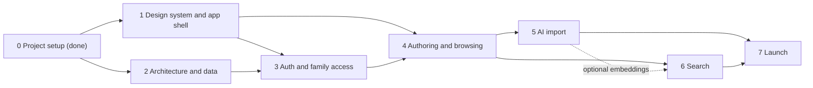

# Recipe Hub Roadmap

This file carries the plan, the architecture, and the owner's guidance for Recipe Hub. Every session reads it in full before starting and updates it before finishing (status, decision log, deferred items). When the code and this file disagree, raise it with the owner instead of silently picking one.

## 1. Product

Recipe Hub is a private site where family members browse, search, and contribute family recipes.

- **Access:** family only. Sign-in is Facebook (Meta) OAuth, and an allowlist decides who gets in.
- **Browse:** a recipe list and detail pages that are pleasant to read while cooking.
- **Search:** rich search across titles, ingredients, instructions, tags, and the family member a recipe came from, with filters.
- **Contribute:** three entry modes that all funnel into one normalized recipe shape:
  1. Photos of a written or printed recipe, parsed by AI.
  2. A pasted URL, parsed from the page's structured data first and by AI for the rest.
  3. Manual entry.

The audience is tens of people, the catalog hundreds to low thousands of recipes, and public exposure is minimal. Small does not mean ad hoc: the architecture is sound and canonical so the project can grow.

## 2. Guiding principles

The owner's guidance. Every session applies it, and the orchestrator checks every delegate's work against it.

1. **Small, flexible, extensible.** Build the smallest thing that solves the stated problem, in a shape that can grow. No speculative features, options, abstractions, or tooling without a real consumer.
2. **Industry standards first.** Ground decisions in current, industry-standard practice, OOP principles, and established design patterns. Verify library and platform behavior against current documentation (for Next.js, the docs bundled in `node_modules/next/dist/docs/`), never memory.
3. **Maintainability is the priority.** Prefer clarity over cleverness and explicit over implicit. There is one way to do each thing, and code that does the same thing looks the same.
4. **Think in layers.** For every layer, know what it is responsible for, how it exposes that to other layers, and what it guarantees them, so each layer can be reasoned about without reading its internals. Express the separation structurally: directories, files, and module boundaries mirror the layers, and tooling enforces the boundaries.
5. **Consistent and deliberate UI.** Built on a component library (shadcn/ui) with a tuned design language. Every screen uses the same tokens, primitives, and patterns, and nothing is styled ad hoc.
6. **Accessible by default.** WCAG 2.2 AA is the baseline for every UI change, not a final pass.
7. **Private by default.** Family data never enters the repository, images are private, and secrets live only in Vercel environment variables.

## 3. How sessions work

- **The main session is the orchestrator.** It owns high-level decisions, architectural forks, sequencing, and validating that delegated work matches this file. It delegates exploration, research, implementation, and test runs to subagents and keeps its own context for synthesis and review.
- **Delegate with clear ownership.** Give each subagent a disjoint set of files, the relevant sections of this file, and acceptance criteria. Subagents implement and report; they do not make architectural decisions. The orchestrator reviews every subagent's diff against sections 2 and 4 before integrating it.
- **Forks go to the owner.** Choices that shape architecture, scope, or a keep or drop decision are presented with a recommendation and its cost, batched together. Each session below lists the forks it is expected to resolve.
- **Session start:** read this file and `AGENTS.md`, review `git log` and the working tree for changes since the last session, and confirm scope with the owner.
- **Session end (definition of done):**
  - `pnpm lint`, `pnpm typecheck`, `pnpm test`, and `pnpm build` pass.
  - Substantial changes get an external Codex review, and its findings are addressed.
  - The change is verified on its Vercel preview deployment.
  - This file is updated: session status, decision log, deferred items, and any guidance that changed.
  - Work lands through a pull request from a session branch (CI plus preview deployment) and merges with the owner's go-ahead.
- **Stay focused.** If a session's scope starts to sprawl, finish the current slice, record the remainder here, and stop. Prefer a clean handoff over a crowded context.

## 4. Architecture

### 4.1 Layers

Recipe Hub is one Next.js project organized as a layered, ports-and-adapters architecture. Dependencies point inward: presentation depends on application, application depends on domain, and infrastructure implements the application's ports.

| Layer | Location | Responsible for | Exposes | Guarantees |
| --- | --- | --- | --- | --- |
| Domain | `src/domain/` | The recipe and member model: entities, value objects, invariants, Zod schemas, domain errors | Types, schemas, pure functions | Pure and deterministic: no I/O, no framework imports, no environment access. A value that passes a domain schema is valid everywhere. |
| Application | `src/application/` | Use cases (create, update, import, search, grant access), authorization, orchestration across ports | Service classes with intention-revealing methods; port interfaces in `src/application/ports/` | Server-only. Every call is authorized for the acting member, inputs are validated, and outputs are serializable DTOs. |
| Infrastructure | `src/infrastructure/` | Adapters to the outside world: Postgres through Drizzle, Vercel Blob, the AI Gateway, web fetching, Better Auth | Classes implementing application ports | Translates external data into domain types at the boundary and hides vendor types and errors behind port contracts. |
| Composition | `src/composition/` | The composition root: constructs adapters and injects them into application services | Factories that return ready services | The only module that knows which adapter backs which port. |
| Presentation | `src/app/`, `src/components/` | Routes, layouts, pages, Server Actions, Route Handlers, UI components | Pages and components | Thin: parses input, calls one application service, renders the result. No business rules, SQL, or vendor SDKs. |
| Shared | `src/lib/` | Cross-cutting utilities: validated environment, logger, small helpers | Functions | Depends on no other layer. |

- **The application layer is the Data Access Layer** that the Next.js data security guide recommends: server-only, authorizing every read and write, and returning minimal DTOs to the render context.
- **`src/components/ui/`** holds the shadcn primitives, which are adjusted only through tokens and variants. Feature components in `src/components/<feature>/` compose primitives and receive data as props. They never fetch data or call services.

### 4.2 Dependency rules and enforcement

- Domain imports only `zod` and pure helpers from `src/lib`. Application imports domain and `src/lib`. Neither imports Next.js, React, Drizzle, or a vendor SDK.
- Presentation never imports infrastructure. Route Handlers that mount a vendor handler (the Better Auth endpoint) obtain it from composition.
- Only `src/lib/env.ts` reads `process.env`. Everything else receives configuration from it.
- Server modules begin with `import 'server-only'`. Client components (`'use client'`) import only components, domain types, and pure helpers.
- Session 2 adds enforcement: a `lint:boundaries` script running dependency-cruiser (the tool and script name the owner's other projects use) and an ESLint restriction on `process.env`. A rule that tooling cannot enforce is written here and checked in review.

### 4.3 Patterns

| Pattern | Where | Why |
| --- | --- | --- |
| Repository | `RecipeRepository` and `MemberRepository` ports with Drizzle adapters | Services and tests do not depend on how data is stored. |
| Strategy | `RecipeExtractor` port with JSON-LD, AI text, and AI vision implementations | The entry modes differ only in how a draft is produced. |
| Adapter | Every infrastructure class | Vendor APIs are translated into port contracts. |
| Composition root with constructor injection | `src/composition/` | Explicit wiring without a DI framework, and fakes injected in tests. |
| Value object | Quantities, units, durations, yields | Each invariant lives in one place. |
| Mapper | Infrastructure (row to domain) and application (domain to DTO) | Each boundary owns its translation. |
| Draft, review, save | All three entry modes | AI output is never saved unreviewed: every mode produces a `RecipeDraft` that the member reviews in the same form before saving. |

**OOP where it earns its keep.** Services, adapters, and extractors are classes that implement interfaces and receive dependencies through their constructors. Domain data is immutable plain objects described by Zod schemas, because data crossing the Server and Client Component boundary must be serializable. Behavior on that data lives in small pure modules beside its schema.

### 4.4 Next.js conventions

- Server Components by default; `'use client'` only at interactive leaves.
- Mutations are Server Actions that validate input with the domain schema, call one application service, and then invalidate cache tags.
- Route Handlers only for HTTP-shaped needs: the auth endpoint, Blob client-upload tokens, and private image delivery.
- `proxy.ts` (Next 16's replacement for `middleware.ts`) makes optimistic redirects for signed-out visitors. The authoritative check is the application layer, on every call.
- Cache Components (`'use cache'`, `cacheTag`, `cacheLife`) for data shared across members. Session-derived data follows the bundled guide `authentication-with-cache-components.md`.
- Search state lives in the URL (`searchParams`) so results are shareable and work with the back button.

### 4.5 Target structure

```text
src/
  app/                    presentation: routing, thin pages and actions
    (public)/             sign-in, request access, privacy, data deletion
    (family)/             signed-in area: recipes, search, import, admin
    api/
      auth/[...all]/      Better Auth handler
      uploads/            Blob client-upload tokens
      images/[...path]/   private image delivery
  components/
    ui/                   shadcn primitives
    <feature>/            feature compositions (recipe, search, layout)
  domain/
    recipe/               schemas, value objects, pure functions, errors
    member/
  application/
    ports/                interfaces the use cases depend on
    recipes/
    ingestion/
    search/
    access/
  infrastructure/
    db/                   Drizzle schema, client, migrations, repositories
    storage/
    ai/
    web/
    auth/
  composition/            composition root
  lib/                    env, logger, shared helpers
```

Files are kebab-case (`recipe-repository.ts`), classes and types PascalCase, functions camelCase. Tests sit beside the code they test as `*.test.ts`.

### 4.6 Cross-cutting concerns

- **Configuration:** `src/lib/env.ts` validates every variable with Zod once and exports a typed object. Vercel supplies the values; local development pulls them with `vercel env pull`.
- **Errors:** domain and application errors are typed classes with stable codes. Presentation maps codes to user-facing messages, and unexpected errors reach Next.js error boundaries.
- **Logging:** one logger module with one message structure: a constant message plus structured fields, with no values interpolated into messages. Lifecycle events (recipe created, import started or failed, access granted) log at info, recoverable problems at warn, failures at error. Never log tokens or family members' contact details.
- **Validation:** Zod at every boundary: form input, AI output, scraped data, and database reads where types can drift.
- **Testing:** Vitest for domain and application code with in-memory fakes for ports; integration tests for repositories against a Neon branch; Playwright for a few end-to-end flows once the core flows exist. Fixtures are synthetic or public-domain recipes, never real family data.

## 5. Specifications and constraints

### 5.1 Recipe model

The normalized shape every entry mode produces. Session 2 finalizes it; this is the starting point.

- Title, short description, and family notes (the story behind the recipe).
- Family source: who the recipe comes from (for example, "Grandma Rose"), distinct from the member who entered it.
- Yield (servings or amount) and times (prep, cook, total) as value objects.
- Ingredient sections, each with an optional heading and ingredient lines: quantity (including fractions and ranges), unit, item, preparation note, and the original text kept verbatim.
- Instruction sections of ordered steps.
- Tags (course, cuisine, dietary, occasion) from a managed vocabulary.
- Images (dish photos and original scans), each with a role.
- Provenance: entry mode (manual, URL, photo), source URL, original images, and which model produced an AI draft.
- Contributor and timestamps.

### 5.2 Entry modes

- **Manual entry:** the recipe form, which is also the review form for the other two modes.
- **URL import:** server-side fetch with SSRF protection (public HTTP(S) addresses only, size and time limits), schema.org `Recipe` JSON-LD parsed first, AI filling gaps or handling pages without structured data, and the result opened as a draft for review.
- **Photo import:** one or more images uploaded from the browser straight to Blob. AI vision transcribes and structures them into a draft, and the originals stay attached to the recipe.
- AI output is validated against the domain schema. A failure produces a partial draft with the problems flagged, never a silent save.

### 5.3 Search

- Weighted full-text search: title first, then ingredients and tags, then description and notes, then instructions. `websearch_to_tsquery` syntax gives quoted phrases, `-` exclusions, and `or`.
- Typo tolerance and partial matches with `pg_trgm`, accent-insensitive matching with `unaccent`.
- Filters: tags, family source, contributor, total time, date added.
- Relevance ranking, highlighted matches, pagination, and URL-held state.
- To evaluate: `pg_search` (BM25 ranking) and semantic search with `pgvector` embeddings created at save time. Both extensions are available on the Neon database.

### 5.4 Access control

- Facebook OAuth is the only sign-in method.
- A database allowlist decides access, with two roles: `member` and `admin`. The allowlist never lives in code.
- Facebook does not always return an email, so access cannot depend on email alone. A request-access path lets an admin approve someone.
- Every application call checks the session and the member's status. Signed-out visitors see only public pages (sign-in, request access, privacy, data deletion).
- Meta's Live mode requires a privacy policy URL and data deletion instructions. Whether Business Verification is also required is unconfirmed.

### 5.5 Hosting and environments

- Vercel project `recipe-hub` in team `jrichard-personal` (Pro plan). Functions, Neon, and Blob are all in `iad1`.
- Production is `https://recipes.jakerichard.tech`: a CNAME (TTL 300) in the `jakerichard.tech` Route 53 zone, with a Let's Encrypt certificate managed by Vercel. The `vercel.app` production alias redirects to it with a 308, as the personal-site project does for its own alias.
- The Route 53 zone is in the owner's personal AWS account: use `--profile personal`. The default AWS profile is a work account and is never used for this project.
- No staging environment. Pull requests get preview deployments behind Vercel Authentication, and from Session 2 each preview gets its own Neon branch.
- Environment variables are managed in Vercel and pulled locally with `vercel env pull`. The AI Gateway authenticates with Vercel's OIDC token, so no provider keys exist.

### 5.6 Platform limits that shape the design

- Function request bodies are capped at 4.5 MB, so every image upload goes from the browser directly to Blob.
- Neon Free plan: 1 GB storage, 100 compute-hours a month, 10 branches.
- AI Gateway free tier: $5 a month, a subset of models, and lower rate limits. Buying credits unlocks every model at provider list price.
- Functions run up to 800 seconds on Pro. Import actions set `maxDuration` explicitly.

### 5.7 Project conventions

- **Formatting:** the owner's shared scheme from the Vispero/sage project: Prettier with tabs, single quotes, width 100, `es5` trailing commas, LF line endings, and perfectionist import sorting. Run `pnpm format`; never hand-format against it.
- **Scripts:** `lint` runs every `lint:*` script, so new checks are added as `lint:*`.
- **Commits:** a plain imperative sentence describing the change, without prefixes.
- **Dependencies:** added with their first consumer, chosen against current documentation, installed with pnpm.
- **Documents:** `README.md` for setup, this file for plan and guidance, `AGENTS.md` for agent instructions.

## 6. Design language

The UI must feel consistent and deliberate. Session 1 turns this section into the final design language; until then the rules below are binding and the direction is a proposal.

### 6.1 Rules

- **Tokens only.** Color, typography, radius, spacing, shadow, and motion come from tokens defined in `src/app/globals.css` (Tailwind v4 `@theme`). Components never use raw color values, arbitrary values such as `text-[13px]`, or one-off styles.
- **Semantic names.** Components use semantic tokens (background, surface, muted, accent, border, focus, destructive) rather than palette steps, so a theme changes in one place. Every token is defined for every supported theme.
- **Primitives first.** Screens are built from the shadcn primitives in `src/components/ui/`. A new look is a new variant on the primitive, never an override at the call site.
- **One of each.** One named type scale with paired line heights, one radius token, one hover and focus treatment, and one set of motion durations that respects `prefers-reduced-motion`.
- **Content is airy, chrome is compact.** Recipes are read while cooking: generous spacing and a comfortable line length for ingredients and steps, compact navigation and controls.
- **Accessible.** WCAG 2.2 AA contrast in every theme, visible focus rings, full keyboard operation, and targets at least 24 by 24 pixels.

### 6.2 References

The owner likes [tanstack.com](https://tanstack.com/) and [mstone.ai](https://mstone.ai/). Observations from their markup and CSS (October 2026):

- **TanStack:** a token-driven system. Warm stone neutrals (`#faf8f2` to `#201b15`) with five-step tonal ramps for terracotta, blue, green, amber, and purple. Bricolage Grotesque for display, Inter for body, IBM Plex Mono for small uppercase labels. A named type scale with paired line heights and negative tracking on large sizes. Light by default with a `.dark` theme. Border-led surfaces with a hairline ring and a small shadow on hover. Fast color transitions (150 to 200 ms). Dense, tool-like navigation in a sticky top bar.
- **mstone.ai:** dark-first with cool blue-grey text and a single electric-blue accent. General Sans for headings and body, JetBrains Mono for accents. Very tight tracking (about -0.035em) on large headings. Large, uniform radii (mostly 16 and 24 px). Airy marketing layout with a 1040 px container, glass effects, glows, and animated text.
- **Common ground to borrow:** a disciplined palette with meaningful tokens and one accent; tight tracking on large headings over a restrained hierarchy; a sans for display and body plus a mono for small labels and metadata; soft, rounded, border-led surfaces with little shadow; quick, quiet hover transitions; a sticky top bar.

### 6.3 Proposed direction

Confirmed or revised in Session 1:

- **Palette:** warm neutrals with one food-friendly accent (terracotta-like), each as a tonal ramp mapped to semantic tokens. TanStack's warmth suits food better than mstone's cool blues.
- **Themes:** light by default with a dark theme through the `.dark` class (shadcn's convention).
- **Type:** a display sans with character for headings, a neutral sans for body text, and a mono in small caps for recipe metadata (times, yield, tags).
- **Shape and depth:** a single radius token in the 10 to 16 px range, border-led cards with a hairline ring, shadow only on interaction.
- **Motion:** short color and opacity transitions only. No glass, glows, or animated text: they cost maintenance and add little to a reading-focused site.
- **Layout:** sticky top bar, a reading-width column for recipe content, and a responsive card grid for browsing.

## 7. Decision log

| Date | Decision | Rationale |
| --- | --- | --- |
| 2026-10-10 | Next.js 16 (App Router), TypeScript end to end, one Vercel project | One Zod recipe schema serves the form, AI output, and database. Zero-config on Vercel. FastAPI with Vite needs Vercel Services (beta) and two copies of the schema; TanStack Start is still a release candidate. |
| 2026-10-10 | Neon Postgres via the Vercel Marketplace (Free plan, `iad1`, Postgres 18, Neon Auth off) | Postgres handles the search. Fast scale-to-zero, billed through Vercel, per-preview branches. Aurora resumes in about 15 seconds and needs IAM setup; Supabase's free tier pauses after a week idle. |
| 2026-10-10 | Private Vercel Blob store `recipe-hub-images` (`iad1`) | Scans stay behind the login, and client uploads avoid the 4.5 MB body limit. Access mode cannot change after creation. |
| 2026-10-10 | Better Auth with the Facebook provider; allowlist in the database | Auth.js v5 never went stable and its maintainers recommend Better Auth. A hook before user creation gates sign-up. |
| 2026-10-10 | Drizzle ORM, version chosen in Session 2 | Close to SQL (needed for search) and supported by Better Auth. 1.0 was a release candidate at the time. |
| 2026-10-10 | AI SDK through the Vercel AI Gateway; no provider keys | Owner's choice. OIDC authentication on Vercel; `vercel env pull` locally. |
| 2026-10-10 | pnpm 12, Node 24, ESLint and Prettier, Vitest, GitHub Actions CI | Canonical toolchain; CI runs lint (code and formatting), typecheck, and tests. |
| 2026-10-10 | Formatting scheme matches the owner's Vispero/sage project | One formatting scheme across the owner's projects. |
| 2026-10-10 | Private repository `jaARke/recipe-hub`; repo-local git identity `jake.richard126@gmail.com` | Private is the reversible choice. The identity lets Vercel match commits to the owner. |
| 2026-10-10 | `AGENTS.md` only, no `CLAUDE.md` | Claude Code 2.1.277 and later reads `AGENTS.md` directly. |
| 2026-10-10 | Neon's agent skills not kept in the repository | Owner's choice. The `neon` skill steers toward Neon Auth and Storage, which the stack does not use. |
| 2026-10-10 | shadcn/ui as the component library; design language tuned against tanstack.com and mstone.ai | Owner's choice: flexible, extensible components with a deliberate design language. |
| 2026-10-10 | Production at `recipes.jakerichard.tech` (Route 53 CNAME); no staging environment | Owner's choice. Previews cover pre-production checks. |
| 2026-10-10 | Layered ports-and-adapters architecture with enforced boundaries | Owner's guidance: clear layer responsibilities and guarantees, expressed structurally. |

## 8. Chronology and dependencies



- Sessions 1 and 2 are independent and can run in either order.
- Session 3 needs the design system for its public pages and the data layer for Better Auth's tables.
- Session 4 needs authentication so every route is gated and recipes are attributed from the first save.
- Sessions 5 and 6 both build on Session 4 and are independent of each other, unless Session 6 adopts embeddings created during import.
- Owner actions (section 10) have their own lead times; start the Meta app early.

## 9. Sessions

### Session 0: Project setup (done 2026-10-10)

Chose the stack and storage; scaffolded Next.js 16.4 with pnpm, Tailwind v4, ESLint with import sorting, Prettier, Vitest, and CI; applied the shared formatting scheme and `.vscode` settings; created the private GitHub repository; created the Vercel project with Git integration; provisioned Neon and the private Blob store and connected both to the project; served production from `recipes.jakerichard.tech` (Route 53 CNAME, HTTPS, 308 redirect from the `vercel.app` alias); wrote this roadmap.

### Session 1: Design system and app shell

**Goal:** a tuned design language and the app shell every later screen uses.

**Delivers:**

- shadcn/ui initialized for Tailwind v4 with CSS variables and the chosen primitive library.
- Design tokens in `src/app/globals.css`: light and dark color, typography through `next/font`, type scale, spacing, radius, shadow, and motion.
- App shell: header and navigation, page container, responsive layout, theme toggle, loading and empty states, toasts.
- A design reference route (development and previews only) showing tokens, every primitive, and representative compositions such as a recipe card, used to tune the design with the owner.
- Section 6 rewritten as the final design language.

**Forks:** primitive library (shadcn now offers Base UI, Radix, and React Aria; Base UI is its default); light, dark, or both and which is default; font pairing; accent color; density.

**Owner actions:** review rounds on the design reference page.

**Done when:** the owner signs off on the design reference page, and the app shell is live in production.

### Session 2: Architecture foundation, recipe domain, and data layer

**Goal:** the layered skeleton with enforced boundaries, the recipe domain model, and persistence.

**Delivers:**

- The directory structure in section 4.5, `server-only`, `lint:boundaries` with dependency-cruiser, and the `process.env` restriction.
- `src/lib/env.ts` and the logger.
- The recipe domain model from section 5.1: Zod schemas, value objects, `RecipeDraft`, domain errors, and unit tests.
- Drizzle with a Neon driver: schema, migrations run from the build command, Neon preview branching enabled, repositories with mappers.
- Application services for recipe create, read, update, and delete, with authorization behind a port that Session 3 implements; the composition root; in-memory fakes and tests.

**Forks:** Drizzle 0.45 or 1.0; Neon driver (serverless HTTP or WebSocket, or `pg` with Fluid compute pooling); ID strategy and URL slugs; how quantities are represented; the tag vocabulary; typed error classes or a result type.

**Done when:** `lint:boundaries` passes and fails on a deliberate violation, a migration runs on a preview branch, and the recipe services are covered by tests.

### Session 3: Authentication and family access

**Goal:** only allowlisted family members can use the site.

**Depends on:** Session 1 (public pages), Session 2 (database and layers).

**Delivers:**

- Better Auth with Facebook, the Drizzle adapter, sessions in Postgres, the `nextCookies` plugin, and the handler route.
- The member model and allowlist, `admin` and `member` roles, a request-access flow with admin approval, and the sign-up gate in `databaseHooks.user.create.before`.
- The optimistic gate in `proxy.ts`; application-layer authorization replaces Session 2's placeholder.
- Facebook sign-in on preview deployments (Better Auth's OAuth proxy plugin or an alternative).
- Public pages: sign-in, request access, privacy policy, data deletion instructions.
- An admin page for members and access requests.

**Forks:** what the allowlist keys on (email, Facebook ID, approval only); the preview sign-in approach; data deletion as an instructions page or a callback.

**Owner actions:** create the Meta developer app (Facebook Login, redirect URI `https://recipes.jakerichard.tech/api/auth/callback/facebook`) and store its ID and secret in Vercel; confirm whether Business Verification is required; be the first admin.

**Done when:** the owner signs in on production, a non-allowlisted account is refused, and an access request can be approved.

### Session 4: Recipe authoring and browsing

**Goal:** members create, edit, browse, and read recipes with photos.

**Depends on:** Sessions 1, 2, and 3.

**Delivers:**

- The recipe form for create and edit: dynamic ingredient and step sections, tags, family source, times, and yield, validated by the domain schema and built to double as the import review form.
- Photo upload through Blob client uploads, authorized in the token route, with an `ImageStore` port, its adapter, and the private image delivery route.
- Browse: recipe list (cards, sorting, pagination) and recipe detail (cooking-friendly layout, print styles, contributor and family source).
- Edit and delete, allowed for the author and admins.
- Cache tags with invalidation on every mutation.

**Forks:** form library (shadcn's field components with React Hook Form or TanStack Form); image optimization for private blobs; whether servings scaling is in scope now.

**Done when:** a member creates, edits, views, and deletes a recipe with photos on a preview deployment, and services and form mapping are tested.

### Session 5: AI import from photos and URLs

**Goal:** photos and links become reviewed recipes.

**Depends on:** Session 4 (recipe form and image store).

**Delivers:**

- The `RecipeExtractor` strategy: JSON-LD, AI text, and AI vision extractors, all producing `RecipeDraft`.
- URL import with SSRF-safe fetching and HTML cleanup; photo import with multiple images.
- AI SDK calls through the Gateway with structured output against the draft schema, streaming partial results into the review form if that improves the experience.
- Import UI: choose a mode, see progress, review in the recipe form, save with provenance.
- Guardrails: per-member rate limits, size limits, a Gateway budget, and clear error states.
- An evaluation set of synthetic or public-domain recipe cards and pages with expected drafts, plus tests for the JSON-LD extractor.

**Forks:** model choice (check the current Gateway catalog for vision quality and cost); free tier or purchased credits; synchronous requests or background jobs; whether to keep raw AI output for audit.

**Owner actions:** try a few real recipe cards by hand (never committed); decide on Gateway credits.

**Done when:** a handwritten card photo and three different recipe sites each produce an accurate draft that saves after review.

### Session 6: Search

**Goal:** fast, forgiving, filterable search.

**Depends on:** Session 4 (browse UI), and Session 5 if embeddings are created at import.

**Delivers:**

- Search storage: a generated, weighted `tsvector` column, GIN indexes, `pg_trgm`, and `unaccent` (wrapped in an immutable function so generated columns can use it), all as migrations.
- `SearchService` with query parsing, filters, facets, ranking, highlighted snippets, and pagination.
- Search UI: a global search bar and a results page with filters, URL state, and empty and no-result states.
- A seeded synthetic corpus with expected-result tests.

**Forks:** Postgres full-text search alone, `pg_search` BM25, or hybrid with `pgvector`; the facet set.

**Done when:** misspellings, ingredient combinations, exclusions, and family-source filters return the expected results quickly on the seeded corpus.

### Session 7: Launch hardening and family onboarding

**Goal:** the family uses the site in production.

**Depends on:** all earlier sessions.

**Delivers:**

- Playwright end-to-end tests for the sign-in gate, manual entry, import, and search.
- An accessibility audit (automated with axe, plus keyboard and screen reader passes) and fixes.
- A performance pass: Core Web Vitals, image sizing, caching.
- A security review: authorization on every service method, upload limits, SSRF, response headers.
- Operations: log review, an error alerting decision, a backup and restore approach for Neon (consider a periodic export), and a runbook in the README.
- The Meta app switched to Live mode, the allowlist populated, and onboarding notes for the family.

**Owner actions:** the family member list, the Meta Live switch, and the announcement to the family.

**Done when:** family members sign in on production and every item above is complete.

## 10. Owner action items

| Action                                                            | Needed by                  |
| ----------------------------------------------------------------- | -------------------------- |
| Review and sign off on the design reference page                  | Session 1                  |
| Create the Meta developer app and add its credentials to Vercel   | Session 3                  |
| Confirm whether Meta requires Business Verification for Live mode | Session 3, ideally earlier |
| Try real recipe cards by hand; decide on AI Gateway credits       | Session 5                  |
| Provide the family member list; switch the Meta app to Live       | Session 7                  |

## 11. Open questions and risks

- **Facebook identity:** some accounts return no email, and Meta's Business Verification requirement for Live mode is unclear. Mitigation: approval-based access, and an early check in the Meta dashboard.
- **Sign-in on previews:** Facebook requires registered redirect URIs and preview URLs change. Mitigation: Better Auth's OAuth proxy plugin.
- **AI accuracy and cost:** handwritten cards vary widely. Mitigation: mandatory review, an evaluation set, budgets, and rate limits.
- **Cache Components with authentication:** session-derived data must follow the bundled guide to avoid caching one member's view for another.
- **Neon Free limits:** fine for this scale; revisit if storage or compute hours approach the caps.

## 12. Status

- [x] Session 0: Project setup
- [ ] Session 1: Design system and app shell
- [ ] Session 2: Architecture foundation, recipe domain, and data layer
- [ ] Session 3: Authentication and family access
- [ ] Session 4: Recipe authoring and browsing
- [ ] Session 5: AI import from photos and URLs
- [ ] Session 6: Search
- [ ] Session 7: Launch hardening and family onboarding
